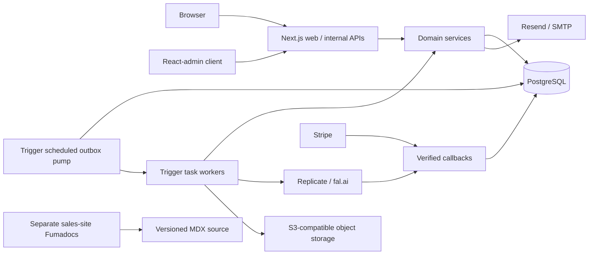
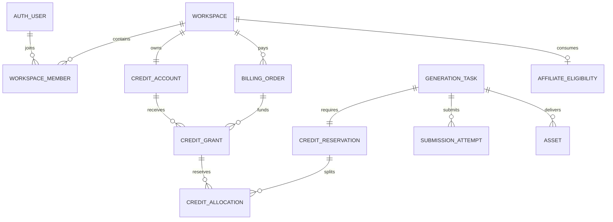

# Shpitto Restart — Detailed Technical Design

Date: 2026-09-27 · Status: selected engineering design; implementation and runtime verification have not started.

This document turns D01–D31 into an implementation contract. It supplements the [requirements](./2026-09-27-shpitto-restart-requirements.md), [master plan](../../.omx/plans/shpitto-restart-plan.md), and [acceptance specification](../../.omx/plans/test-spec-shpitto-restart.md). The [Chinese edition](./2026-09-27-shpitto-detailed-technical-design.zh-CN.md) is the full review counterpart requested by the user.

“Selected” means the design has made a choice. “Verified” requires the relevant implementation evidence. M0 validates selected choices; it does not restart an open-ended framework competition. Paid accounts, production credentials, prices, commission rates and source-license terms remain separate release inputs. No implementation, test run, purchase, payout or publication is authorized by a planning status label.

Design review: Architect re-review and subsequent independent Critic review both APPROVE on 2026-09-27. [Review record](../../.omx/plans/shpitto-detailed-design-review.md). This approves the plan, not an implemented product.

## 1. Architectural decision and boundaries

### 1.1 RALPLAN-DR

Principles: buyer-owned deployment; one authority for each business invariant; durable local experience; reuse mature general-purpose components; reversible delivery with evidence.

Top drivers: (1) minimize the buyer's deployment and customization burden; (2) protect credits and upstream spend under uncertain asynchronous outcomes; (3) reuse admin/auth/docs infrastructure while retaining explicit SaaS business rules.

| Alternative | Strongest case | Cost in this product | Decision |
| --- | --- | --- | --- |
| Next.js modular monolith + external job runner | One root source product, shared domain code, one transactional database; lowest local/deployment burden. | Module boundaries and worker/web version compatibility need enforcement. | Selected. |
| Separate API, ledger and worker services | Independent scaling and ownership; useful with multiple backend teams. | Distributed authorization, contracts, deployment and transaction coordination without a current scale requirement. | Preserve adapter seams; no V1 service split. |
| Payload-led backend and admin | Excellent when editors, drafts, media and publishing workflows dominate operations. | Adds backend/auth/schema/API ownership alongside Better Auth and Drizzle; current operations center on payments, tasks and credits. | No Payload runtime in V1. |
| Refine Core + custom admin components | Flexible headless administration and consistent product component styling. | More list/form/interaction assembly than React-admin for the agreed operational scope. | No Refine runtime in V1. |

React-admin OSS owns admin presentation. Better Auth owns account authentication. Drizzle owns application migrations. Domain services own authorization, task transitions and financial commands. Fumadocs renders source-controlled developer documentation. No framework gains generic write access to the financial or generation tables.

### 1.2 Deployment components



The no-cloud profile replaces Trigger with a persistent local worker, providers with Mock, storage with a local volume and email delivery with a local SMTP inbox. It runs the same domain commands and PostgreSQL schema. Storage has one `local` demo driver and one `s3` production driver; `s3` selects R2 or AWS S3 by endpoint/configuration and does not create vendor-specific domain branches. The vendor sales site is a separate deployment and is absent from the customer application dependency graph.

## 2. Selected technology and version baseline

**Decision status:** selected engineering baseline, based on official documentation and public package metadata read on 2026-09-27. No dependencies were installed and no build was run during planning. M0 verifies this configuration; it does not reopen ordinary choices. An actual incompatibility requires a narrow amendment with evidence. Do not silently move to `latest`.

| Layer | Selected version / service | Scope and rationale |
| --- | --- | --- |
| Runtime | Node.js 24 LTS; local/Docker 24.21.0; pnpm 12.6.0 | Pin `packageManager` and lockfile. Vercel selects 24.x; Trigger `node-24` currently documents 24.18.0. Managed hosts control their patches. |
| Web | Next.js 16.3.6 App Router; React/react-dom 19.3.0 | One root modular monolith, Node runtime for DB/auth/webhooks, server rendering for public/product pages. |
| Language | TypeScript 6.0.3 | Retain the JavaScript compiler/plugin API rather than introduce the TypeScript 7 native-compiler transition. Explicit target, module resolution and `types` in config. |
| Database | PostgreSQL 17; upstream patch 17.11 | Same major locally and on Neon; managed patch revisions belong to Neon. No PG18-only feature is needed. |
| Data access | drizzle-orm 0.45.3; drizzle-kit 0.31.11; pg 8.23.0 | `node-postgres` interactive transactions; one reviewed SQL migration sequence. |
| Identity | better-auth and @better-auth/drizzle-adapter 1.7.6 | Reuse sessions, email/password, verification/reset and two-factor plugin. Domain owns minimal workspaces/members/invites; no unproven shared Organization-plugin transaction. |
| Operator UI | react-admin 5.15.4, OSS core | Ready lists/forms/filtering/navigation, custom auth/data providers; MUI/Emotion confined to `/admin`. No Enterprise packages required. |
| Product UI | tailwindcss and @tailwindcss/postcss 4.3.3; shadcn CLI 4.21.0 | Deliver reviewed component source. Record registry source revision/hash plus notices; a pinned CLI alone does not freeze fetched components. |
| Docs | fumadocs-core/ui 16.15.14; fumadocs-mdx 15.4.5 | Public source-controlled versioned MDX, static search and shared export content; no runtime CMS. |
| Schemas | zod 4.6.5 | Request/config contracts, consistent DTO validation and generated interface documentation. |
| Payment | stripe 22.6.2; Stripe Hosted Checkout and Customer Portal | No Elements or browser Stripe SDK required for V1. Capture selected SDK API version in release metadata and align webhook endpoints. |
| Tasks | @trigger.dev/sdk and @trigger.dev/build 4.6.4 | Production execution and scheduling; PostgreSQL domain state remains authoritative. Persistent local worker supports no-cloud demo. |
| Objects | @aws-sdk/client-s3 and @aws-sdk/s3-request-presigner 3.1141.0 | One private S3-compatible adapter for Cloudflare R2 and AWS S3; local filesystem adapter for demo and acceptance. MinIO is a test target only. |
| Mail | resend 6.30.0; nodemailer 10.0.10 | Resend reference delivery plus SMTP alternative and local capture. |
| Affiliate | FirstPromoter V2 HTTP API | Stable workspace UID, native campaign commission rules, third-party payout workflow; optional feature. Section 10 fixes the integration. |
| Models | Four Wan 2.2 endpoints on Replicate and fal.ai | Section 10 pins provider/mode schema contracts. Provider diversity is delivered; model-family diversity is not a V1 promise. |
| Verification toolchain | ESLint flat config, TypeScript compiler, Vitest, Playwright, dependency/license scan | Tool choices selected; resolve their compatible exact dev-package patches with the first frozen lockfile. A patch-resolution task is not an unresolved product architecture. |

Compatibility evidence: Better Auth accepts the selected Drizzle 0.45.x pair; its adapter declares `drizzle-orm ^0.45.2`. React-admin supports React 19. Fumadocs UI/Core versions match, target Next 16 and React `^19.2.0`, and MDX accepts Core `^16.15.3`. These declarations support the choice but do not prove the assembled product. [Better Auth metadata](https://registry.npmjs.org/better-auth/1.7.6), [adapter metadata](https://registry.npmjs.org/@better-auth%2fdrizzle-adapter/1.7.6), [React-admin metadata](https://registry.npmjs.org/react-admin/5.15.4), [Fumadocs Core metadata](https://registry.npmjs.org/fumadocs-core/16.15.14), [MDX metadata](https://registry.npmjs.org/fumadocs-mdx/15.4.5).

### Deployment baseline

| Environment | Selected topology |
| --- | --- |
| Reference managed production | Vercel web + Neon PostgreSQL 17 + private R2 through the shared S3 adapter + Trigger.dev Cloud + Resend; buyer-owned accounts and secrets. AWS S3 uses the same adapter contract. |
| Docker production | Next standalone web container + the same external PostgreSQL/S3/Trigger/mail contracts. Docker is an application deployment path, not a promise to self-host every service. |
| Local no-cloud demo | Docker PostgreSQL 17, local Next web, database-polling worker, private filesystem storage, captured mail and persistent Mock provider. |
| Vendor sales/Docs | Separate `vendor/` application/deployment; reuse versioned Docs bodies only; no vendor runtime/code/account requirement in the buyer product. |

Use pooled Neon connections for normal interactive transactions and a direct connection for migrations/backups. No reliance on session-level database settings or advisory locks through transaction pooling. Web and Trigger regions should be near the selected DB region. Vercel requests never wait for video completion. [Neon pooling](https://neon.com/docs/connect/connection-pooling), [Vercel Node support](https://vercel.com/docs/functions/runtimes/node-js/node-js-versions), [Trigger runtime configuration](https://trigger.dev/docs/config/config-file).

### Alternative decisions and operational consequences

| Decision | Fair alternative and advantage | Why selected / accepted cost |
| --- | --- | --- |
| React-admin OSS | Refine preserves a single shadcn design system with headless providers. | Ready operator screens save more assembly; accept a separate MUI admin visual layer. No UI-only authorization. |
| React-admin OSS | Payload provides mature content editing, drafts, publishing, generated APIs and backend facilities. | V1 operations are domain commands, while Docs are versioned source. Avoid a second schema/auth owner and custom CMS operational views. Reconsider only when content workflows become actual requirements. |
| Fumadocs/MDX | Payload CMS enables non-developer authoring. | Developer-targeted versioned APIs/Skills benefit from code review and release-aligned source. MDX is trusted repository source, never arbitrary user input evaluated at runtime. |
| Modular monolith | Separate API/ledger services isolate deployment and scaling. | Buyers need a small reproducible deployment; retain extraction seams without distributed financial transactions. |
| Domain-owned workspace records | Better Auth Organization plugin supplies reusable teams/invitations. | Minimal owner/member scope needs atomic last-owner, personal-workspace and billing invariants. Do not rely on before-hooks across unrelated transactions; reuse auth while implementing only these bounded domain rules. |

React-admin's official Next integration is client-only; load it from a client boundary with SSR disabled. Fumadocs provides MDX compilation. Copying Next standalone output must explicitly include `public` and `.next/static`. [React-admin Next](https://marmelab.com/react-admin/NextJs.html), [Fumadocs MDX](https://www.fumadocs.dev/docs/mdx), [Next standalone](https://nextjs.org/docs/app/api-reference/config/next-config-js/output).

Node 24 and PG17 are maintained release lines at the research date; the exact runtime patch accepted by each managed host is recorded in deployment evidence. [Node releases](https://nodejs.org/en/about/previous-releases), [PostgreSQL support](https://www.postgresql.org/support/versioning/), [TypeScript 6](https://www.typescriptlang.org/docs/handbook/release-notes/typescript-6-0.html).

M0 acceptance: resolve exact dependencies and license inventory without unsupported peer overrides; create the frozen lockfile; generate/review auth plus domain migrations; prove an authenticated operator list and atomic credit command; build versioned Docs; prove standalone packaging. Missing evidence means implementation is unfinished, not that the documented selection is absent.


### OpenSpec clarification status

The [OpenSpec design](../../openspec/changes/restart-shpitto-video-saas/design.md) closes five boundaries: E01 immutable personal ownership and team transfer; E02 user/workspace suspension versus billing-hold permissions; E03 one ProviderPort; E04 cancel-then-repurchase without scheduled plan changes; E05 creator last-valid-touch attribution within 30 days and audited dispute-win commission correction. These are selected engineering defaults, not retroactive user confirmations. The specs/tasks govern implementation; historical reviews predate these clarifications. Detailed sections remain the schema/algorithm/endpoint register.

## 3. Source layout and ownership

All paths below are target files, not claims that implementation files exist today.

| Target | Responsibility | Allowed dependencies |
| --- | --- | --- |
| `src/app/(marketing)`, `(auth)`, `(app)` | Public pages, account UI, workspace application | Components and application facades. |
| `src/app/admin/[[...segments]]/page.tsx` | Server operator guard + client admin entry | `src/admin`; no admin SSR requirement. |
| `src/app/api/**/route.ts` | Parse/validate, authenticate, authorize, map DTO/errors | Domain command/query entrypoints only. |
| `src/modules/{workspaces,credits,generation,assets,billing,affiliates,operations}` | Domain commands, queries, policies and repositories | Shared IDs/clock/errors, database transaction context, narrow integration ports. |
| `src/lib/auth.ts`, `src/db/schema/auth.ts` | Better Auth config and generated schema mapping | Auth adapter and database; never browser imports. |
| `src/db/schema/{workspace,credit,generation,billing,integration}.ts` | Explicit schema and database constraints | Drizzle; domain constants without framework imports. |
| `src/db/migrations`, `scripts/migrate.ts` | Ordered SQL migrations and deployment lock | PostgreSQL direct connection; no request-time auto-migrate. |
| `src/adapters/providers/{replicate,fal,mock}` | Normalize vendor submit/status/results | Vendor SDK/HTTP and provider interface. |
| `src/adapters/{tasks,storage,mail,affiliates}` | Trigger/local, S3/local, Resend/SMTP, selected affiliate | Port implementations, no independent credit decisions. |
| `trigger/{dispatch,reconcile,materialize,outbox}.ts` | Thin production task entrypoints | Domain services; receive internal IDs, not raw secrets or full prompts. |
| `scripts/local-worker.ts` | Durable polling/lease loop for demo | Same domain services and Mock adapter. |
| `src/admin/{data-provider,auth-provider,resources,commands}` | Lists, filters, details and controlled actions | Internal admin API; no database/client-secret imports. |
| `src/config/{brand,navigation,plans,models}.ts` | Typed presentation, catalog and plan configuration | Schemas; prices are read from approved catalog bindings. |
| `content/docs/<release>/**`, `docs/buyer/**` | Canonical developer content and generated offline guides | Release manifest and actual API/Skill contracts. |
| `skills/*`, `.shpitto/contracts/*`, `scripts/{validate-change,export-release}.ts` | Governed customization and delivery | Pinned trusted validator/baseline; explicit export manifest. |
| `vendor/sales/`, `internal/`, `legacy/shpitto-platform/` | Vendor site, engineering evidence, frozen old source | Excluded from customer runtime, checks, image and export. |

Browser code cannot import `src/db`, secrets, privileged adapters or domain repositories. Domain modules cannot import React, Next request objects or Trigger SDKs. Cross-module work uses named commands and a shared transaction object, not duplicate “service” wrappers or arbitrary table writes. An import-boundary check enforces these rules.

## 4. Data model, constraints and migration ownership

### 4.1 Conventions and ERD

Application IDs are UUIDs. Better Auth IDs remain the adapter's text IDs and are referenced without forced conversion. Time is `timestamptz` in UTC. Credit quantities and currency minor units are nonnegative `bigint`; JSON APIs encode them as decimal strings. Every money value also carries a currency. Status values use constrained text and explicit transition functions. `jsonb` is for validated snapshots/vendor evidence, never an unstructured replacement for relational ownership.



### 4.2 Schema register

`PK` means primary key, `FK` foreign key, `UQ` unique, `IX` index. All domain rows have `created_at`; mutable projections also have `updated_at`. A listed workspace FK is non-null. Financial/source references use `ON DELETE RESTRICT`; financial history is retained when an account is suspended or de-identified.

| Table | Required columns | Keys, checks and indexes |
| --- | --- | --- |
| Better Auth tables | User, session, account, verification and plugin two-factor fields generated from the selected configuration | Better Auth owns field semantics. Drizzle owns applied SQL. Session/account user FKs; provider/account uniqueness; no duplicate custom password tables. |
| `workspaces` | `id uuid`, `kind personal/team`, `name text`, `created_by text`, `status active/suspended`, `version int` | PK id; FK creator→auth user; partial UQ creator where personal; no hard deletion while financial/task history exists. |
| `workspace_members` | `workspace_id uuid`, `user_id text`, `role owner/member` | Composite PK; both FKs; IX(user_id, workspace_id). Last-owner rule is transactional, not a CHECK over another row. |
| `workspace_invites` | `id uuid`, workspace, `email_normalized text`, `role member`, `token_hash text`, `expires_at`, `accepted_at`, `inviter_id text` | UQ token hash; FK inviter; one live pending invitation per workspace/email using explicit status; expiry 7 days. |
| `operator_roles` | `user_id text`, `role support/operator/superadmin`, `revoked_at`, `granted_by text` | PK/FK user; roles checked from DB on each admin request; changes audited. |
| `credit_accounts` | `workspace_id uuid`, `version bigint` | PK/FK workspace; serialization lock for every credit mutation. |
| `credit_grants` | `id uuid`, workspace, `source subscription/purchase/compensation/manual/demo`, `issued/available/reserved/consumed/expired/voided bigint`, `expires_at nullable`, `origin_grant_id uuid nullable`, `origin_allocation_id uuid nullable`, `order_id uuid nullable`, `business_key text` | UQ business key; FKs source/order; CHECK all buckets≥0 and issued=sum(buckets); IX(workspace, expires_at, id); compensation UQ origin allocation. |
| `credit_reservations` | `id uuid`, workspace, `task_id uuid`, `amount bigint`, `status held/consumed/refunded/released` | UQ task; FK task; amount>0; IX(workspace,status). |
| `credit_allocations` | `id uuid`, reservation, grant, `amount bigint`, `source_expiry timestamptz nullable`, `source_kind`, `lineage_root uuid` | FKs reservation/grant/root; UQ(reservation,grant); amount>0; immutable after reserve. |
| `credit_ledger` | `id uuid`, workspace, grant, `operation_id uuid`, `entry_no int`, signed bucket deltas, `kind`, `task_id nullable`, `reason`, `created_at` | UQ(operation_id,entry_no); FKs; append-only role grants; IX(workspace,created_at,id). Reversal entries reference original entry. |
| `domain_commands` | `id uuid`, `scope text`, `idempotency_key text`, `payload_hash text`, `actor_id text nullable`, `result jsonb` | UQ(scope,idempotency_key); same key/different payload→409; result committed with business mutation. |
| `generation_tasks` | `id uuid`, workspace, `requested_by text`, `mode`, `model_key`, `catalog_version`, `input_snapshot jsonb`, `quoted_credits bigint`, `status`, `failure_code nullable`, `deadline_at`, `version int` | FK requester; IX(workspace,created_at,id), IX(status,deadline_at); immutable quote/model/input after creation. |
| `submission_attempts` | `id uuid`, task, `attempt_no int`, `provider`, `client_reference text`, `provider_request_id nullable`, `state`, `started_at`, `reconcile_deadline`, `probe_count int`, `cost_minor nullable`, `cost_currency nullable`, `cost_state unknown/estimated/confirmed` | UQ(task,attempt_no); UQ(provider,provider_request_id) when present; never infer cost zero from missing evidence. |
| `assets` | `id uuid`, workspace, `task_id nullable`, `purpose input/output`, `state pending/ready/quarantined/deleted`, `object_key text`, `created_by text`, `mime`, `bytes bigint`, `sha256`, `duration_ms nullable`, `upload_expires_at nullable` | UQ object key; FK task; IX(workspace,created_at,id); ready output requires integrity metadata. |
| `billing_accounts` | workspace, `stripe_customer_id text`, `status active/hold`, `hold_reason nullable` | PK workspace; UQ Stripe customer; replacement mapping history retained. |
| `subscriptions` | `id uuid`, workspace, `stripe_subscription_id text`, `price_id`, `status`, `period_start/end`, `cancel_at_period_end bool` | UQ subscription ID; IX(workspace,status); only one active subscription enforced by command/partial constraint. |
| `billing_orders` | `id uuid`, workspace, `kind subscription/pack`, `stripe_invoice_id nullable`, `stripe_payment_intent_id nullable`, `status`, `paid_minor bigint`, `refunded_minor bigint`, `currency`, `paid_at`, `grant_business_key` | UQ invoice when present; UQ PI when present; refunded≤paid; price/catalog snapshot immutable; IX(workspace,paid_at,id). |
| `billing_recovery_cases` | `id uuid`, order, `kind refund/dispute/mismatch`, `status`, `exposure_credits bigint`, `evidence jsonb`, `resolution_command_id nullable` | UQ(external event/business case key); append-only case history; no automatic negative grant balance. |
| `integration_inbox` | `id uuid`, `source`, `external_event_id`, `payload_hash`, encrypted/minimized payload, `status`, `attempts`, `next_attempt_at`, `last_error` | UQ(source,external_event_id); IX(status,next_attempt_at); provider-specific authentication verified before insert. |
| `integration_outbox` | `id uuid`, workspace nullable, `kind`, `aggregate_id uuid`, `business_key`, `payload jsonb`, `status`, `available_at`, `lease_until`, `lease_owner`, `lease_token`, `lease_generation bigint`, `attempts` | UQ(kind,business_key); IX(status,available_at); leases claimed using SKIP LOCKED. |
| `affiliate_attributions` | workspace, `vendor`, `referral_id`, `referral_snapshot`, `captured_at`, `locked_at nullable`, `policy_version` | PK workspace; third-party IDs only; no local commission rate/balance/payout ledger. |
| `affiliate_eligibility` | workspace, `first_order_id uuid`, `consumed_at`, `vendor_sale_id nullable`, `sync_status` | PK workspace; UQ first order; FK order; identity survives member/payer/customer changes. |
| `admin_audit` | `id uuid`, `actor_id`, `permission`, `command_id`, `workspace_id nullable`, `target_type/id`, `reason`, sanitized before/after, `result`, `request_id`, `event_kind`, `event_key` | Partial UQ(command_id) for command-success only; UQ(event_key) for later integration audit events; IX(actor,created_at), IX(workspace,created_at); append-only. |

Every task→asset, reservation→task, allocation→grant and order→grant relation must also agree on workspace. Implement composite UQ `(id,workspace_id)` and composite FKs on tenant-owned joins; do not rely solely on UUID secrecy. Ingestion payloads and prompts have explicit size limits and retention, rather than unrestricted permanent JSON storage.


Schema supplements in sections 6.4, 9.4 and 10.7 are required, not optional notes. All their order/workspace/user references use FKs and the same tenant consistency constraints. `billing_accounts` also stores reconciliation lease owner/token/generation/expiry; `billing_customer_history(workspace_id,stripe_customer_id,valid_from,valid_until)` has globally unique Stripe customer IDs and retains old mappings. Add `operator_step_ups(session_id PK,user_id,verified_at,expires_at,revoked_at)` populated only from trusted server-side successful Better Auth second-factor verification; checking that 2FA is merely enabled is insufficient. Bound session/user FKs and require the same live session at command time. Add `rate_limit_buckets(scope,key_hash,window_start,count,expires_at)` with composite PK and atomic UPSERT; purge expired buckets. Review state and integration leases have guarded transitions and compare-and-set versions.

### 4.3 Auth/workspace ownership

Reuse Better Auth for signup, credential checks, password reset, email verification, sessions and operator second factors. The bounded workspace domain owns owner/member/invite and personal/team invariants. The Better Auth organization plugin is not selected: its general-purpose organization routes and hook/transaction integration add unnecessary ownership questions for the confirmed minimal role model. Do not assume plugin hooks share the application's Drizzle transaction or maintain two authoritative membership stores.

Implementation uses the domain-owned workspace tables above. This keeps a single DB transaction for last-owner changes and domain commands without depending on undocumented plugin transaction sharing. The small workspace module is deliberate product logic; account/session/password functionality remains reused. Adding the organization plugin later requires an explicit schema/API migration decision with race and endpoint-bypass evidence.

First authenticated use idempotently creates the personal workspace and demo grant when allowed. A failed setup transaction can be retried; an auth account without a completed workspace is shown a recoverable setup state. Invitation tokens are random, hashed at rest, single-use and bound to verified normalized email. Lock the workspace row before membership mutations; reject deletion/demotion of its final owner.

Migrations are generated/reviewed through Drizzle, including changes generated for Better Auth. No production schema push or second CMS migration owner. A deployment migration takes a PostgreSQL advisory lock. Use expand/backfill/switch/contract; destructive changes wait until all web/worker versions have stopped using the old columns.

## 5. Credits: transactional algorithms and expiry

### 5.1 Invariants

1. A workspace has one serialization row. Mutations lock `credit_accounts` first, then task/reservation/grants in stable ID order; membership changes lock the workspace before financial locks when both are needed.
2. The immutable ledger explains every mutable grant-bucket change; SQL bucket checks hold at commit. Reconciliation reports mismatches and holds affected commands instead of silently editing history.
3. Spendable balance is the sum of `available` on nonexpired grants. The expiry sweep is housekeeping; query/reserve logic always checks the clock.
4. Reservation allocations preserve amount, original grant kind, expiry and lineage. A later plan/config change cannot reprice an accepted task.
5. Business-command uniqueness, ledger entries, grant projections, terminal task state, successful admin audit and resulting outbox messages commit together.

### 5.2 Reserve and create a task

```text
BEGIN
  authorize current membership; validate model capability, input asset, billing hold
  lock workspace credit account FOR UPDATE
  resolve command key (workspace, create-task, client idempotency key)
  if committed command exists: require same payload hash; return its result
  move expired unreserved grant amounts into expired bucket; append expiry entries
  select eligible grants ORDER BY expires_at NULLS LAST, created_at, id FOR UPDATE
  reject if their available sum < immutable server-calculated quote
  allocate FEFO: available -= n; reserved += n; append reservation ledger entries
  insert queued task, held reservation, immutable allocations and dispatch outbox
  insert command result with task ID
COMMIT
```

The client supplies a model key and options, never a trusted credit price. Quotes come from a versioned model catalog. Retrying the same request returns the same task. A model disabled between quote display and acceptance returns a conflict and requires a fresh quote. Serialization/deadlock failures retry the transaction at most three times; an exhausted retry returns a retryable error without an external provider call.

### 5.3 Cancel, deliver and fail

Cancellation locks the account and task, and succeeds only while task=`queued` with no dispatch claim. It moves reserved amounts back to available if valid, otherwise to expired; it does not create seven-day compensation because no failed generation occurred. A cancellation command sets task and reservation terminal atomically and invalidates the unclaimed outbox work.

Delivery settlement requires verified durable output assets. In one transaction set task=`succeeded`, reservation=`consumed`, move reserved→consumed per allocation, append ledger, and record delivery. A duplicate success cannot consume again. An already terminal failed/cancelled task cannot be reopened by a late success event.

Failure settlement, including unrecoverable delivery, uses one `task-failure:<taskId>` command:

```text
BEGIN; lock account, task, held reservation and allocated grants
  if already terminal: return the recorded result or record terminal conflict
  for each allocation:
    valid subscription / purchase / valid compensation:
      reserved -= n; available += n; append refund entry
    subscription whose original expiry passed during execution:
      reserved -= n; expired += n; append source-close entry
      create compensation grant(n, expiry=refund_time+7 days,
        origin_allocation=allocation.id, original subscription lineage)
      append compensation issue entry; unique origin allocation prevents renewal
    compensation whose expiry has passed:
      reserved -= n; expired += n; append expired-refund entry
      retain the existing compensation expiry; create no new extension
    other expired grant:
      reserved -= n; expired += n; preserve source-specific expiry
  task=failed; reservation=refunded; record failure and upstream cost state
COMMIT
```

Full credit refund means restoring the full allocation under its agreed source/expiry terms. It does not make expired compensation spendable again. The user ledger displays that result explicitly. Provider charges are separate currency evidence, never deducted again from the user's credit refund.

Operator adjustments create a new grant or a compensating ledger operation; they never UPDATE/DELETE historical ledger rows. Revocations can use only available, unreserved amounts. Larger corrections create a billing recovery case and hold new paid-generation requests until an authorized resolution; active tasks still settle.

## 6. Generation state machine and recovery

| State / event | Required guard | Next state and atomic effect |
| --- | --- | --- |
| Create accepted | Valid member/input, sufficient credits, billing active | `queued`; reservation + outbox created. |
| User cancel | `queued`, no dispatch claim | `cancelled`; release once. |
| Worker claim | Task queued, outbox lease valid | `dispatching`; persist attempt and disable cancellation before network I/O. |
| Submit returns request ID | Current attempt is dispatching/unknown | `submitted`; persist provider ID. |
| Submit outcome uncertain | Timeout, broken response or crash after claim | `submission_unknown`; reconcile existing attempt. |
| Provider accepted/running | Verified callback or authoritative status read | `submitted` / `running`; monotonic progress. |
| Provider output ready | Valid success payload with output references | `materializing`; enqueue ingestion. |
| Output copied and validated | Private durable object and ready asset metadata | `succeeded`; consume reservation once. |
| Verified provider failure | No usable delivered output | `failed`; refund once. |
| Recovery deadline exhausted | Recorded probes exhausted or hard deadline passed | `failed` with `DELIVERY_UNRECOVERABLE`; refund once, cost unknown/confirmed retained. |
| Any conflicting late event | Task already terminal | Quarantine evidence/output; no recharge, reopen, auto-resubmit or duplicate refund. |

### 6.1 Atomic dispatch and paid-submission rule

`claimDispatch` uses the same account/task locks as cancellation. Once it records the attempt and enters dispatching, cancellation returns 409 even if the HTTP call has not yet started. This conservative boundary implements “before submission begins” without racing a network side effect.

Disable SDK/HTTP automatic retries for the paid submit call. A process crash between persisted claim and request transmission is still uncertain; safety favors reconciliation/manual evidence over duplicate upstream spend. Retry the same paid call only if that exact upstream endpoint has a documented and verified idempotency guarantee for the persisted key. Otherwise, V1 allows at most one unambiguously dispatched paid request per task. A user can explicitly create a new task after the old task reaches its terminal outcome.

Bind callbacks to provider + attempt ID + a verified signature and a high-entropy per-attempt correlation token, using the actual provider's supported verification method. Do not assume a client reference is a searchable upstream idempotency key. If no request ID or trusted callback can be recovered, close as unrecoverable at the deadline; an operator's cost uncertainty is not a reason to hold user credits indefinitely.

### 6.2 Concrete engineering defaults

| Control | Initial default | Rule |
| --- | --- | --- |
| Submit HTTP timeout | 30 seconds, one attempt | Timeout creates unknown state, never blind retry. |
| Unknown reconciliation | 60 minutes from dispatch, at most 24 probes | Delays 15/30/60 seconds then 3 minutes, bounded by absolute deadline; callbacks can resolve earlier. |
| Known-request processing deadline | 60 minutes from dispatch | Catalog can select a different reviewed per-model value before enabling that model. |
| Materialization | 30 minutes from first successful provider result, at most 8 attempts | Backoff 5/15/30/60/120/300/600 seconds; fetch latest authoritative output URL if supported. |
| Outbox lease | 60 seconds; heartbeat every 20 seconds | Expired job lease does not authorize duplicate paid submit. |
| Safe integration delivery retries | 12 attempts / 24 hours | Full-jitter exponential backoff, then operator-visible dead letter. |
| Local worker poll | 1 second when busy, up to 5 seconds idle | PostgreSQL persistence; no process-memory queue. |
| Task status UI polling | 3 seconds active, 10 seconds background | Stop on terminal; page navigation rehydrates from DB. |

These are reviewable engineering budgets, not provider SLAs. Deadline extension requires a catalog/config change and is captured in a new task's snapshot. Existing tasks retain their accepted recovery policy. Domain deadlines remain effective if a Trigger run exhausts its retries or is interrupted.

### 6.3 Outbox/inbox and workers

Web requests commit domain work and outbox rows; best-effort immediate Trigger scheduling lowers latency. A scheduled Trigger outbox pump runs every minute to recover missed scheduling. Multiple pumps use `FOR UPDATE SKIP LOCKED`. Trigger task identifiers use the durable outbox ID and configured idempotency controls, while the domain command still deduplicates after any external retention window expires.

Callback routes verify raw bytes and source-specific authentication, cap payload size, insert inbox uniquely, and acknowledge quickly. A processor translates events into domain commands. Event ID deduplication and business-effect deduplication are distinct. Out-of-order events are checked against the provider's authoritative status and terminal rules; event arrival order cannot become the billing authority.

The local worker polls the same outbox and invokes the same command handlers. Demo jobs survive process restarts. Production startup refuses Mock/local drivers, demo grants and default secrets. Local mode does not attempt to emulate a successful real payment/provider integration.

### 6.4 Recovery sweep and worker fencing

Use `generation_tasks.next_action_at`, `queue_deadline_at`, `stage_deadline_at`, `overall_deadline_at` and `version`, with a partial index on `(next_action_at,id)` for nonterminal tasks. Queued tasks have a 10-minute dispatch budget; expiry terminates with `DISPATCH_UNAVAILABLE` and the standard failure/refund transaction. On dispatch, the submission/known-execution stage receives its 60-minute budget. On the first authenticated successful provider result, materialization receives 30 minutes, bounded by `overall_deadline_at=dispatch_started_at+90 minutes`. Once materializing, its stage deadline replaces the former inference deadline; retries never reset any deadline. Selection and settlement use DB time.

A separate `sweepRecovery` job runs every minute through a recurring Trigger schedule and every 10 seconds in the local worker. It scans authoritative task rows rather than relying on a previously enqueued follow-up, claims bounded batches, and schedules safe reconciliation/ingestion or executes overdue failure settlement. Completed/dead-letter/missing Trigger jobs and failed outboxes do not remove tasks from this scan. A deadline settlement locks the same account/task/reservation as success and fails only the still-active matching version; concurrent success and expiry have one winner. Terminal retries return the existing result.

Outbox rows carry `lease_owner`, random `lease_token`, monotonic `lease_generation` and `lease_until`. Claim increments the generation; heartbeat, progress and acknowledgement compare the exact owner/token/generation. A stale worker cannot acknowledge, clear or replace a newer lease. Generation commands also check task/attempt version and stage. Reclaiming an outbox for a task already dispatching/unknown schedules reconciliation of the existing attempt; it never acquires a new paid-submit right. A unique initial dispatch business key and task/attempt constraint enforce one initial paid submission.

The sweeper is independent of the original job, but not a promise of operation during total Trigger/DB downtime. After an outage it settles overdue tasks before accepting another state advance. Alert if its DB heartbeat is older than three minutes. The runbook supplies an authenticated maintenance CLI invoking the same sweep; no operator directly changes balances/status. Acceptance injects lost jobs, exhausted retries, stale lease acknowledgements, concurrent sweeps, queued starvation, and success exactly at the terminal boundary.


## 7. Provider adapters and asset pipeline

```ts
type ProviderPort = {
  capabilities(modelKey: string): ModelCapabilities;
  validate(input: VideoInput): ValidatedVideoInput;
  submit(attempt: SubmissionContext): Promise<SubmitResult>;
  getStatus(ref: ProviderRequestRef): Promise<ProviderObservation>;
  readResult(ref: ProviderRequestRef): Promise<ProviderResult>;
  verifyWebhook(rawBody: Uint8Array, headers: Headers): Promise<VerifiedObservation>;
};
// SubmitResult: accepted(requestId) | definitelyRejected(code) | unknown(evidence)
// ProviderObservation: queued | running | completed | failed; never domain delivery.
// ProviderResult: outputCandidates | failed | unavailable.
// SubmissionContext includes validated input, immutable catalog snapshot and persisted attempt correlation.
```

`ValidatedVideoInput` contains mode, prompt, catalog model, allowed duration/aspect ratio, optional input asset ID and safe options. It contains no browser-supplied remote fetch URL. Provider-specific parameters exist only in the adapter. Model catalog entries include provider endpoint/version, enabled modes, schema, output shape, limits, estimated provider cost metadata, credit tariff version, deadline and webhook verification strategy.

Section 10 pins the four provider/mode endpoints, schemas and actual input/output mappings. Adapter implementation follows that register.

The server authorizes a ready input asset and gives the provider a bounded source URL or uploads through the vendor's supported mechanism. Input default: JPEG/PNG/WebP, ≤20 MiB, ≤4096×4096 pixels; the selected model may impose tighter limits. Verify actual content and decode constraints, not just filename or browser MIME. Reject active content and decompression bombs.

Provider outputs are fetched only by the worker from validated HTTPS provider-result locations. Block private/link-local IPs, credentials in URLs and redirect escapes; revalidate DNS/redirect targets. Stream with a 250 MiB cap and a total fetch timeout. Temporary provider URLs are never returned as the durable customer asset.

Write output to a deterministic private key `workspaces/<workspaceId>/tasks/<taskId>/<assetId>.mp4`; verify byte count, SHA-256, media container/video track and positive duration with the selected worker media probe. Finish object upload and HEAD/integrity checks before the DB marks asset ready. A database failure after upload leaves a recognizable orphan for recovery/garbage collection; an existing matching object makes a repeated ingestion safe.

Downloads require current workspace access, then issue a 60-second signed URL. Input URLs for providers use a separate expiry sufficient for the selected model, default 2 hours. Already issued URLs can remain usable until expiry after member removal; docs disclose this bound. For immediate revocation requirements use an authorized streaming proxy, not a claim that presigned links revoke instantly.

Local storage uses opaque keys mapped under one configured volume root; normalize and verify containment, reject traversal and symlinks, and serve through the same authorized download interface. Incomplete uploads expire after 1 hour; orphan cleanup waits 24 hours. Default ready output retention is indefinite until owner deletion, subject to operator storage policy and published terms; no silent purge policy is introduced.


Media tooling is selected: `sharp 0.35.4` validates/normalizes owned images; FFmpeg/ffprobe 7.x probes bounded local video files inside workers. Trigger uses `ffmpeg({version:"7"})` from its pinned build extension; capture the resolved binary version/hash, build options and notices in release metadata. Invoke `ffprobe` through `execFile` with fixed arguments and an opaque local path, a 15-second timeout, bounded output and disabled network protocols; never concatenate a shell command or pass an upstream URL. The local demo worker runs in the supplied Docker image with the same probe, so the buyer needs no host FFmpeg installation. Record binary redistribution obligations before publishing any image/package. [Trigger FFmpeg extension](https://trigger.dev/docs/config/extensions/ffmpeg), [ffprobe](https://ffmpeg.org/ffprobe.html), [sharp installation](https://sharp.pixelplumbing.com/install/).

## 8. Internal API contracts and operator UI

### 8.1 Transport conventions

These are session-authenticated application interfaces, not the deferred public API product. There are no customer API keys. Request bodies use versioned Zod DTOs. Mutation routes check same-origin/CSRF protections as well as authorization. GET never changes business state.

```json
{"data":{"id":"uuid","status":"queued","quotedCredits":"100"},"meta":{"requestId":"uuid"}}
```

List responses use `{data:[],meta:{page:1,pageSize:25,total:123,requestId:"…"}}`. Errors use `{error:{code,message,fieldErrors?,retryable},meta:{requestId}}`. Codes: 400 `INVALID_INPUT`; 401 `UNAUTHENTICATED`; 403 `FORBIDDEN`; 404 `NOT_FOUND` for inaccessible tenant resources; 409 `STATE_CONFLICT`/`IDEMPOTENCY_CONFLICT`; 402 `INSUFFICIENT_CREDITS`; 429 `RATE_LIMITED`; 503 `INTEGRATION_UNAVAILABLE`. Logs retain diagnostic detail while responses omit secrets/upstream raw bodies.

All monetary/business POST commands require `Idempotency-Key` (UUID or bounded 8–128-character opaque key). Canonical request hashing excludes transport metadata. Scope includes authenticated actor where appropriate, workspace and operation. Reuse with a different semantic body is rejected; repeated valid requests return the stored result.

### 8.2 Endpoint register

| Method/path | Input / response | Authorization and side effects |
| --- | --- | --- |
| Better Auth `/api/auth/**` | Selected SDK-owned signup/session/reset/2FA DTOs | Auth rate limits, session cookies, verified origin; plugin-specific routes reviewed explicitly. |
| GET/POST `/api/workspaces` | List memberships / `{name}`→workspace | Auth user; create team idempotently; personal created by setup command. |
| GET `/api/workspaces/:w` | Workspace summary and own permission set | Current member. |
| GET `/api/workspaces/:w/members` | Member DTO list | Current member; never credentials/session details. |
| POST `/api/workspaces/:w/invitations` | `{email}`→invitation summary | Owner; invite email outbox in same transaction. |
| POST `/api/invitations/accept` | `{token}`→membership | Verified matching user; one-use token. |
| DELETE `/api/workspaces/:w/members/:user` | Success result | Owner; transactional final-owner protection; audit. |
| POST `/api/workspaces/:w/transfer-owner` | `{targetUserId}` | Owner + recent authentication; atomic role change, no ownerless workspace. |
| GET `/api/models` | Enabled, client-safe capabilities and prices | Signed-in user; no provider secrets. |
| POST `/api/workspaces/:w/generation-quotes` | `{modelKey,mode,options}`→quote/version | Member; server catalog quote, short-lived display aid. |
| POST `/api/workspaces/:w/generations` | `{modelKey,mode,prompt,inputAssetId?,options,catalogVersion}`→task | Member; atomic reservation/task/outbox; required idempotency key. |
| GET `/api/workspaces/:w/generations` | `page,pageSize,status`→tasks | Member; pageSize1–100, stable createdAt/id order. |
| GET `/api/workspaces/:w/generations/:id` | Task, safe failure and asset summaries | Member; resource workspace verified. |
| POST `/api/workspaces/:w/generations/:id/cancel` | Empty DTO→terminal/current task | Member; queued-only transition. |
| POST `/api/workspaces/:w/assets/uploads` | `{mime,size,sha256?}`→upload intent | Member; quotas and MIME allowlist; expires in10minutes. |
| POST `/api/workspaces/:w/assets/:id/complete` | Upload proof→validated asset | Member; object/content validation before ready. |
| GET `/api/workspaces/:w/assets` | Paginated asset summaries | Member. |
| GET `/api/workspaces/:w/assets/:id/download` | Signed URL and expiry | Member; ready asset only; private response/cache. |
| DELETE `/api/workspaces/:w/assets/:id` | Deletion request summary | Owner or the recorded asset creator; reject inputs referenced by active tasks; async object removal. |
| GET `/api/workspaces/:w/credits` | Available/reserved/expiry breakdown | Member; decimal-string amounts. |
| GET `/api/workspaces/:w/credits/ledger` | Paginated allocation/ledger summaries | Member; safe reasons and lineage. |
| GET `/api/workspaces/:w/billing` | Subscription/order summaries | Owner. |
| POST `/api/workspaces/:w/billing/checkout` | `{catalogProductKey}`→Checkout URL | Owner; server binds workspace, Stripe customer and approved price. |
| POST `/api/workspaces/:w/billing/portal` | Empty→portal URL | Owner; fixed return URL allowlist. |
| GET `/api/workspaces/:w/affiliate` | Optional program entry/status | Owner; disabled returns capability flag. |
| POST `/api/webhooks/stripe`, `/replicate/:attemptNonce`, `/fal/:attemptNonce`, `/affiliate` | Provider-authenticated payload→ack | No user session; provider-specific verification/inbox only. |
| GET `/api/admin/:resource` | `page,pageSize,sort,filter`→list | Explicit operator permission, whitelisted resources/fields. |
| GET `/api/admin/:resource/:id` | Safe detailed DTO | Operator; sensitive fields masked. |
| POST `/api/admin/commands/:command` | `{targetId,reason,expectedVersion,payload}`→result | Command permission + recent2FA + idempotency + atomic audit. |
| GET `/api/health/{live,ready}` | Minimal health status | No secret/config values; ready checks schema/DB; integration details only admin. |

React-admin `getList` maps page/perPage/sort/filter to the list contract and returns `{data,total}`. `getOne/getMany/getManyReference` use read endpoints with bounded ID lists/filters. Unsupported `create/update/updateMany/delete/deleteMany` fail locally and on the server for protected resources. Custom action buttons call named commands. There is no generic PATCH of task status, ledger balance or subscription entitlement.

`authProvider.checkAuth/getIdentity/getPermissions` uses the real Better Auth session and `GET /api/admin/me` (session, current global role and step-up validity). Client permissions improve usability only; server queries/commands recheck DB role and second-factor freshness. RA field sorting/filter names are mapped through a fixed allowlist; never interpolate client column names into SQL.

## 9. Billing, identity, permissions and audit

### 9.1 Stripe event processing

Checkout is only a payment entry point. A browser return URL never grants credits. Store the pending order/workspace/catalog binding before creating the Checkout session; use Stripe idempotency for Checkout creation and persist the returned ID. Signed webhook events enter the inbox, then a billing processor retrieves authoritative payment/subscription objects as needed.

| Event / case | Canonical business effect |
| --- | --- |
| `invoice.paid` for the configured recurring price | Grant once per eligible invoice line/service period, key `stripe:invoice:<invoiceId>:line:<lineId>`; expiry is that line's period end. Only grant a paid, valid recurring entitlement, not arbitrary invoice charges. |
| Pack `checkout.session.completed` or delayed payment success | Require payment confirmed; canonical order keyed by PaymentIntent; grant key `stripe:pack:<paymentIntentId>`. Both events converge on the same command. |
| `payment_intent.succeeded` observed separately | Reconcile the known order; never introduce another grant key. Unknown/mismatched objects go to operator review. |
| Payment failed / incomplete / trial | No purchased-credit grant. No free trial credits unless a separately configured policy exists. |
| Subscription updated/deleted | Mirror status and period/cancellation metadata; cancel-at-period-end preserves existing grant expiry. No extra grant from a status event. |
| Customer/mapping changed | Preserve workspace billing lineage and affiliate consumed eligibility; mapping change requires operator reason. |
| Refund/dispute | Create/reconcile recovery case by refund/dispute ID; apply the cash policy below and synchronize affiliate reversal separately. |

V1 has one monthly recurring price, no annual/multi-item billing, scheduled plan changes, mid-period upgrades or proration. An owner cancels at period end and may purchase again only after authoritative reconciliation proves the prior subscription ended; existing quota retains its original expiry. Stripe Portal must hide unsupported plan-switch paths. Catalog edits affect future purchases; changing existing subscriptions requires a separately designed migration. Unexpected upstream changes become reconciliation cases. This selected engineering default replaces the earlier unspecified scheduled-change promise; see OpenSpec E04.

Mixed invoices and multiple subscription items are rejected from automatic granting unless their catalog mapping and line semantics are explicit. Credits use the configured product quantity, not `amount_paid × guessed exchange rate`. Taxes, discounts, provider costs and credit quantities are separate values.

### 9.2 Cash-refund and dispute defaults

The user confirmed generation-credit refunds, not a universal cash-refund policy. Engineering handling is selected as follows; commercial refund eligibility still needs published terms before sale.

| Situation | Selected safe behavior |
| --- | --- |
| Full cash refund and all associated credits unused/unreserved | After confirmed Stripe refund, revoke those available grants with reversal entries and audit. Subscription cancellation is a separate explicit operation. |
| Some credits consumed or reserved; partial refund; disputed payment | Create recovery case, freeze new billable generation for the affected workspace, retain history and let active tasks settle. Operator reviews allocation/exposure; no automatic negative credits or second cash charge. |
| Dispute won/reversed | Reconcile authoritative payment state; restore only the previously revoked eligible entitlement once, with original expiry, after resolving any open recovery case. |
| Task failure credit refund | Apply section5 only; it is not a Stripe cash refund and does not reverse affiliate commission by itself. |

An operator command may request a Stripe refund only after previewing its monetary amount, credit exposure and reason. Payment execution is a separately authorized production action. Webhook confirmation completes accounting; API-request success alone is not proof of money movement. All pending/external-success-local-failure paths reconcile by stored Stripe identifiers.

### 9.3 Permission matrix

| Action | Member | Workspace owner | Support | Operator | Superadmin |
| --- | --- | --- | --- | --- | --- |
| Generate/read/download own workspace resources | Yes | Yes | No implicit tenant access | Audited support access | Audited support access |
| Manage workspace billing/members | No | Yes | Read support projection | Controlled support commands | Controlled support commands |
| View cross-workspace operational records | No | No | Redacted read | Read | Read |
| Adjust credits / resolve recovery / retry safe ingestion | No | No | No | Named commands + recent2FA | Same |
| Change model availability / operational config | No | No | No | Limited commands + audit | Yes + audit |
| Grant/revoke operator roles | No | No | No | No | Recent2FA + reason; cannot remove last superadmin |
| Edit ledger/task/order rows directly | No | No | No | No | No application capability |

No global role implies ownership of a customer's session. Support access records actor, purpose and target. Operator bootstrap is a one-time server CLI with named user and audit, disabled after initial setup; public signup can never create an operator. Role revocation takes effect on the next server request. Operator sessions require verified email and second factor; privileged commands require a step-up within10minutes.

Admin command transaction writes domain mutation, ledger effects, command result and success audit together. External side effects become outbox messages; later result/failure is an additional audit event. Failed authorization is a security event, not a fabricated successful business audit. Do not log passwords, tokens, full webhook bodies or raw provider URLs with credentials.

Initial rate-limit defaults: signup/reset10 per IP per15minutes, auth login5 failed attempts per account/IP per15minutes, generation10 creations per workspace perminute and5 active tasks perworkspace, admin commands20 peroperator perminute. Store enforcement in PostgreSQL-backed counters/leases so multiple web instances agree; exact limits are configurable and tested for lock contention. Return `Retry-After` for429.

### 9.4 Canonical payment reconciliation and checkout serialization

Add `billing_checkout_attempts(id,workspace_id,kind,catalog_snapshot,stripe_session_id,status,expires_at,idempotency_key)`, with unique session/key and a partial unique workspace slot while a subscription checkout is `creating/open/unknown`. Under the billing-account lock, refuse another recurring checkout while this slot or a nonterminal subscription exists. Commit the attempt before calling Stripe; use `checkout:<attemptId>` as the Stripe idempotency key. A lost response retains the slot and reconciles the same request/session; it never opens a second subscription checkout. Release the slot only after authoritative expiry/cancellation/payment reconciliation. If an external dashboard action nevertheless creates another subscription, place billing on hold and require an audited cancel/refund resolution; a DB constraint alone does not undo an external charge.

All paid/refund/dispute observations enter **one `reconcilePayment` command**, not independent grant and reversal handlers. `billing_payment_aliases(provider,object_kind,external_id,order_id)` uniquely maps Checkout, invoice and PaymentIntent references to a canonical order. `billing_cash_events(provider,event_kind,external_id,order_id,amount_minor,status,occurred_at)` stores immutable confirmed refund/loss facts and later correcting observations; the same economic loss cannot be reversed twice. The initial scope supports one mapped recurring line/payment; ambiguous multi-payment invoices become recovery cases.

An account-level reconciliation lease uses a fencing generation: acquire/renew the lease, retrieve current Stripe invoice/PaymentIntent/charge/refunds/dispute and subscription information, then apply only if the lease generation still matches. External reads occur outside SQL transactions. A fenced stale fetch cannot overwrite a newer reconciliation. Merge persisted successful refund identities monotonically; event delivery order never reduces refunded amount or erases a known dispute.

Transaction lock order when present: workspace → billing account → credit account → canonical order → task/reservation/grants by stable ID. Generation-only commands take the credit account before their task/grants and recheck billing hold after that lock; they never acquire a billing-account lock afterward. `reconcilePayment` writes payment projection, grant/reversal, billing hold/recovery case, required audit, command result and downstream outbox together. A duplicate invoice/Checkout/PI event resolves the same order and grant key.

| Reconciled state before any grant | Mandatory effect |
| --- | --- |
| Confirmed paid, positive supported amount, no refund/dispute, eligible recurring line/pack | Issue the original grant exactly once. |
| Full successful refund already exists | Record refunded order; issue no credits. A later paid webhook cannot override this. |
| Partial refund or open/lost dispute already exists | Hold billing and create recovery case; issue no automatic full grant. |
| Refund races with grant | Serialized reconciliation produces either no grant or one grant followed by matching reversal/hold; never a spendable orphan grant. |
| Refund/dispute affects an existing grant | Apply section 9.2; active reservations settle, consumed exposure is reviewed, and no unrelated grant is confiscated. |

Add explicit cases under the existing billing acceptance family: refund-before-paid, dispute-before-paid, simultaneous grant/refund, stale provider fetch, two simultaneous recurring Checkouts and lost Checkout response. Default customer billing is monthly only, one recurring price per workspace; annual plans and immediate proration are not exposed in V1. Commercial amounts remain configurable release inputs.


## 10. Provider and affiliate integrations

### 10.1 Selected video model contracts

The following four paths are the V1 implementation baseline. Model availability and real output quality remain release checks, not an open model-selection exercise.

| Adapter key | Selected upstream endpoint | Mode-specific input | Output locator |
| --- | --- | --- | --- |
| `replicate-wan22-t2v` | `wan-video/wan-2.2-t2v-fast` | `prompt`, `aspect_ratio` | Prediction `output` URI string |
| `replicate-wan22-i2v` | `wan-video/wan-2.2-i2v-fast` | `prompt`, `image` | Prediction `output` URI string |
| `fal-wan22-t2v` | `fal-ai/wan/v2.2-a14b/text-to-video` | `prompt`, `aspect_ratio` | Result `video.url` |
| `fal-wan22-i2v` | `fal-ai/wan/v2.2-a14b/image-to-video` | `prompt`, `image_url`, `aspect_ratio` | Result `video.url` |

Replicate T2V schema pin: `c483b1f7b892065bc58ebadb6381abf557f6b1f517d2ff0febb3fb635cf49b4d`.

Replicate I2V schema pin: `4eaf2b01d3bf70d8a2e00b219efeb7cb415855ad18b7dacdc4cae664a73a6eea`.

These September 17, 2026 versions were inspected in official model-page JSON. They are deliberately pinned inspected versions, not a claim about the latest versions. Save their schemas and digests in the release contract manifest. fal endpoint names are version-family identifiers; record the inspected schema digest and contract-check changes because a mutable hosted endpoint is not an immutable model build.

Sources: [Replicate T2V](https://replicate.com/wan-video/wan-2.2-t2v-fast), [Replicate I2V](https://replicate.com/wan-video/wan-2.2-i2v-fast), [fal T2V](https://fal.ai/models/fal-ai/wan/v2.2-a14b/text-to-video/api), [fal I2V](https://fal.ai/models/fal-ai/wan/v2.2-a14b/image-to-video/api).

Shared product preset: `resolution=720p`, `num_frames=81`, `frames_per_second=16`, approximately five seconds, with `16:9` or `9:16`. Do not promise exactly 5.000 seconds; store measured output dimensions/duration. Replicate sets `interpolate_output=false`, `disable_safety_checker=false`; T2V also sets `optimize_prompt=false`. fal sets `interpolator_model=none`, `num_interpolated_frames=0`, `enable_safety_checker=true`, `enable_output_safety_checker=true`, `enable_prompt_expansion=false`.

Replicate I2V has no `aspect_ratio` input in the pinned schema. Materialize a normalized, owned source image at the chosen ratio, show the crop before confirmation, and pass its signed URL as `image`; fal receives that normalized image as `image_url`. Never forward client URLs, LoRA URLs, last-frame inputs or arbitrary provider parameters. Input image access must remain valid for the configured queue/recovery window; refresh only before an unsubmitted attempt.

### 10.2 Submission, verification and reconciliation

The single server-side adapter contract is the Section 7 `ProviderPort`: `capabilities`, `validate`, `submit`, `getStatus`, `readResult` and `verifyWebhook`. Mock and both live adapters use this contract. Completed status remains an observation; `readResult` exposes candidates/errors, while domain delivery requires owned durable assets. Domain commands own transitions, credits and audit. Persist endpoint, version/schema digest, input digest and attempt nonce before the external call.

```text
POST https://api.replicate.com/v1/predictions
Authorization: Bearer <REPLICATE_API_TOKEN>
{ "version":"<pin>", "input":{...},
  "webhook":"https://app.example/api/webhooks/replicate/<attempt-nonce>",
  "webhook_events_filter":["completed"] }
GET https://api.replicate.com/v1/predictions/<prediction-id>

POST https://queue.fal.run/<selected-endpoint>?fal_webhook=<encoded-callback>
Authorization: Key <FAL_KEY>
X-Fal-No-Retry: 1
{ "prompt":"...", "num_frames":81, "frames_per_second":16, ... }
```

Persist Replicate prediction ID or fal `request_id` before scheduling follow-up work. For fal use official `queue.status`/`queue.result` with the selected endpoint and request ID; retain returned tracking URLs after origin validation. Do not confuse queue `COMPLETED` with successful output: inspect errors/results. fal webhook `OK`/`ERROR` uses a different vocabulary. [Replicate HTTP](https://replicate.com/docs/reference/http), [fal queue](https://fal.ai/docs/documentation/model-apis/inference/queue).

Automatic upstream create retries are disabled, including SDK HTTP retry behavior, unless a documented response proves that nothing was submitted. A network timeout or lost response is not such proof. fal platform retries are disabled by the header above. Its queue start deadline does not terminate an already running inference.

| Callback | Required verification before accepting an observation |
| --- | --- |
| Replicate | Preserve raw bytes; verify `webhook-id`, `webhook-timestamp`, `webhook-signature` using the account/organization signing secret from `GET /v1/webhooks/default/secret`; HMAC-SHA256, constant-time comparison and 300-second timestamp tolerance. Deduplicate message ID. |
| fal | Preserve raw bytes; require request/user/timestamp/signature headers; verify ED25519 over the documented newline-separated values and SHA-256 body digest using `https://rest.fal.ai/.well-known/jwks.json`; cache keys no longer than 24 hours; enforce 300-second timestamp tolerance and expected account user ID. Deduplicate request/outcome observations. |

The attempt nonce is correlation, not a replacement for signature verification. Match the authenticated provider identity, request ID and stored attempt; reject conflicting mappings. Durably insert the verified inbox entry, then acknowledge promptly. Ingestion and domain processing execute asynchronously. [Replicate signatures](https://replicate.com/docs/topics/webhooks/verify-webhook), [fal signatures](https://fal.ai/docs/documentation/model-apis/inference/webhooks).

The selected recovery budget is **60 minutes and at most 24 reconciliation probes** for an unknown submission, with an operator alert at 30 minutes. These are application policy values, not provider guarantees. Known IDs permit authenticated status lookup. A missing ID permits verified callback correlation and, only where supported, bounded provider lookup with an exact match; similarity of prompts or timestamps cannot establish ownership. fal's documented queue API does not establish a generic missing-ID search facility.

At the exhausted deadline, the domain records unrecoverable delivery failure and refunds once under the credit lineage rules. It never automatically submits another paid job. Late callbacks/results are quarantined for operator investigation and cannot reopen the task, redebit credits or issue another refund. Trigger retries resume reconciliation rather than repeating creation.

Result materialization gets **30 minutes and at most eight attempts**. Start immediately when output appears; use the asset module's streaming limits, approved origins, content validation and atomic finalization. An upstream result URL is not delivery. Application success requires a durable owned object and matching database record. Expired/missing output with exhausted recovery follows the same failure/refund rule. [Replicate retention](https://replicate.com/docs/topics/predictions/data-retention).

### 10.3 Selected affiliate service and identity

Select **FirstPromoter V2** for the optional buyer SaaS integration. It provides external UID tracking, sale/refund deduplication, commission review and payout visibility. Native campaign monetary rewards support `By count = 1`; this is the default first-payment program. Rewardful was rejected for this baseline because the inspected public contract centers on Stripe customers/invoices and does not document the same generic workspace-UID sale path; this is a fit decision, not a claim of impossibility.

| Boundary | Concrete contract |
| --- | --- |
| Stable identity | `uid=workspace:<uuid>` for signup, sale and refund. Do not identify referrals by payer email, member ID, current Stripe customer or subscription. |
| Optional operation | `AFFILIATE_PROVIDER=disabled` by default; absent keys disable affiliate features without disabling authentication, credits, generation or billing. |
| Source of truth | Shpitto owns workspace attribution/first-payment eligibility and verified billing events; FirstPromoter owns reward calculation, commission balances and payouts. |
| Program isolation | Buyer account/program credentials are unrelated to Shpitto's source-license program. No shared order IDs, balances or payout authority. |
| Tracking mode | Use server-side Tracking API; do not enable duplicate native Stripe sale tracking for these same transactions. FirstPromoter Stripe Payouts is a separate optional payment facility. |

The signup API supports UID-only identification. Capture the approved creator referral before workspace creation; persist it once and prevent later members or changed payer details from replacing it. If the workspace paid before acquiring valid attribution, block late attribution from making a later payment commissionable under the default. [Signup API](https://docs.firstpromoter.com/api-reference-v2/api-admin/tracking-api/leads-and-signups), [API tracking](https://docs.firstpromoter.com/integrations/billing/api).

### 10.4 API DTOs and ordered delivery

All requests use `Account-ID`, `Authorization: Bearer <API key>` and JSON, from the server only. Credentials and the configured hosted dashboard URL belong to deployment configuration; client code never receives the API key.

```text
POST https://api.firstpromoter.com/api/v2/track/signup
{ "uid":"workspace:<uuid>", "tid":"<captured-visitor-id>",
  "skip_email_notification":true }
POST https://api.firstpromoter.com/api/v2/track/sale
{ "uid":"workspace:<uuid>", "event_id":"payment:<canonical-id>",
  "amount":2900, "currency":"USD", "plan":"starter-monthly" }
POST https://api.firstpromoter.com/api/v2/track/refund
{ "uid":"workspace:<uuid>", "event_id":"refund:<canonical-id>",
  "sale_event_id":"payment:<canonical-id>", "amount":"1450", "currency":"USD" }
```

`tid` or a verified `ref_id` supplies attribution; omit payer email to avoid cross-workspace merging. Sale amounts are integer currency minor units; the documented refund DTO uses a string amount. Canonical billing records normalize currency and commissionable cash basis before export. [Sale API](https://docs.firstpromoter.com/api-reference-v2/api-admin/tracking-api/sales), [Refund API](https://docs.firstpromoter.com/api-reference-v2/api-admin/tracking-api/refund).

Billing transactions atomically append an affiliate outbox record and its business key. Deduplicate one payment across invoice, Checkout and PaymentIntent observations before creating `payment:<id>`; never use each Stripe event ID as a separate sale. Persist verified `paid_at`, source object references and all historical workspace-to-Stripe-customer mappings.

Before the first sale is delivered, wait a five-minute eligibility window, reconcile paid Stripe objects across those historical customer mappings, and order canonical payments by `(paid_at,payment_id)`, not webhook arrival time. Resolve invoice-backed PaymentIntent aliases to the same canonical payment. Failed or incomplete history lookup holds affiliate export; it does not block the user's purchased credits.

Lock per workspace to assign the immutable first-effective-payment reference and serialize outbox delivery. Send all subsequent verified payments with the same UID so FirstPromoter's native campaign configuration remains usable. Retry with identical event ID and payload digest; a duplicate response needs identity reconciliation, not a new event ID. Refund delivery depends on acknowledgement/reconciliation of its original sale.

If a delayed event reveals an older effective payment after export, set `eligibility_conflict`, hold affected commission approval/payout handoff and open an audited repair case. Reconcile provider records and deny or correct wrong attribution before releasing the hold. Never silently rewrite the first-payment reference or implement a parallel commission ledger. Outbox failures expose attempt count, next retry and redacted reason; operator replay keeps the same business key.

### 10.5 Default policy, refunds and configuration changes

Configure FirstPromoter's monetary reward `By count = 1`. Leave its rate, threshold and settlement economics to buyer configuration. The local integration records `commissionPolicy=first_payment`, the canonical first-payment reference and a policy revision for audit. [Native commission length](https://help.firstpromoter.com/en/articles/8971339-recurring-commissions-and-monetary-rewards).

Do not assume a refund can never reset a provider's charge counter. Initial acceptance must demonstrate the configured count-one behavior through full/partial refunds and later payments. Under the declared default, any returned commission whose sale differs from the canonical first payment is placed on hold and automatically denied through the supported API before operator approval or payout handoff. Keep automatic disbursement disabled for this default. This is eligibility enforcement; commission amounts and balances remain provider-owned.

Full and partial cash refunds export unique incremental refund amounts, referencing the original sale. Multiple partial refunds must not exceed that sale's refundable cash basis. A full cash refund does not reset local first-payment eligibility. Generation-credit refunds and compensation grants are not cash refunds and do not reverse affiliate commissions. A disputed payment holds payout eligibility immediately; the billing domain emits the corresponding supported reversal once, preventing a later cash refund from reversing the same loss twice.

Buyers may change rates or commission duration in FirstPromoter. Switching away from the first-payment default requires a recorded matching local `commissionPolicy=provider_campaign` revision; this removes the first-only eligibility denial guard for the explicitly configured future policy. Changes do not reset workspace identity, replay historical sales or duplicate events. New settings require configuration review before payout handoff; preserve policy revisions and reconcile provider treatment of existing commissions rather than rewriting historical amounts locally.

### 10.6 Operator review, payout visibility and incoming events

| Integration action | Supported upstream route |
| --- | --- |
| Read commissions | `GET /api/v2/company/commissions`; `q` searches event ID/referral UID. |
| Approve or deny | `POST /api/v2/company/commissions/approve` or `/deny`, body `{ "ids":[123] }`. More than five IDs may return an asynchronous batch. |
| Resolve batch | `GET /api/v2/company/batch_processes/<id>`; wait for the provider's terminal result. |
| Read payouts | `GET /api/v2/company/payouts`; mirror status, external ID and synchronization freshness. |
| Initiate payment | Open the configured HTTPS FirstPromoter dashboard; the authenticated operator reviews and initiates the supported payout there. |

The application records review/deny intentions in its audit/outbox transaction and reports completion only after provider reconciliation. A local review, redirect, approval or manually marked-paid record is not proof that money transferred. Use provider status labels without strengthening their meaning. Sources: [commissions](https://docs.firstpromoter.com/api-reference-v2/api-admin/commissions/get-all-commissions), [approve](https://docs.firstpromoter.com/api-reference-v2/api-admin/commissions/approve-commissions), [deny](https://docs.firstpromoter.com/api-reference-v2/api-admin/commissions/deny-commissions), [batches](https://docs.firstpromoter.com/api-reference-v2/api-admin/batches/show-batch-process), [payouts](https://docs.firstpromoter.com/api-reference-v2/api-admin/payouts/get-all-payouts).

Hosted payout methods depend on account eligibility. FirstPromoter documents operator-triggered PayPal/Stripe integrations and external manual/CSV flows; Wise is an external flow. One-click PayPal requires its applicable plan, PayPal Business and enabled Payouts API. Managed automatic disbursement is optional and does not replace the V1 operator review requirement. [Payout methods](https://help.firstpromoter.com/en/articles/8971513-how-to-pay-your-promoters).

FirstPromoter V2 documents configurable authorization headers, not a verified signature protocol in the inspected pages. Configure a long random webhook bearer secret, require HTTPS and constant-time comparison, deduplicate `X-Event-Id`, and treat notifications as hints. Fetch authoritative commission/payout status through the authenticated API before updating local visibility or clearing holds. Reject unknown account/program references; never execute payouts from a notification. [Webhook setup](https://docs.firstpromoter.com/webhooks-v2/overview), [event headers](https://docs.firstpromoter.com/webhooks-v2/payload).

The release evidence must cover all four real video paths, invalid signatures, lost creation responses, deadline/late-result behavior, the two payer/customer-change cases, multiple workspaces, reversed webhook order, invoice/PaymentIntent deduplication, cash refunds, native count-one behavior or verified denial protection, and hosted review/payment status. Account availability and real invocation evidence remain release gates; no live-service verification is claimed by this design.


### 10.7 Persistent affiliate review and payout guard

Add `affiliate_commission_reviews(external_commission_id PK, workspace_id, order_id, policy_revision, review_state, denial_batch_id, provider_status, authoritative_checked_at, hold_reason, version)` and `affiliate_sync_checkpoints(account_id PK, cursor, last_success_at, status)`. Review states are `pending/eligible/held/deny_pending/denied`; these are reference/eligibility records, never local commission balances. Eligibility conflicts and suspected self-referrals create persistent holds. Outbox denial intent and audit commit together; asynchronous batches remain `deny_pending` until authenticated API reconciliation proves completion.

Run commission reconciliation every five minutes and immediately before an approve command or hosted payout handoff. Require successful authoritative refresh within the preceding 60 seconds, no unresolved first-payment/conflict/abuse hold in the selected payout set, and completed denials for all known ineligible commissions in that set. Missing records, stale state, failed requests and incomplete batches fail closed; the UI disables approval/handoff and shows the recoverable reason. Include an account-wide checkpoint so an unprocessed backlog cannot be hidden by a fresh individual row. Reconcile outside the DB transaction, then compare policy/review versions and checkpoint generation before recording the approved intent.

Direct actions inside FirstPromoter's dashboard are outside the app's technical control. The operator runbook requires manual payouts, a matching reviewed commission set, a final provider refresh and no unresolved holds; auto-disbursement remains disabled under the default program. The app does not claim it can prevent an account owner from bypassing that procedure. A redirect only opens the review surface and never records payment success.

Engineering abuse defaults: hold a referral when the affiliate's verified account identity matches the workspace owner/payer; otherwise flag, without automatic rejection, more than three newly attributed workspaces per affiliate in 24 hours or a repeated verified payment-instrument fingerprint across referred workspaces. Use only identifiers lawfully available through authenticated services; never store raw card details. If a matching signal is unavailable, record it as unknown, not verified safe. Manual review can release legitimate multiple workspaces and must not impose a global user lifetime reward cap. These thresholds are configurable review triggers, not replacement commission rules.

Acceptance must prove failed refresh blocks handoff, asynchronous denial cannot be marked complete early, stale review versions are rejected, returned older-payment conflicts stay held, direct-dashboard limits are documented, and a legitimate multi-workspace referral can pass review.


## 11. Developer Docs, Skills and customer export

### 11.1 Documentation implementation

Fumadocs renders trusted repository MDX under vendor `/docs`; public reading is the default. Navigation has Template, Skills, APIs and Releases. Each page declares `release`, `title`, `description`, `section`, `status` and related contract identifiers. Search indexes only published release content. A visible version selector and per-page release label prevent examples from drifting across releases.

`content/docs/<release>/` is the canonical content source. Build the vendor site's Docs from that source, and generate portable Markdown plus code snippets into `docs/buyer/` for the customer package. The vendor shell, source-license checkout, analytics and internal records never enter the export. Developer-supplied MDX is trusted code; end-user content cannot execute as MDX. API examples describe actual session/service contracts and label public API-key access as deferred.

### 11.2 Twelve shipped Skills

| Skill | Allowed scope | Required output/evidence |
| --- | --- | --- |
| `quick-start` | Environment setup and local demo | Prerequisite/config report, persistent demo journey. |
| `add-provider` | Provider adapter/catalog/test contracts | Capability mapping, safe-submit/reconcile contract, four-path coverage impact. |
| `add-generation-task` | Declared task extension | State/DTO/credit/asset impacts and regression plan. |
| `configure-credits` | Versioned tariff/plan configuration | Grant/expiry/quote compatibility and financial regression evidence. |
| `extend-assets` | Declared asset types/storage views | Ownership, ingestion/download and retention checks. |
| `deploy-template` | Supported deployment configuration | Environment/schema/worker/storage health and rollback record. |
| `security-review` | Read/review and explicitly scoped fixes | Findings with boundary owners and verification. |
| `upgrade-template` | Versioned migration/change set | Backup, compatibility, local changes and rollback plan. |
| `customize-brand` | Brand tokens/assets/copy | Consistent shell, accessibility and business-flow preservation. |
| `create-page` | Allowed marketing/product presentation routes | Route/nav/metadata contract, responsive evidence. |
| `modify-page` | Declared component/page diff | Preserved real actions/data and scoped rollback. |
| `customize-site` | Shared theme/shell and approved presentation | Coherent changes with all critical journeys retained. |

Canonical Skill files live under `skills/<name>/SKILL.md`; thin documented adapters make them discoverable to Codex, Claude Code and OpenCode without claiming identical platform behavior. Reuse selected shadcn guidance/blocks with pinned provenance and notices. Legacy Skill concepts may be adapted, but its website-generation runtime/static-output contracts and source history do not ship.

### 11.3 Executable customization gate

1. Inspect current release, existing dirty files, declared intent and protected contracts. Record baseline and scoped change manifest before edits.
2. Ordinary visual customization permits `brand`, theme, content and presentation paths. Core auth, memberships, billing/webhooks, ledger, states, database and validator/export rules require a dedicated engineering change.
3. Run the validator from a pinned trusted release/worktree outside the candidate diff. It reads the staged candidate source, lockfile, contracts and relevant configuration, and records a cryptographic digest.
4. Verify path/import/schema boundaries plus required business/UI behavior. A visual edit can break behavior without touching a protected path; semantic checks remain mandatory.
5. The supplied export/deploy entrypoint accepts evidence only for that exact candidate digest and trusted validator version. Missing, failed or stale evidence blocks completion. Candidate edits cannot disable the validator that judges them.
6. Publish changed files/check results/remaining risks and a scoped rollback patch. Preserve unrelated dirty work; overlapping changes need explicit resolution before destructive recovery.

Policy changes are reviewed separately against the prior trusted baseline, with their own evidence. Source ownership means a buyer can bypass local tools deliberately; the product promises a governed supported workflow, not an impossible filesystem lock or mandatory vendor runtime.

### 11.4 Export contract

The release manifest explicitly includes new root source, migrations, runtime/deploy configuration, Skills, buyer docs, fixtures needed for local demo, license notices and version metadata. Explicitly exclude `legacy`, `vendor`, `internal`, `.omx`, `.git`, agent personal state, secrets, caches and build artifacts. No broad “copy repository except a few names” export.

Create customer history from the clean export, never a clone retaining development history. Inspect lockfile references for private paths/packages. Include `template-version.json`, supported migration range, dependency/license inventory and matching Docs version. A clean-room install/local demo, managed deploy and Docker run are required release evidence, not assumed from the developer checkout.


### 11.5 Source-license commerce and update delivery

Select Lemon Squeezy hosted checkout and its separate merchant affiliate program for vendor source sales. The vendor site has its own package/deployment boundary under `vendor/sales/`; its dependencies do not enter the root customer build. Its purchase records and credentials are separate from buyer-operated Stripe/FirstPromoter accounts. [Lemon Squeezy affiliates](https://docs.lemonsqueezy.com/help/affiliates-for-merchants).

Beta fulfillment is manual: verify a paid source order, record buyer GitHub identity, acquired release, purchase date and update entitlement end; create a per-customer private repository from the clean export and deliver its checksum ZIP. Publish later releases to that customer's repository only while update entitlement is active. Do not use a shared repository exposing all future commits. Preserve already acquired files and access to those releases when updates expire; no runtime license-server check disables them. Renewal changes eligibility for subsequent versions, not the acquired code. Merchant approval, license project/seat limits, source-sale price and support economics remain explicit commercial release inputs.

## 12. Operations, deployment and recovery

### 12.1 Profiles and configuration

| Profile | Processes and persistence | Required secrets/configuration |
| --- | --- | --- |
| Local demo | Next dev + persistent local worker + Docker PostgreSQL/SMTP inbox + asset volume | Generated local auth secret, local DB URL; Mock fixtures; no cloud keys. |
| Managed reference | Managed Next web + Trigger workers/schedules + managed PostgreSQL + private S3-compatible bucket + Resend | Production auth URL/secret, DB pooled/direct URLs, Stripe keys/webhook secret, provider keys/callback verification, Trigger credentials, storage credentials, email and optional affiliate config. |
| Docker application | Multi-stage standalone Next image plus Trigger deployment; same external managed services | Same production contract; persistent local worker is not the production queue. |

Environment groups: `APP_ENV`, `APP_URL`, `BETTER_AUTH_SECRET`, `DATABASE_URL`, `DATABASE_DIRECT_URL`, `TASK_DRIVER`, `TRIGGER_PROJECT_REF`, `TRIGGER_SECRET_KEY`, `GENERATION_PROVIDER_MODE`, `REPLICATE_API_TOKEN`, `FAL_KEY`, provider callback verification variables, `STRIPE_SECRET_KEY`, `STRIPE_WEBHOOK_SECRET`, approved price IDs, `STORAGE_DRIVER=local|s3`, S3-compatible endpoint/region/bucket/access credentials and path-style option, `MAIL_DRIVER`, Resend or SMTP values, `AFFILIATE_ENABLED` and selected service credentials. R2 and AWS S3 share the same adapter and environment contract. `.env.example` contains placeholders and comments only.

`src/config/env.ts` validates by profile. Production refuses localhost origins, demo grant/Mock/local storage/task drivers, weak/default secrets and missing mandatory services. Optional affiliate disabled is valid. Secrets remain server/worker-only; diagnostic endpoints reveal configured/missing status, never values. Runtime config and model/plan versions are recorded with release metadata.

### 12.2 Deployment sequence and rollback

1. Back up DB and validate restore instructions; provision bucket/private access and dedicated buyer service accounts.
2. Build web and worker from the same release manifest/lockfile; scan export and image context.
3. Apply additive DB migration once using direct connection/advisory lock; verify compatible schema version.
4. Deploy workers, callback routes and web in the documented compatibility order; register signed webhooks and schedules.
5. Check readiness, job outbox drain, mail/storage access, and payment/provider sandbox flows. Real paid validation uses separately supplied budget/accounts.
6. Promote traffic only after release gates. Rollback web/worker to the prior compatible release; stop new submissions via an operator flag if reconciliation is unsafe. Do not blindly downgrade a schema or replay paid submissions.

If a destructive migration is unavoidable, schedule a maintenance window, block new commands, drain/reconcile active attempts, take a tested backup and document data restoration consequences. Restore is a deliberate operation, not a normal application rollback. Backup default: daily snapshot plus managed point-in-time recovery when configured; target RPO15minutes/RTO4hours is an engineering objective requiring the chosen service tier and a restore drill, not a verified availability claim.

### 12.3 Observability and retention

Every request/job/event carries request ID, workspace/task/attempt IDs where applicable, command/outbox/inbox ID and release version. Structured JSON logs redact secrets, signed URLs and prompt content by default. Metrics cover reserve failures, active/unknown task counts, outbox lag, callback failures, materialization retries, terminal refund totals, provider cost unknowns, ledger mismatches, billing recovery cases and affiliate sync delay.

Initial alerts: oldest dispatch outbox>5minutes; unknown submission>30minutes; reconciliation deadline reached; any ledger mismatch; webhook dead letter; no worker heartbeat>3minutes; materialization failure spike; billing/affiliate sync pending>1hour. An operator runbook maps each alert to inspect/reconcile/safe-retry/hold commands and explicitly forbids blind paid resubmission.

Health liveness checks process reachability; readiness checks DB/schema and configured production mode. External provider outages degrade only their capability and queue acceptance policy, not authentication/read history. Admin shows dependency health and last successful probes. Default minimized inbox payload retention30days and operational logs30days; financial/audit retention is configured to the operator's published/legal requirements, with deletion workflows avoiding destruction of financial lineage.

## 13. Implementation work breakdown and verification

### 13.1 Milestones with concrete outputs

| Milestone | Main target files / work | Dependency and exit evidence |
| --- | --- | --- |
| M0 — lock feasibility | `internal/inventory/*`, `internal/decisions/stack.json`, adapter contract spikes, license manifest | Verify selected versions/accounts/model contracts/admin bridge/affiliate semantics; preserve source inventory. Evidence can change a selection only with recorded incompatibility. |
| M1 — archive/scaffold | Archive manifest, root package/config, `src/config/env.ts`, auth/admin/docs shell, Docker demo | Reversible literal-path relocation; new root excludes legacy; local PostgreSQL/mail/storage boot; no old runtime dependency. |
| M2 — identity/ledger | Auth schema, workspaces, credits, migrations, domain command/audit foundation | Membership isolation, last-owner race, FEFO, concurrent reserve, replay and expiry/compensation scenarios. |
| M3 — complete Mock slice | Generation state machine, local worker/outbox/inbox, asset adapter/UI | Persistent signup→workspace→Mock success/failure/cancel→download; restart/unknown/crash cases. |
| M4 — real video | Replicate/fal adapters, catalog, Trigger entrypoints, durable ingestion | All four real provider/mode rows; verified callbacks/status; bounded unknown and materialization recovery. |
| M5 — Stripe | Checkout/portal/webhooks, orders/subscriptions/grants/recovery | Test-mode subscription/pack/replay/out-of-order/refund/dispute; no browser-return grants. Can run parallel to M4 after M3 contracts. |
| M6 — operations/affiliate | React-admin resources/data/auth providers, named commands, affiliate adapter | Negative privilege checks, atomic audit, workspace-first-payment reporting and supported payout-review walkthrough. |
| M7 — governed Skills/Docs | Twelve Skills, trusted validator/export contract, MDX/API references | Representative customization + negative bypass cases; release-matched tutorials and all12Skill pages. |
| M8 — deliverable release | Managed/Docker guides, clean export, customer repo package, vendor Docs/sales | Fresh exported deployment; licenses/secrets/history inspection; restore drill; real integration evidence; Beta/stable gates. |

Keep each implementation change reviewable by domain or vertical slice. Shared schema/API contracts are established before parallel integrations. No lane independently replaces the stack, redefines credits or modifies another lane's contracts. Existing T01–T62 remain the acceptance index; detailed cases below strengthen their implementation evidence without claiming they ran.

### 13.2 Expanded verification plan

| Layer | Required cases | Evidence |
| --- | --- | --- |
| Unit | FEFO/ties/expiry, mixed grants, compensation nonrenewal, all illegal task transitions, DTO/catalog guards, role matrices, affiliate eligibility | Controlled clock, deterministic fixtures, ≥80% owned-domain branch coverage plus all mandatory invariants. |
| PostgreSQL integration | Simultaneous reserve/cancel/dispatch/refund, last-owner race, duplicate business keys, inbox/outbox leases, rollback before audit commit, grant projection reconciliation | Real disposable PostgreSQL; transaction IDs and invariant assertions; no in-memory substitute. |
| Adapter contracts | Provider unknown response, verified/forged callbacks, output variants/expiry; Stripe event families; Trigger retries; affiliate duplicate sale/refund | Pinned fixtures plus service-backed validation for claims mocks cannot establish. |
| Browser E2E | Local cold start/restart, teams and revoked access, task success/failure/cancel, download, billing/admin/affiliate, responsive customization | User journey assertions, sanitized traces/screenshots, declared release/environment. |
| Release/Docs | Trusted-validator stale/bypassed evidence, export allowlist, clean history, no secrets/private dependencies, Docs deep links/examples | Export manifest/digests, independent checkout/install, managed/Docker runs and Docs release map. |
| Recovery/observability | Crash at each side-effect boundary, stuck/late provider result, DB/object mismatch, backup restore, provider outage | Runbook drill, alert/correlation evidence, proved no duplicate paid submission or credit effect. |

### 13.3 Three failure pre-mortems

| Imagined failure | Leading signal | Design response and release proof |
| --- | --- | --- |
| Retry creates duplicate provider spend or credits never return | Unknown attempt is treated as retryable HTTP failure; ledger lacks allocation lineage. | Single persisted dispatch, finite recovery, terminal refund transaction; crash/race/expiry tests and real provider ambiguity evidence. |
| Admin or visual Skill bypasses business rules | Writable generic ledger endpoint; presentation replaces real checkout with mock; candidate disables its own checks. | Read-only RA resources, named audited commands, trusted external baseline/digest and negative semantic customization cases. |
| Customer package leaks vendor state or cannot run independently | Broad copy, private package references, local-only ignored config. | Allowlisted export, new customer history, secret/license scan and fresh exported deployment. |

## 14. ADR and execution handoff

**Decision:** root Next.js modular monolith; PostgreSQL/Drizzle transactional domain; Better Auth authentication; React-admin OSS operations; Fumadocs source-controlled Docs; Trigger production jobs with a persistent local demo driver; two real provider adapters; optional third-party affiliate service. The source package and vendor sales business have separate dependency, data and delivery boundaries.

**Drivers:** source-product simplicity, paid asynchronous correctness, mature open-source reuse. **Alternatives considered:** separate services, Payload-led backend, Refine headless admin and wholesale legacy extraction. **Why chosen:** reuses general infrastructure while keeping one ledger/state/authorization authority and the already confirmed D15 baseline. **Consequences:** two UI systems are accepted (product shadcn, admin MUI); custom domain commands and integration verification remain necessary; no CMS publishing workflow or generic admin CRUD over protected data. **Follow-ups:** verify compatibility/license/account prerequisites, implement the contracts, collect T01–T62 evidence and document any evidence-driven deviation.

| Execution responsibility | Suggested native-agent role | Reasoning / boundary |
| --- | --- | --- |
| Migration/root/deployment owner | executor | High; owns inventory, root manifests, export/deploy contracts. |
| Domain/schema/credits owner | executor | High; owns migrations and transactional invariants; coordinate before shared schema edits. |
| Providers/jobs/assets owner | executor | High; owns adapters and recovery, consumes frozen domain interfaces. |
| Billing/affiliate/admin owner | executor | High; owns integration/UI commands; cannot bypass domain ownership. |
| Independent architecture review | architect role prompt using supported model | High; state/transaction/security boundaries and strongest alternative. |
| Independent final acceptance | critic/verifier role prompt using supported model | High; require fresh evidence rather than package presence or prose claims. |

Use inherited supported model defaults; do not hardcode unavailable legacy model IDs. Native subagents can split bounded M4/M5 or documentation work within available slots. Start with a single owner for M0–M3 shared contracts; use coordinated team execution only when independent lanes are ready. A future execution request can use `ralph` for a single-owner completion loop or `team` for named file ownership, with PRD and test specification already present. This planning deliverable itself does not start either implementation mode.


Concrete future launch hints (not executed by this document):

```text
$ralph Execute M0-M3 from .omx/plans/shpitto-restart-plan.md and docs/plans/2026-09-27-shpitto-detailed-technical-design.md; use the PRD/test spec as acceptance authority.
$team Execute M4 and M5 after M3: assign providers/jobs/assets and Stripe billing to separate owners; root owns shared contracts and integration.
omx team 2:executor "Implement the approved Shpitto M4/M5 slices with explicit file ownership and shared-domain contracts"
```

Within this host's four available native slots, use the leader plus at most three bounded agents. Team completion requires each lane's changed-file report and reproducible evidence, followed by independent integration review against T01-T62; unresolved failures return to the owning lane. Before shutdown the leader confirms clean export, both deployment paths, cross-lane financial/isolation cases and remaining externally blocked paid evidence. A subsequent Ralph handoff rechecks the combined revision, evidence digests and unresolved findings instead of trusting individual lane summaries. Architect/Critic/verifier roles may be expressed in prompts with supported inherited models if configured role models are unavailable.

Final implementation reports name changed files, simplified/reused capabilities, evidence, remaining risks and any unresolved paid/account constraints. Current document status proves a concrete design exists; it does not prove a runnable application, passing test suite or production-ready integrations.
