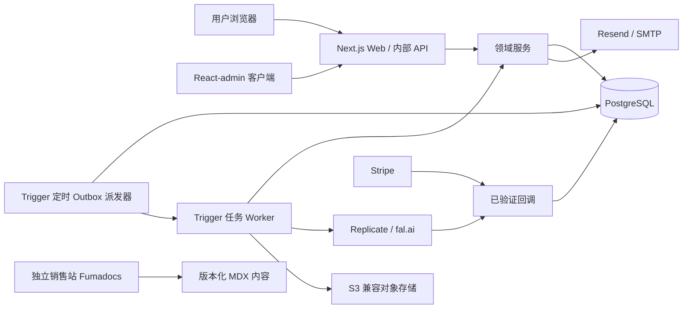
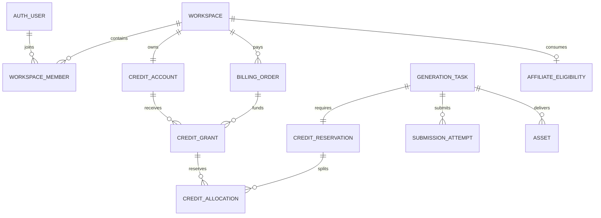

# Shpitto 重启项目：详细技术方案

日期：2026-09-27 · 状态：已作出工程设计选择；尚未开始实现和运行验证。

本文将 D01–D31 落实为可指导实现的技术约定，补充[需求确认记录](./2026-09-27-shpitto-restart-requirements.zh-CN.md)、[总体实施计划](./2026-09-27-shpitto-restart-plan.zh-CN.md)和[验收规格](./2026-09-27-shpitto-restart-test-spec.zh-CN.md)。本文是用户要求的完整中文审核版，与[英文技术方案](./2026-09-27-shpitto-detailed-technical-design.md)对应。

“已选定”表示设计已经作出选择；“已验证”必须有实际实现证据。M0 验证选定方案，不再开展开放式框架比较。付费账号、生产凭据、价格、佣金比例和源码授权条款属于独立的发布输入。计划状态本身不代表已经实现、测试、购买、付款或发布。

方案评审：2026-09-27 已依次通过 Architect 复审与独立 Critic 审查。[评审记录](../../.omx/plans/shpitto-detailed-design-review.md)。通过范围是技术方案，不能视为产品已经实现或通过测试。

## 1. 架构决策与边界

### 1.1 RALPLAN-DR 决策摘要

原则：买家自主部署；每项业务规则只有一个权威实现；本地体验真实持久化；复用成熟通用组件；迁移和交付可恢复、有证据。

三项主要驱动因素：（1）降低买家的部署与定制负担；（2）在异步结果不确定时保护积分和上游成本；（3）复用后台、认证、文档基础设施，同时明确保留 SaaS 业务规则的归属。

| 方案 | 最有说服力的优势 | 对本项目的代价 | 决策 |
| --- | --- | --- | --- |
| Next.js 模块化单体＋外部任务运行器 | 根目录交付一个产品，共享领域代码，数据库事务统一；本地和部署成本较低。 | 必须落实模块依赖约束以及 Web/Worker 版本兼容。 | 选定。 |
| 独立 API、积分账本和 Worker 服务 | 可分别扩容和分配团队责任，适合多个后端团队。 | 当前规模无需承担分布式授权、协议、部署和事务协调。 | 保留适配器边界，V1 不拆分服务。 |
| 以 Payload 为后端和后台中心 | 内容编辑、草稿、媒体、发布流程占主导时很有价值。 | 在 Better Auth、Drizzle 之外增加后端、认证、Schema 和 API 的归属；当前后台主要管理支付、任务、积分。 | V1 不引入 Payload 运行时。 |
| Refine Core＋自定义后台组件 | 无头后台灵活，可统一产品组件风格。 | 相比 React-admin，需要更多列表、表单和交互组装工作。 | V1 不引入 Refine 运行时。 |

React-admin OSS 负责后台展示；Better Auth 负责账号认证；Drizzle 负责应用数据库迁移；领域服务负责授权、任务状态和财务命令；Fumadocs 渲染版本化开发者文档。任何框架均不得获得积分和生成任务数据表的通用写入权限。

### 1.2 部署组件



无云账号本地模式使用持久化本地 Worker 替代 Trigger、Mock 替代真实模型、本地卷替代对象存储、本地 SMTP 收件箱替代实际邮件投递。领域命令和 PostgreSQL Schema 保持一致。存储只定义一个 `local` 演示驱动和一个 `s3` 生产驱动；`s3` 通过 endpoint/config 选择 R2 或 AWS S3，不增加供应商专属领域分支。销售站独立部署，不进入买家应用的依赖图。

## 2. 已选技术栈与版本基线

**状态：技术方案已经选定。** 依据为 2026-09-27 查询的官方文档与公开依赖元数据。本轮没有安装依赖或执行构建。M0 验证此配置，不再重开常规技术竞选；只有真实不兼容证据才触发限定范围的方案修订。不得静默切换为 `latest`。

| 层次 | 选定版本／服务 | 边界与原因 |
| --- | --- | --- |
| 运行时 | Node.js 24 LTS；本地／Docker 24.21.0；pnpm 12.6.0 | 固定 `packageManager` 和锁文件。Vercel 选择 24.x；Trigger 的 `node-24` 当前文档列为 24.18.0。托管平台控制补丁更新。 |
| Web | Next.js 16.3.6 App Router；React/react-dom 19.3.0 | 根目录模块化单体；数据库、认证、回调使用 Node 运行时；公开页和产品页支持服务端渲染。 |
| 语言 | TypeScript 6.0.3 | 保留 JavaScript 编译器及插件 API，避免同时引入 TypeScript 7 原生编译器迁移；显式配置 target、模块解析与 types。 |
| 数据库 | PostgreSQL 17；上游补丁 17.11 | 本地与 Neon 使用相同大版本；Neon 管理实际补丁；当前不需要 PG18 专属功能。 |
| 数据访问 | drizzle-orm 0.45.3；drizzle-kit 0.31.11；pg 8.23.0 | 通过 node-postgres 执行交互式事务；仅有一条经审核的 SQL 迁移序列。 |
| 身份 | better-auth 与 @better-auth/drizzle-adapter 1.7.6 | 复用会话、邮箱密码、验证／重置及双因素插件；领域层管理最小工作区／成员／邀请模型，不假设与 Organization 插件共享事务。 |
| 运营界面 | react-admin 5.15.4 开源核心 | 复用列表、表单、筛选和导航；自定义认证／数据适配器；MUI/Emotion 限于 `/admin`；不依赖企业版模块。 |
| 产品界面 | tailwindcss 与 @tailwindcss/postcss 4.3.3；shadcn CLI 4.21.0 | 交付审核后的组件源码；记录 registry 来源版本／哈希和许可；仅锁 CLI 无法固定远端组件内容。 |
| Docs | fumadocs-core/ui 16.15.14；fumadocs-mdx 15.4.5 | 公开、纳入源码管理的版本化 MDX，静态搜索及共用导出正文，不需要运行时 CMS。 |
| 数据契约 | zod 4.6.5 | 请求／配置校验、统一 DTO 与接口文档生成。 |
| 支付 | stripe 22.6.2；Stripe Hosted Checkout 与 Customer Portal | V1 不需要 Elements 或浏览器 Stripe SDK；发布清单记录 SDK 对应 API 版本，并使 Webhook 配置一致。 |
| 任务 | @trigger.dev/sdk 与 @trigger.dev/build 4.6.4 | 生产执行与调度；PostgreSQL 领域状态为权威；持久化本地 worker 支持无云账号演示。 |
| 对象存储 | @aws-sdk/client-s3 与 @aws-sdk/s3-request-presigner 3.1141.0 | Cloudflare R2 与 AWS S3 共用一套私有 S3-compatible 适配器；演示和验收使用本地文件系统适配器。MinIO 仅作兼容性测试目标。 |
| 邮件 | resend 6.30.0；nodemailer 10.0.10 | 默认 Resend；支持 SMTP 替代及本地邮件捕获。 |
| 联盟 | FirstPromoter V2 HTTP API | 稳定工作区 UID、原生佣金规则与第三方付款流程；可选启用；第 10 节明确接入。 |
| 视频模型 | Replicate 与 fal.ai 的四个 Wan 2.2 端点 | 第 10 节固定供应商／模式结构；交付双供应商，不承诺 V1 同时覆盖不同模型家族。 |
| 验证工具 | ESLint flat config、TypeScript 编译器、Vitest、Playwright、依赖／许可扫描 | 工具类别已选；首个冻结锁文件解析兼容的精确开发工具补丁。补丁解析不等于产品架构未定。 |

兼容依据：Better Auth 接受所选 Drizzle 0.45.x 组合，适配器声明 `drizzle-orm ^0.45.2`；React-admin 支持 React 19；Fumadocs UI/Core 版本一致，面向 Next 16 与 React `^19.2.0`，MDX 接受 Core `^16.15.3`。这些声明支持选型，但不能证明组合后的产品已经可运行。[Better Auth 元数据](https://registry.npmjs.org/better-auth/1.7.6)、[适配器元数据](https://registry.npmjs.org/@better-auth%2fdrizzle-adapter/1.7.6)、[React-admin 元数据](https://registry.npmjs.org/react-admin/5.15.4)、[Fumadocs Core 元数据](https://registry.npmjs.org/fumadocs-core/16.15.14)、[MDX 元数据](https://registry.npmjs.org/fumadocs-mdx/15.4.5)。

### 部署基线

| 环境 | 已选拓扑 |
| --- | --- |
| 托管生产参考 | Vercel Web + Neon PostgreSQL 17 + 通过共享 S3 适配器接入的私有 R2 + Trigger.dev Cloud + Resend；使用买家自己的账号与密钥。AWS S3 使用同一适配器协议。 |
| Docker 生产 | Next standalone Web 容器，连接相同 PostgreSQL／S3／Trigger／邮件契约；Docker 表示应用部署方式，不承诺自托管全部基础设施。 |
| 本地无云演示 | Docker PostgreSQL 17、本地 Next Web、轮询数据库的 worker、私有文件存储、邮件捕获及持久化 Mock。 |
| 模板销售站与 Docs | 独立 `vendor/` 应用及部署；只复用版本化 Docs 正文，买家产品不依赖销售站代码、账号或运行时。 |

常规交互事务使用 Neon 池化连接；迁移和备份使用直连；不依赖事务池中的会话级设置或会话级 advisory lock。Web、Trigger 尽量靠近数据库地域；Vercel 请求不等待视频完成。[Neon 连接池](https://neon.com/docs/connect/connection-pooling)、[Vercel Node 支持](https://vercel.com/docs/functions/runtimes/node-js/node-js-versions)、[Trigger 运行时配置](https://trigger.dev/docs/config/config-file)。

### 替代方案与取舍

| 决定 | 替代方案的合理优势 | 选择原因及接受的成本 |
| --- | --- | --- |
| React-admin OSS | Refine 无预设 UI，便于保持统一 shadcn 设计体系。 | 现成运营页面减少组装工作；接受独立的 MUI 运营视觉层；权限仍由服务端验证。 |
| React-admin OSS | Payload 提供成熟内容编辑、草稿、发布、自动 API 与后端能力。 | V1 运营核心是领域命令，Docs 则是版本化源码；避免第二套结构／认证所有权和大量自定义 CMS 业务页面。确有新增内容流程时再评估。 |
| Fumadocs/MDX | Payload CMS 方便非开发者编写内容。 | 开发者 API／Skills 文档需要代码审核及与发布版本同步；MDX 仅处理可信仓库源码，不在运行时执行任意用户输入。 |
| 模块化单体 | 独立 API／账本服务可以分别扩容和部署。 | 买家需要体积较小、可复现的部署；保留拆分接口，不引入分布式资金事务。 |
| 领域工作区表 | Better Auth Organization 插件提供现成组织及邀请。 | 最小 owner/member 范围需要原子化的最后所有者、个人工作区和计费约束；不能依赖不同事务的 before-hook。复用认证，仅实现必要领域规则。 |

React-admin 官方 Next 集成为客户端模式，必须从 client 边界关闭 SSR 加载。Fumadocs 提供 MDX 编译。Next standalone 打包须显式复制 `public` 与 `.next/static`。[React-admin Next 集成](https://marmelab.com/react-admin/NextJs.html)、[Fumadocs MDX](https://www.fumadocs.dev/docs/mdx)、[Next standalone](https://nextjs.org/docs/app/api-reference/config/next-config-js/output)。

调研日 Node 24 和 PG17 属于受维护版本；各托管平台实际补丁记录在部署验证结果中。[Node 版本](https://nodejs.org/en/about/previous-releases)、[PostgreSQL 支持周期](https://www.postgresql.org/support/versioning/)、[TypeScript 6](https://www.typescriptlang.org/docs/handbook/release-notes/typescript-6-0.html)。

M0 验收：不使用无依据的 peer override 解析精确依赖及许可清单；生成冻结锁文件；生成并审核认证和领域迁移；证明运营登录列表与原子积分命令；构建版本化 Docs；验证 standalone 包。缺少这些证据表示实现尚未完成，不表示没有技术选择。


### OpenSpec 补充状态

[OpenSpec 中文审核入口](../../openspec/reviews/shpitto-restart.zh-CN.md) 补全五处工程默认值：E01 个人空间所有权和团队转让；E02 用户停用、空间暂停与账单冻结的权限矩阵；E03 唯一 ProviderPort；E04 到期取消后重新购买，不做预约换套餐；E05 创建者三十天内最后有效触达及争议胜诉后的人工佣金纠正。这些并非追认用户逐项确认的商业规则。正式规格和任务清单负责实施；历史评审早于这些补充，不自动覆盖。本文继续作为数据、算法和端点登记表。

## 3. 源码目录与责任归属

以下均为目标路径，不表示目前已存在这些实现文件。

| 目标路径 | 职责 | 允许依赖 |
| --- | --- | --- |
| `src/app/(marketing)`、`(auth)`、`(app)` | 公共页面、账号界面、工作空间应用 | 组件和应用入口。 |
| `src/app/admin/[[...segments]]/page.tsx` | 服务端运营权限检查＋后台客户端入口 | `src/admin`；不要求后台 SSR。 |
| `src/app/api/**/route.ts` | 解析、校验、认证、授权、DTO 和错误映射 | 领域命令与查询入口。 |
| `src/modules/{workspaces,credits,generation,assets,billing,affiliates,operations}` | 领域命令、查询、规则和仓储 | 共用 ID/时钟/错误、数据库事务上下文、小型集成接口。 |
| `src/lib/auth.ts`、`src/db/schema/auth.ts` | Better Auth 配置和生成 Schema 映射 | 认证适配器和数据库；不得被浏览器导入。 |
| `src/db/schema/{workspace,credit,generation,billing,integration}.ts` | 数据结构和数据库约束 | Drizzle，以及不导入框架的领域常量。 |
| `src/db/migrations`、`scripts/migrate.ts` | 有序 SQL 迁移和部署锁 | PostgreSQL 直连；请求处理期间不自动迁移。 |
| `src/adapters/providers/{replicate,fal,mock}` | 统一供应商提交、状态和结果 | 供应商 SDK/HTTP、供应商接口。 |
| `src/adapters/{tasks,storage,mail,affiliates}` | Trigger/local、S3/local、Resend/SMTP、联盟适配器 | 接口实现，不独立决定积分。 |
| `trigger/{dispatch,reconcile,materialize,outbox}.ts` | 轻量生产任务入口 | 领域服务；传内部 ID，不传密钥或完整提示词。 |
| `scripts/local-worker.ts` | 持久化轮询和租约循环 | 同一领域服务及 Mock 适配器。 |
| `src/admin/{data-provider,auth-provider,resources,commands}` | 列表、筛选、详情和受控操作 | 内部后台 API；不导入数据库或客户端密钥。 |
| `src/config/{brand,navigation,plans,models}.ts` | 类型化品牌、导航、模型与套餐配置 | 配置 Schema；价格来自审核后的产品绑定。 |
| `content/docs/<release>/**`、`docs/buyer/**` | 开发者源文档和生成的离线指南 | 版本清单、实际 API/Skill 协议。 |
| `skills/*`、`.shpitto/contracts/*`、`scripts/{validate-change,export-release}.ts` | 受约束定制和交付 | 固定的可信校验器/基线、显式导出清单。 |
| `vendor/sales/`、`internal/`、`legacy/shpitto-platform/` | 销售站、工程证据、旧源码归档 | 排除于买家运行时、检查、镜像和导出。 |

浏览器代码不得导入 `src/db`、密钥、特权适配器或领域仓储。领域模块不得导入 React、Next 请求对象、Trigger SDK。跨模块操作通过命名命令和共享事务对象完成，避免重复服务包装和任意数据表写入。使用导入边界检查落实这些约束。

## 4. 数据模型、约束与迁移归属

### 4.1 约定与 ER 图

应用 ID 使用 UUID；Better Auth ID 保持适配器的 text 类型，不强制转换。时间统一 UTC `timestamptz`。积分数量和最小货币单位使用非负 `bigint`，JSON 中编码为十进制字符串；金额必须附带币种。状态使用受约束文本和明确转换函数。`jsonb` 只保存经过校验的快照、供应商证据，不能代替关系型归属。



### 4.2 数据表清单

PK 为主键，FK 为外键，UQ 为唯一约束，IX 为索引。领域记录均有 `created_at`；可变投影另有 `updated_at`。表中工作空间外键均非空。财务和来源引用使用 `ON DELETE RESTRICT`；账号停用或去标识化不删除财务历史。

| 数据表 | 必需字段 | 键、约束和索引 |
| --- | --- | --- |
| Better Auth 表 | 由选定配置生成 User、Session、Account、Verification、双因素字段 | 字段语义归 Better Auth；应用 SQL 迁移归 Drizzle。Session/Account 用户外键、供应商账号唯一约束；不另建密码表。 |
| `workspaces` | `id uuid`、`kind personal/team`、`name text`、`created_by text`、`status active/suspended`、`version int` | PK id；创建者 FK→认证用户；personal 类型对创建者部分唯一；有财务或任务历史时不硬删除。 |
| `workspace_members` | `workspace_id uuid`、`user_id text`、`role owner/member` | 复合 PK；两个 FK；IX(user_id,workspace_id)。最后一个 owner 通过事务保护，不能用跨行 CHECK 假装实现。 |
| `workspace_invites` | `id uuid`、workspace、`email_normalized text`、`role member`、`token_hash text`、`expires_at`、`accepted_at`、`inviter_id text` | Token hash 唯一；邀请者 FK；显式状态保证每工作空间/邮箱只有一个待处理邀请；7 天过期。 |
| `operator_roles` | `user_id text`、`role support/operator/superadmin`、`revoked_at`、`granted_by text` | 用户 PK/FK；每次后台请求查询数据库角色；角色变化留审计。 |
| `credit_accounts` | `workspace_id uuid`、`version bigint` | 工作空间 PK/FK；所有积分写操作的串行锁。 |
| `credit_grants` | `id uuid`、workspace、`source subscription/purchase/compensation/manual/demo`、`issued/available/reserved/consumed/expired/voided bigint`、`expires_at nullable`、`origin_grant_id uuid nullable`、`origin_allocation_id uuid nullable`、`order_id uuid nullable`、`business_key text` | business_key 唯一；来源/订单 FK；所有桶≥0 且 issued=所有桶之和；IX(workspace,expires_at,id)；补偿来源 allocation 唯一。 |
| `credit_reservations` | `id uuid`、workspace、`task_id uuid`、`amount bigint`、`status held/consumed/refunded/released` | task 唯一且 FK；amount>0；IX(workspace,status)。 |
| `credit_allocations` | `id uuid`、reservation、grant、`amount bigint`、`source_expiry timestamptz nullable`、`source_kind`、`lineage_root uuid` | reservation/grant/root FK；UQ(reservation,grant)；amount>0；预占后不可修改。 |
| `credit_ledger` | `id uuid`、workspace、grant、`operation_id uuid`、`entry_no int`、各桶有符号增量、`kind`、`task_id nullable`、`reason`、`created_at` | UQ(operation_id,entry_no)；FK；数据库权限仅允许追加；IX(workspace,created_at,id)。冲正引用原记录。 |
| `domain_commands` | `id uuid`、`scope text`、`idempotency_key text`、`payload_hash text`、`actor_id text nullable`、`result jsonb` | UQ(scope,idempotency_key)；同 key 不同内容返回409；结果与业务写操作同事务提交。 |
| `generation_tasks` | `id uuid`、workspace、`requested_by text`、`mode`、`model_key`、`catalog_version`、`input_snapshot jsonb`、`quoted_credits bigint`、`status`、`failure_code nullable`、`deadline_at`、`version int` | 请求者 FK；IX(workspace,created_at,id)、IX(status,deadline_at)；创建后报价、模型、输入不可改。 |
| `submission_attempts` | `id uuid`、task、`attempt_no int`、`provider`、`client_reference text`、`provider_request_id nullable`、`state`、`started_at`、`reconcile_deadline`、`probe_count int`、`cost_minor nullable`、`cost_currency nullable`、`cost_state unknown/estimated/confirmed` | UQ(task,attempt_no)；存在请求 ID 时 UQ(provider,provider_request_id)；缺少证据不能视为成本为零。 |
| `assets` | `id uuid`、workspace、`task_id nullable`、`purpose input/output`、`state pending/ready/quarantined/deleted`、`object_key text`、`created_by text`、`mime`、`bytes bigint`、`sha256`、`duration_ms nullable`、`upload_expires_at nullable` | object_key 唯一；task FK；IX(workspace,created_at,id)；ready 输出必须具有完整性元数据。 |
| `billing_accounts` | workspace、`stripe_customer_id text`、`status active/hold`、`hold_reason nullable` | 工作空间 PK；Stripe Customer 唯一；更换映射保留历史。 |
| `subscriptions` | `id uuid`、workspace、`stripe_subscription_id text`、`price_id`、`status`、`period_start/end`、`cancel_at_period_end bool` | Stripe 订阅 ID 唯一；IX(workspace,status)；命令与部分约束保证一个有效订阅。 |
| `billing_orders` | `id uuid`、workspace、`kind subscription/pack`、`stripe_invoice_id nullable`、`stripe_payment_intent_id nullable`、`status`、`paid_minor bigint`、`refunded_minor bigint`、`currency`、`paid_at`、`grant_business_key` | 非空 invoice/PI 各自唯一；refunded≤paid；产品/价格快照不变；IX(workspace,paid_at,id)。 |
| `billing_recovery_cases` | `id uuid`、order、`kind refund/dispute/mismatch`、`status`、`exposure_credits bigint`、`evidence jsonb`、`resolution_command_id nullable` | 外部事件/业务案件键唯一；追加案件历史；不自动形成负积分桶。 |
| `integration_inbox` | `id uuid`、`source`、`external_event_id`、`payload_hash`、加密/最小化载荷、`status`、`attempts`、`next_attempt_at`、`last_error` | UQ(source,external_event_id)；IX(status,next_attempt_at)；验签后才能写入。 |
| `integration_outbox` | `id uuid`、workspace nullable、`kind`、`aggregate_id uuid`、`business_key`、`payload jsonb`、`status`、`available_at`、`lease_until`、`lease_owner`、`lease_token`、`lease_generation bigint`、`attempts` | UQ(kind,business_key)；IX(status,available_at)；SKIP LOCKED 领取租约。 |
| `affiliate_attributions` | workspace、`vendor`、`referral_id`、`referral_snapshot`、`captured_at`、`locked_at nullable`、`policy_version` | 工作空间 PK；只保存第三方标识；不自建佣金率、余额或付款账本。 |
| `affiliate_eligibility` | workspace、`first_order_id uuid`、`consumed_at`、`vendor_sale_id nullable`、`sync_status` | 工作空间 PK；首订单唯一且 FK；更换成员、付款人、Customer 不重置。 |
| `admin_audit` | `id uuid`、`actor_id`、`permission`、`command_id`、`workspace_id nullable`、`target_type/id`、`reason`、脱敏前后值、`result`、`request_id`、`event_kind`、`event_key` | 仅 command-success 使用部分 UQ(command_id)；后续集成审计使用 UQ(event_key)；IX(actor,created_at)、IX(workspace,created_at)；仅追加。 |

task→asset、reservation→task、allocation→grant、order→grant 同时必须满足工作空间相同。为租户数据建立 `(id,workspace_id)` 复合唯一约束和复合 FK，不依赖 UUID 难猜。摄取载荷和提示词设置明确大小、保留期限，不无上限永久保存 JSON。


第 6.4、9.4、10.7 节的补充表和字段均为必须实现的结构，所有订单／工作区／用户引用使用 FK 及相同租户一致性约束。`billing_accounts` 还保存核对租约的 owner/token/generation/expiry；`billing_customer_history(workspace_id,stripe_customer_id,valid_from,valid_until)` 对 Stripe customer ID 全局唯一，保留历史映射。新增 `operator_step_ups(session_id PK,user_id,verified_at,expires_at,revoked_at)`，仅由服务端可信的 Better Auth 双因素验证成功结果写入；只检查账号“已启用 2FA”不足以通过。绑定会话／用户 FK，执行命令时必须还是同一有效会话。新增 `rate_limit_buckets(scope,key_hash,window_start,count,expires_at)`，使用复合 PK 和原子 UPSERT，定期清理过期桶。审核状态及集成租约使用受约束状态迁移和版本比较更新。

### 4.3 认证与工作空间归属

复用 Better Auth 的注册、密码校验、重置、邮箱验证、Session 和运营账号双因素。有限的工作空间模块负责 owner/member/invite 和 personal/team 规则。不选择 Better Auth Organization 插件：其通用组织端点、Hook/事务集成为当前最小角色模型增加了不必要的归属问题。不得假定插件 Hook 与应用共享 Drizzle 事务，也不得同时维护两套权威成员表。

实施使用上述领域自有工作空间表，在同一数据库事务中保护最后一个 owner 和领域命令，避免依赖未确认的插件事务机制。这部分小型工作空间代码属于产品规则；账号、密码、Session 仍复用成熟实现。未来引入 Organization 插件必须单独作出 Schema/API 迁移决策，并提供并发与端点绕过验证证据。

首次认证使用时幂等创建个人工作空间，以及配置允许的本地演示积分。初始化事务失败可重试；已有认证账号但未完成工作空间的用户进入可恢复的初始化页面。邀请 Token 随机生成、哈希保存、单次使用，并绑定已验证的规范化邮箱。成员变化先锁工作空间行，禁止删除或降级最后一个 owner。

所有迁移通过 Drizzle 生成和审核，包括 Better Auth 配置引出的表变化。生产禁止 schema push，不增加第二套 CMS 迁移所有者。部署迁移获取 PostgreSQL advisory lock。采用扩展、回填、切换、收缩步骤；确认所有 Web/Worker 版本不再使用旧列后才能破坏性删除。

## 5. 积分：事务算法与有效期

### 5.1 不变量

1. 每工作空间只有一个串行化账户行。写操作先锁 `credit_accounts`，再按稳定 ID 顺序锁任务、预占、积分批次；同时修改成员和积分时，先锁工作空间再锁财务记录。
2. 不可变账本解释每次积分桶变化，SQL 桶约束在提交时成立。对账发现不一致时报告并暂停相关命令，不能静默改历史。
3. 可用余额是未过期批次的 `available` 之和。定时过期任务只做整理；查询和预占始终检查当前时间。
4. 分配记录保留数量、原始批次类型、有效期和来源链。后续套餐或配置变化不能重新定价已接受任务。
5. 命令去重、账本、批次投影、任务终态、成功后台审计、Outbox 同事务提交。

### 5.2 预占并创建任务

```text
BEGIN
  校验当前成员权限、模型能力、输入资产、计费暂停状态
  FOR UPDATE 锁工作空间积分账户
  查询命令键（workspace, create-task, 客户端幂等键）
  已完成：要求 payload hash 相同，返回已有结果
  将已过期未预占积分转入 expired，并追加过期账本
  FOR UPDATE 获取有效批次，按 expires_at NULLS LAST、created_at、id 排序
  可用总量不足服务端固定报价则拒绝
  按 FEFO 分配：available -= n；reserved += n；追加预占账本
  插入 queued 任务、held 预占、不可变分配和派发 Outbox
  写入包含 task ID 的命令结果
COMMIT
```

客户端提交模型标识和参数，不提交可信积分价格。报价来自版本化模型目录。同请求重试返回同任务。展示报价后模型若被禁用，接受时返回冲突并要求重新报价。事务序列化或死锁错误最多重试三次；耗尽后返回可重试错误，不调用外部模型。

### 5.3 取消、交付、失败

取消先锁账户和任务，只能发生在任务为 `queued` 且尚无派发领取时。预占积分仍有效则回 available，否则进入 expired；取消没有发生生成失败，因此不创建七天补偿。任务和预占终态同事务写入，尚未领取的 Outbox 同时失效。

成功结算要求已验证的持久化输出资产。同一事务设置任务 `succeeded`、预占 `consumed`，按分配把 reserved 转 consumed，追加账本、记录交付。重复成功事件不得再次扣积分。失败或取消终态不得被迟到成功事件重新开启。

失败，包括无法完成交付，使用唯一 `task-failure:<taskId>` 命令：

```text
BEGIN；锁账户、任务、held 预占和对应批次
  已终态：返回已有结果或记录终态冲突
  遍历每项分配：
    未过期订阅 / 永久购买 / 未过期补偿：
      reserved -= n；available += n；追加返还记录
    执行期间原有效期已过的订阅批次：
      reserved -= n；expired += n；追加来源关闭记录
      创建补偿批次（n，有效期=本次返还时间+7天，
        origin_allocation=分配ID，保留原订阅来源链）
      追加补偿发放；唯一 origin allocation 防止再次续期
    已过期的补偿批次：
      reserved -= n；expired += n；追加已过期返还记录
      保留原补偿有效期，不再延长
    其他已过期批次：
      reserved -= n；expired += n；保留来源自己的有效期
  task=failed；reservation=refunded；记录失败及上游成本状态
COMMIT
```

全额返还表示按约定来源和有效期规则处理全部分配，不表示已过期补偿重新可用。用户账本明确展示此结果。供应商收费另记为货币成本证据，不从用户本次退款再扣一次。

运营调整创建新积分批次或补偿账本操作，不 UPDATE/DELETE 历史账本。撤销只能使用 available 且未预占数量。更大金额纠正产生计费恢复案件，并暂停新的计费生成请求，直到授权处理；已有任务仍可结算。

## 6. 生成状态机与恢复

| 状态/事件 | 必要条件 | 下一状态与原子效果 |
| --- | --- | --- |
| 接受创建 | 成员、输入有效，积分足够，计费正常 | `queued`；预占与 Outbox 一起创建。 |
| 用户取消 | `queued`，无派发领取 | `cancelled`；只释放一次。 |
| Worker 领取 | queued，Outbox 租约有效 | `dispatching`；网络操作前持久化 attempt 并关闭取消入口。 |
| 提交返回请求 ID | 当前 attempt 为 dispatching/unknown | `submitted`；保存供应商请求 ID。 |
| 提交结果不确定 | 超时、响应损坏、领取后进程退出 | `submission_unknown`；对账已有 attempt。 |
| 供应商接受/运行 | 可信回调或权威状态查询 | `submitted`/`running`；进度只向前。 |
| 上游输出就绪 | 有效成功载荷和输出引用 | `materializing`；安排摄取。 |
| 输出已复制验证 | 私有持久化对象和 ready 资产元数据 | `succeeded`；预占只消费一次。 |
| 确认上游失败 | 没有可用的已交付输出 | `failed`；返还一次。 |
| 恢复预算耗尽 | 已达探测上限或绝对截止时间 | `failed`，代码 `DELIVERY_UNRECOVERABLE`；返还一次，保留已知/未知成本。 |
| 任意冲突迟到事件 | 任务已终态 | 隔离证据/输出；不重新收费、重开、自动重提或重复退款。 |

### 6.1 原子派发与付费提交规则

`claimDispatch` 与取消使用相同账户/任务锁。保存 attempt 并进入 dispatching 后，即使 HTTP 尚未发出，取消也返回409。这一保守边界消除了取消与网络副作用之间的竞态。

关闭付费提交接口的 SDK/HTTP 自动重试。持久化领取后、实际发请求前进程崩溃，也属于不确定结果；优先对账或检查证据，避免重复上游支出。只有该端点确实提供并验证了针对已保存 key 的幂等保证，才能重试同一次付费调用。否则 V1 每任务最多一次明确派发的付费请求。旧任务终态后，用户可明确创建新任务。

回调绑定供应商、attempt ID，以及真实供应商支持的签名以及用于关联的高熵单次 attempt 回调 Token。不能假定 client reference 自动成为可检索的上游幂等键。如果找不到请求 ID，也没有可信回调，达到期限后以无法交付终止；运营成本不确定不能无限冻结用户积分。

### 6.2 明确工程默认值

| 控制项 | 初始默认值 | 规则 |
| --- | --- | --- |
| 提交 HTTP 超时 | 30 秒、一次请求 | 超时进入 unknown，禁止盲重试。 |
| 不确定提交对账 | 派发起60分钟，最多24次探测 | 间隔15/30/60秒，随后3分钟；受绝对期限限制，可信回调可提前结束。 |
| 已知请求执行期限 | 派发起60分钟 | 启用模型前可在目录中设置经审核的其他模型专属值。 |
| 输出持久化 | 首次上游成功起30分钟，最多8次 | 退避5/15/30/60/120/300/600秒；支持时重新获取权威输出 URL。 |
| Outbox 租约 | 60秒；每20秒续租 | 租约过期不授权再次付费提交。 |
| 安全的集成投递重试 | 12次/24小时 | 指数退避和随机抖动；耗尽进入运营可见死信。 |
| 本地 Worker 轮询 | 繁忙1秒，空闲最多5秒 | PostgreSQL 持久化，不用进程内存队列。 |
| UI 任务查询 | 活跃3秒，后台10秒 | 终态停止；页面恢复从数据库重新读取。 |

以上是可审核的工程预算，不是供应商 SLA。延长期限必须变更模型目录/配置，并写入新任务快照；已有任务保持接受时的恢复规则。即使 Trigger 用完重试或被中断，领域截止期限仍生效。

### 6.3 Outbox、Inbox 与 Worker

Web 请求提交领域变化和 Outbox，随后尽力立即通知 Trigger 以降低延迟。Trigger 的定时 Outbox 派发器每分钟恢复漏发任务；多实例使用 `FOR UPDATE SKIP LOCKED`。Trigger 任务使用持久化 Outbox ID 和配置的幂等控制；外部幂等保留期过去后，领域命令仍保证不重复执行。

回调端点验证原始字节及供应商对应认证，限制载荷，唯一写入 Inbox，尽快应答。处理器把事件转为领域命令。事件 ID 去重和业务效果去重是两层不同机制。乱序事件依据上游权威状态与终态规则处理，不能用到达顺序决定财务事实。

本地 Worker 消费同一 Outbox，调用同一命令处理器，进程重启后继续。生产启动拒绝 Mock/local 驱动、演示积分和默认密钥。本地模式不把真实支付或模型接口伪装成已验证成功。

### 6.4 恢复扫描与执行租约校验

`generation_tasks` 增加 `next_action_at`、`queue_deadline_at`、`stage_deadline_at`、`overall_deadline_at` 和 `version`，对未终态任务建立 `(next_action_at,id)` 部分索引。排队任务最多等待调度 10 分钟，超过后以 `DISPATCH_UNAVAILABLE` 进入标准失败／退积分事务。开始提交时，提交／已知执行阶段获得 60 分钟预算；首次收到已认证的供应商成功结果后，资产落库获得 30 分钟预算，但不超过 `overall_deadline_at=dispatch_started_at+90 分钟`。进入落库阶段后，其期限替代原推理期限；任何重试不得重置期限。扫描及结算使用数据库时间。

独立 `sweepRecovery` 任务通过 Trigger 周期计划每分钟运行，本地 worker 每 10 秒运行。它扫描权威任务表，不依赖此前是否成功加入后续任务；以有限批次领取任务，安排安全核对／落库或执行超时失败结算。原 Trigger 任务结束、死信、缺失或 outbox 失败，都不会使任务脱离此扫描。期限结算与成功结算锁定相同账户／任务／预留记录，仅处理仍活跃且版本匹配的任务；成功和超时并发只有一个胜者，终态重复调用返回已存结果。

Outbox 增加 `lease_owner`、随机 `lease_token`、单调递增 `lease_generation` 和 `lease_until`。领取时增加代次；心跳、进度及确认均比较完整 owner/token/generation。过期执行者不能确认、清除或替换新租约。领域命令同时检查任务／attempt 版本与阶段。重新领取已经提交中或结果未知任务的 outbox，仅安排对既有 attempt 的核对，不能获得新的付费提交权。唯一初始调度业务键和任务／attempt 约束保证只有一次初始付费提交。

扫描独立于原任务，但不承诺在 Trigger／数据库整体故障时仍可执行。恢复后优先结算已超期任务，再接受新的状态推进。数据库中的扫描心跳超过三分钟触发告警。运行手册提供调用同一扫描逻辑的受认证维护 CLI；运营者不能直接改余额或状态。验收注入任务丢失、重试耗尽、过期租约确认、并行扫描、排队饥饿及终态边界成功事件。


## 7. 模型适配器与资产流水线

```ts
type ProviderPort = {
  capabilities(modelKey: string): ModelCapabilities;
  validate(input: VideoInput): ValidatedVideoInput;
  submit(attempt: SubmissionContext): Promise<SubmitResult>;
  getStatus(ref: ProviderRequestRef): Promise<ProviderObservation>;
  readResult(ref: ProviderRequestRef): Promise<ProviderResult>;
  verifyWebhook(rawBody: Uint8Array, headers: Headers): Promise<VerifiedObservation>;
};
// SubmitResult：accepted(requestId) | definitelyRejected(code) | unknown(evidence)
// ProviderObservation：queued | running | completed | failed；不是领域交付状态。
// ProviderResult：outputCandidates | failed | unavailable。
// SubmissionContext 包含已验证输入、不可变目录快照及持久化尝试关联。
```

`ValidatedVideoInput` 含模式、提示词、目录模型、允许的时长/比例、可选输入资产 ID 和安全参数，不接受浏览器指定任意远程下载 URL。供应商专有参数仅存在于适配器。模型目录包含端点/版本、模式、参数 Schema、输出形态、限制、成本估算元数据、积分价格版本、期限、回调验证方法。

第 10 节已固定四个供应商／模式端点、参数和输出映射，适配器以该登记表为准。完成状态只是供应商观察结果；实际成功必须经过自有资产持久化和验证。

服务端授权 ready 输入资产后，向上游提供有期限的源 URL，或使用其支持的上传方式。输入默认 JPEG/PNG/WebP、≤20MiB、≤4096×4096像素；所选模型可进一步收紧。验证真实内容和解码限制，不只看扩展名或浏览器 MIME。拒绝活动内容和解压炸弹。

仅 Worker 从经过验证的 HTTPS 供应商结果地址拉取输出。阻断内网/link-local IP、URL 内嵌凭据和重定向逃逸；每次 DNS/重定向重新校验。流式读取最大250MiB，并限制总超时。供应商临时 URL 不能作为已持久交付资产返回用户。

输出写入固定私有键 `workspaces/<workspaceId>/tasks/<taskId>/<assetId>.mp4`；通过选定的 Worker 媒体探测工具验证字节数、SHA-256、容器/视频轨道、正时长。完成上传及 HEAD/完整性检查后，数据库才能标记 ready。对象已上传但数据库提交失败时，保留可识别孤儿对象以恢复/清理；相同对象已存在且校验一致时，重复摄取安全。

下载先检查当前工作空间权限，再生成60秒签名 URL。提供给模型的输入 URL 使用独立期限，默认2小时并覆盖所选模型需求。成员移除后，已签出的 URL 仍可能有效至过期；文档明确这一上限。如果需要立即撤销，应使用授权流式代理，不能宣称预签名链接会瞬间失效。

本地存储使用不透明键映射到指定卷根目录，归一化并校验路径包含关系，拒绝穿越和符号链接，通过相同授权下载接口服务。未完成上传1小时后过期，孤儿对象清理等待24小时。ready 输出默认保留至所有者删除，受运营存储配置及公开条款约束；不隐含引入自动清空规则。


媒体工具选定 `sharp 0.35.4` 校验和标准化已授权输入图片；worker 使用 FFmpeg/ffprobe 7.x 检查受大小限制的本地视频。Trigger 从已锁定构建扩展调用 `ffmpeg({version:"7"})`；发布清单记录实际二进制版本、哈希、构建选项及许可。通过 `execFile` 传固定参数与不透明本地路径调用 ffprobe，限制为 15 秒、限制输出、禁用网络协议；不得拼接 shell 命令或传入上游 URL。本地演示 worker 运行在提供的 Docker 镜像中，包含相同探测工具，买家无需在宿主机安装 FFmpeg。发布镜像／包前记录二进制再分发义务。[Trigger FFmpeg 扩展](https://trigger.dev/docs/config/extensions/ffmpeg)、[ffprobe](https://ffmpeg.org/ffprobe.html)、[sharp 安装](https://sharp.pixelplumbing.com/install/)。

## 8. 内部 API 协议与后台界面

### 8.1 传输约定

以下是 Session 认证的内部应用接口，不是暂缓的公共 API 产品，不提供客户 API Key。请求体使用有版本的 Zod DTO；写端点除授权外还验证同源/CSRF；GET 不改变业务状态。

```json
{"data":{"id":"uuid","status":"queued","quotedCredits":"100"},"meta":{"requestId":"uuid"}}
```

列表响应为 `{data:[],meta:{page:1,pageSize:25,total:123,requestId:"…"}}`。错误为 `{error:{code,message,fieldErrors?,retryable},meta:{requestId}}`。状态码：400 `INVALID_INPUT`；401 `UNAUTHENTICATED`；403 `FORBIDDEN`；跨租户不可访问资源返回404 `NOT_FOUND`；409 `STATE_CONFLICT`/`IDEMPOTENCY_CONFLICT`；402 `INSUFFICIENT_CREDITS`；429 `RATE_LIMITED`；503 `INTEGRATION_UNAVAILABLE`。日志保留诊断，响应不包含密钥或上游原始错误体。

财务和业务 POST 命令要求 `Idempotency-Key`，使用 UUID 或8–128字符的不透明键。规范化请求哈希排除传输元数据；作用域按需包含当前用户、工作空间、操作。同 key 不同语义请求拒绝；相同请求返回已保存结果。

### 8.2 端点清单

| 方法/路径 | 输入/输出 | 权限和副作用 |
| --- | --- | --- |
| Better Auth `/api/auth/**` | SDK 管理的注册/Session/重置/双因素 DTO | 认证限流、Session Cookie、可信来源；显式审核插件端点。 |
| GET/POST `/api/workspaces` | 成员工作空间列表 / `{name}`→工作空间 | 已登录；幂等建团队，个人空间由初始化命令创建。 |
| GET `/api/workspaces/:w` | 空间摘要和自己的权限 | 当前成员。 |
| GET `/api/workspaces/:w/members` | 成员列表 DTO | 当前成员；不含凭据/Session。 |
| POST `/api/workspaces/:w/invitations` | `{email}`→邀请摘要 | Owner；邮件 Outbox 同事务创建。 |
| POST `/api/invitations/accept` | `{token}`→成员关系 | 已验证且邮箱匹配；Token 单次使用。 |
| DELETE `/api/workspaces/:w/members/:user` | 成功结果 | Owner；事务保护最后一个 owner；审计。 |
| POST `/api/workspaces/:w/transfer-owner` | `{targetUserId}` | Owner＋近期认证；原子转移，不能出现无 owner 状态。 |
| GET `/api/models` | 已启用模型的安全能力/价格 | 已登录；无供应商密钥。 |
| POST `/api/workspaces/:w/generation-quotes` | `{modelKey,mode,options}`→报价/版本 | 成员；服务端目录报价，短期展示辅助。 |
| POST `/api/workspaces/:w/generations` | `{modelKey,mode,prompt,inputAssetId?,options,catalogVersion}`→任务 | 成员；原子预占/任务/Outbox；必须幂等键。 |
| GET `/api/workspaces/:w/generations` | `page,pageSize,status`→任务列表 | 成员；pageSize1–100，createdAt/id 稳定排序。 |
| GET `/api/workspaces/:w/generations/:id` | 任务、安全失败信息、资产摘要 | 成员；验证资源工作空间。 |
| POST `/api/workspaces/:w/generations/:id/cancel` | 空 DTO→终态/当前任务 | 成员；仅 queued 可转换。 |
| POST `/api/workspaces/:w/assets/uploads` | `{mime,size,sha256?}`→上传意图 | 成员；额度和 MIME 白名单；10分钟失效。 |
| POST `/api/workspaces/:w/assets/:id/complete` | 上传证明→已验证资产 | 成员；对象/内容验证后才能 ready。 |
| GET `/api/workspaces/:w/assets` | 分页资产摘要 | 成员。 |
| GET `/api/workspaces/:w/assets/:id/download` | 签名 URL 与期限 | 成员；仅 ready；私有响应/缓存。 |
| DELETE `/api/workspaces/:w/assets/:id` | 删除请求摘要 | Owner 或创建者规则；活动任务引用的输入不能删；异步移除对象。 |
| GET `/api/workspaces/:w/credits` | 可用/预占/到期明细 | 成员；金额十进制字符串。 |
| GET `/api/workspaces/:w/credits/ledger` | 分页分配/账本摘要 | 成员；安全原因和来源链。 |
| GET `/api/workspaces/:w/billing` | 订阅/订单摘要 | Owner。 |
| POST `/api/workspaces/:w/billing/checkout` | `{catalogProductKey}`→Checkout URL | Owner；服务端绑定空间、Stripe Customer、批准的价格。 |
| POST `/api/workspaces/:w/billing/portal` | 空→Portal URL | Owner；固定回跳地址白名单。 |
| GET `/api/workspaces/:w/affiliate` | 可选联盟入口/状态 | Owner；关闭时返回能力标记。 |
| POST `/api/webhooks/stripe`、`/replicate/:attemptNonce`、`/fal/:attemptNonce`、`/affiliate` | 供应商认证载荷→ack | 无用户 Session；供应商验证和 Inbox 写入。 |
| GET `/api/admin/:resource` | `page,pageSize,sort,filter`→列表 | 明确运营权限，资源/字段白名单。 |
| GET `/api/admin/:resource/:id` | 安全详情 DTO | 运营角色；敏感字段脱敏。 |
| POST `/api/admin/commands/:command` | `{targetId,reason,expectedVersion,payload}`→结果 | 命令权限＋近期双因素＋幂等＋原子审计。 |
| GET `/api/health/{live,ready}` | 最小健康状态 | 不暴露配置/密钥；ready 查 Schema/DB；集成细节仅后台可见。 |

React-admin `getList` 将 page/perPage/sort/filter 映射为上述列表协议，返回 `{data,total}`；`getOne/getMany/getManyReference` 使用带数量上限的 ID/筛选读取接口。受保护资源的 `create/update/updateMany/delete/deleteMany` 在客户端和服务端均拒绝。自定义操作按钮调用命名命令，不提供任意 PATCH 任务状态、账本余额、订阅权益的接口。

`authProvider.checkAuth/getIdentity/getPermissions` 使用真实 Better Auth Session 和显式新增的只读 `/api/admin/me`。客户端权限只改善界面；服务端查询和命令重新检查数据库角色及双因素新鲜度。RA 排序/筛选字段通过固定白名单映射，不能将客户端列名插入 SQL。

## 9. 支付、身份、权限与审计

### 9.1 Stripe 事件处理

Checkout 只是支付入口，浏览器回跳不发积分。创建 Checkout Session 前保存待支付订单/空间/目录绑定，调用 Stripe 创建时使用幂等键，并保存返回 ID。签名 Webhook 进入 Inbox，支付处理器按需读取权威支付/订阅对象。

| 事件/情况 | 权威业务效果 |
| --- | --- |
| 指定周期价格对应的 `invoice.paid` | 每有效发票行/服务周期发一次积分，键为 `stripe:invoice:<invoiceId>:line:<lineId>`；到期时间取该行 period end。只对已支付且有效的周期权益发积分，不处理任意发票收费。 |
| 积分包 `checkout.session.completed` 或延迟支付成功 | 必须确认支付完成；订单以 PaymentIntent 唯一；发放键 `stripe:pack:<paymentIntentId>`。两事件进入同一命令。 |
| 单独收到 `payment_intent.succeeded` | 对账已知订单，不引入第二种发放键；未知/不匹配对象进入运营处理。 |
| 支付失败/未完成/试用 | 不发购买积分；没有另行配置规则就没有免费试用积分。 |
| 订阅更新/删除 | 同步状态、周期、取消信息；到期取消保留原积分到期时间；状态事件不额外发积分。 |
| Customer/映射变化 | 保留空间计费来源和联盟已消费资格；变更必须有运营原因。 |
| 退款/争议 | 按 refund/dispute ID 建立或对账恢复案件；执行现金规则，联盟冲正独立同步。 |

V1 采用一个月度循环价格，不支持年付、多订阅项、预约换套餐、期中升级或按比例结算。Owner 到期取消后，只有权威对账确认旧订阅结束，才能重新购买；现有积分保持原到期时间。Stripe Portal 隐藏未支持的换套餐入口。目录价格修改只影响未来购买，已有订阅变价需另行设计迁移。意外上游变更转为对账案件。该选定工程默认值取代此前不完整的预约变更承诺，见 OpenSpec E04。

混合发票、多订阅项只有在目录映射和行语义明确后才能自动发放，否则拒绝自动处理。积分按配置产品数量发放，不采用“实付金额×猜测兑换率”。税、折扣、供应商成本、积分数量分开记录。

### 9.2 现金退款和争议默认处理

用户已确认生成失败的积分退款，并未确认统一现金退款商业条款。工程处理选定如下，正式销售前仍需发布商业退款资格规则。

| 情况 | 选定处理 |
| --- | --- |
| 全额现金退款，关联积分完全未用、未预占 | Stripe 确认后，通过冲正和审计撤销可用积分。取消订阅属于另一个明确操作。 |
| 积分已消费/预占；部分现金退款；支付争议 | 建恢复案件，暂停该空间新的计费生成，保留历史、允许活动任务结算。运营审核分配和风险敞口，不自动负积分或再次扣现金。 |
| 争议胜诉/撤销 | 对账权威支付状态，处理未关闭案件后，仅恢复先前撤销的有效权益一次，保留原到期时间。 |
| 生成任务积分退款 | 只执行第5节；不是 Stripe 退款，本身不冲正联盟佣金。 |

运营发起 Stripe 退款前，命令先展示金额、积分敞口、原因。生产现金执行需要另外明确授权。Webhook 确认后完成记账，API 请求成功不等于资金已转移。待处理、外部成功而本地失败等路径均凭已保存的 Stripe 标识对账。

### 9.3 权限矩阵

| 操作 | Member | 工作空间 Owner | Support | Operator | Superadmin |
| --- | --- | --- | --- | --- | --- |
| 生成/读取/下载自己空间资源 | 是 | 是 | 不隐含租户访问 | 经审计的支持访问 | 经审计的支持访问 |
| 管理空间计费/成员 | 否 | 是 | 只读支持投影 | 受控支持命令 | 受控支持命令 |
| 跨空间运营读取 | 否 | 否 | 脱敏读取 | 读取 | 读取 |
| 调积分/处理恢复案件/重试安全摄取 | 否 | 否 | 否 | 命名命令＋近期双因素 | 相同 |
| 模型可用性/运营配置 | 否 | 否 | 否 | 有限命令＋审计 | 是＋审计 |
| 授予/撤销运营角色 | 否 | 否 | 否 | 否 | 近期双因素＋原因；不能移除最后一个 superadmin |
| 直接编辑账本/任务/订单行 | 否 | 否 | 否 | 否 | 应用不提供 |

全局角色不等于可以冒用客户 Session。支持访问记录操作者、目的、目标。首次运营账号通过一次性服务端 CLI 指定用户并审计，完成初始化后关闭；公开注册永远不能创建运营角色。撤权后下一次服务端请求生效。运营 Session 要求邮箱验证和双因素；高权限命令要求10分钟内完成加强认证。

后台命令在同事务写业务变化、账本、命令结果、成功审计。外部副作用写入 Outbox，后续成败追加审计事件。授权失败记为安全事件，不能伪造成功业务审计。禁止记录密码、Token、完整 Webhook 载荷或含凭据的模型 URL。

初始限流：注册/重置每 IP 每15分钟10次；登录失败每账号/IP 每15分钟5次；生成每空间每分钟10次且最多5个活动任务；后台命令每运营账号每分钟20次。用 PostgreSQL 持久化计数器/租约保证多实例一致，限额可配置并验证锁竞争。429 返回 `Retry-After`。

### 9.4 标准付款核对与结账串行控制

新增 `billing_checkout_attempts(id,workspace_id,kind,catalog_snapshot,stripe_session_id,status,expires_at,idempotency_key)`，session/key 唯一；订阅 checkout 处于 `creating/open/unknown` 时，以部分唯一约束占用工作区订阅结账槽位。持有计费账户锁时，如槽位或未终止订阅存在，则拒绝第二个订阅结账。在调用 Stripe 前提交 attempt，以 `checkout:<attemptId>` 作为 Stripe 幂等键。响应丢失时保留槽位，核对同一请求／session，不另开订阅结账。只有权威过期／取消／付款核对后才释放槽位。若外部管理界面仍产生额外订阅，暂停该工作区计费并要求带审计的取消／退款处理；数据库约束不能撤销外部收费。

全部付款／退款／争议事件进入**同一个 `reconcilePayment` 命令**，不拆成互不协调的发积分与冲正处理器。`billing_payment_aliases(provider,object_kind,external_id,order_id)` 唯一映射 Checkout、invoice 和 PaymentIntent 到同一订单。`billing_cash_events(provider,event_kind,external_id,order_id,amount_minor,status,occurred_at)` 保存不可改写的已确认退款／损失事实及后续纠正观察；同一经济损失不能冲正两次。初始范围支持单一已映射周期项目／付款；不明确的多付款账单进入人工恢复案例。

计费账户核对租约带代次校验：领取／续约后，读取 Stripe 当前 invoice／PaymentIntent／charge／退款／争议及订阅状态，只有代次仍匹配才应用。外部读取在 SQL 事务外执行。过期执行者不能以旧快照覆盖新核对；已存成功退款 ID 单调合并，不因事件先后降低退款总额或抹去已知争议。

需要对应对象时，统一加锁顺序为：工作区 → 计费账户 → 积分账户 → 标准订单 → 按稳定 ID 排序的任务／预留／批次。仅生成任务的命令先锁积分账户，再锁任务／批次，并在积分锁后复查计费暂停状态；之后不得反向获取计费账户锁。`reconcilePayment` 在同一事务写入付款投影、积分发放／冲正、计费暂停／恢复案例、必要审计、命令结果及后续 outbox。重复 invoice／Checkout／PI 事件解析到相同订单与积分业务键。

| 发积分前核对到的状态 | 必须执行的结果 |
| --- | --- |
| 确认已付、金额为正、属于支持产品、无退款／争议 | 原始积分只发放一次。 |
| 已存在全部成功退款 | 记录已退款订单，不发积分；稍后收到的付款 Webhook 不得覆盖。 |
| 已存在部分退款或进行中／败诉争议 | 暂停计费并建立恢复案例，不自动全额发积分。 |
| 退款与发积分并发 | 串行核对得到“不发放”或“一次发放后匹配冲正／暂停”；不得遗留可消费的孤立积分。 |
| 退款／争议影响既有批次 | 依第 9.2 节处理；活跃预留继续结算，已消费敞口进入审核，不没收无关批次。 |

现有计费验收族明确增加：退款先到、争议先到、并发发放／退款、过期供应商快照、同时发起两个订阅结账、结账响应丢失。初始客户计费按月，每工作区一个周期价格；V1 不提供年付或即时按比例变更。商业金额仍是可配置的发布输入。


## 10. 视频供应商与联盟分销集成

### 10.1 已选定的视频模型契约

以下四条路径是 V1 的实施基线。模型可用性和真实输出质量仍需通过发布验收，模型选型本身已收敛。

| 适配器标识 | 选定的上游端点 | 模式专用输入 | 输出位置 |
| --- | --- | --- | --- |
| `replicate-wan22-t2v` | `wan-video/wan-2.2-t2v-fast` | `prompt`、`aspect_ratio` | Prediction 的 `output` URI 字符串 |
| `replicate-wan22-i2v` | `wan-video/wan-2.2-i2v-fast` | `prompt`、`image` | Prediction 的 `output` URI 字符串 |
| `fal-wan22-t2v` | `fal-ai/wan/v2.2-a14b/text-to-video` | `prompt`、`aspect_ratio` | 结果中的 `video.url` |
| `fal-wan22-i2v` | `fal-ai/wan/v2.2-a14b/image-to-video` | `prompt`、`image_url`、`aspect_ratio` | 结果中的 `video.url` |

Replicate 文生视频 schema 固定版本：`c483b1f7b892065bc58ebadb6381abf557f6b1f517d2ff0febb3fb635cf49b4d`。

Replicate 图生视频 schema 固定版本：`4eaf2b01d3bf70d8a2e00b219efeb7cb415855ad18b7dacdc4cae664a73a6eea`。

这两个版本创建于 2026 年 9 月 17 日，其 schema 已从官方模型页面的 JSON 中核对。这里固定的是已检查版本，不宣称它们是最新版本。发布契约清单须保存 schema 和摘要。fal 端点名称标识版本系列；应记录已检查的 schema 摘要并检查契约变化，因为可变的托管端点不等于不可变的模型构建版本。

来源：[Replicate 文生视频](https://replicate.com/wan-video/wan-2.2-t2v-fast)、[Replicate 图生视频](https://replicate.com/wan-video/wan-2.2-i2v-fast)、[fal 文生视频](https://fal.ai/models/fal-ai/wan/v2.2-a14b/text-to-video/api)、[fal 图生视频](https://fal.ai/models/fal-ai/wan/v2.2-a14b/image-to-video/api)。

统一产品预设：`resolution=720p`、`num_frames=81`、`frames_per_second=16`，时长约五秒，比例支持 `16:9` 或 `9:16`。不得承诺恰好 5.000 秒；保存实际输出尺寸和时长。Replicate 设置 `interpolate_output=false`、`disable_safety_checker=false`，文生视频另设 `optimize_prompt=false`。fal 设置 `interpolator_model=none`、`num_interpolated_frames=0`、`enable_safety_checker=true`、`enable_output_safety_checker=true`、`enable_prompt_expansion=false`。

固定版本的 Replicate 图生视频 schema 没有 `aspect_ratio` 输入。先将本工作区拥有的源图处理为所选比例，确认前展示裁剪效果，然后以签名 URL 传入 `image`；fal 用 `image_url` 接收同一处理后的图片。禁止透传客户端任意 URL、LoRA URL、末帧输入或任意供应商参数。输入图片访问有效期须覆盖配置的排队和恢复窗口；只能在尚未提交的尝试中刷新输入地址。

### 10.2 提交、回调校验与对账恢复

服务端唯一适配器契约采用第 7 节 `ProviderPort`：`capabilities`、`validate`、`submit`、`getStatus`、`readResult`、`verifyWebhook`。Mock 与两家真实供应商共用该契约。completed 只是观察结果；读取结果得到候选资产或错误，实际成功仍须自有持久化资产。领域命令决定任务、积分和审计。外部调用前保存端点、版本／结构摘要、输入摘要及尝试 nonce。

```text
POST https://api.replicate.com/v1/predictions
Authorization: Bearer <REPLICATE_API_TOKEN>
{ "version":"<pin>", "input":{...},
  "webhook":"https://app.example/api/webhooks/replicate/<attempt-nonce>",
  "webhook_events_filter":["completed"] }
GET https://api.replicate.com/v1/predictions/<prediction-id>

POST https://queue.fal.run/<selected-endpoint>?fal_webhook=<encoded-callback>
Authorization: Key <FAL_KEY>
X-Fal-No-Retry: 1
{ "prompt":"...", "num_frames":81, "frames_per_second":16, ... }
```

持久化 Replicate prediction ID 或 fal `request_id` 后，才调度后续工作。fal 使用官方 `queue.status`/`queue.result`，传入选定端点和请求 ID；返回的查询地址须校验来源后保存。队列 `COMPLETED` 不代表输出成功，仍须检查错误和结果。fal 回调采用不同的 `OK`/`ERROR` 状态值。[Replicate HTTP](https://replicate.com/docs/reference/http)、[fal 队列](https://fal.ai/docs/documentation/model-apis/inference/queue)。

禁用自动重试上游创建请求，包括 SDK 的 HTTP 重试；只有文档支持的响应能够证明请求未提交时，才允许重新创建。网络超时或响应丢失不构成该证明。上述请求头禁用 fal 平台重试。fal 的开始排队时限不会终止已经开始的推理。

| 回调 | 接受观察结果前的必要校验 |
| --- | --- |
| Replicate | 保留原始字节；使用 `GET /v1/webhooks/default/secret` 获取的账号/组织签名密钥，校验 `webhook-id`、`webhook-timestamp`、`webhook-signature`；采用 HMAC-SHA256、常量时间比较和 300 秒时间容差；按消息 ID 去重。 |
| fal | 保留原始字节；要求请求、用户、时间和签名请求头；按官方定义以换行拼接字段及 SHA-256 正文摘要，使用 `https://rest.fal.ai/.well-known/jwks.json` 的 ED25519 公钥验签；公钥缓存不超过 24 小时；校验 300 秒时间容差和配置的账号用户 ID；按请求及结果观察记录去重。 |

尝试 nonce 只用于关联，不能替代验签。核对认证后的供应商身份、请求 ID 和已存尝试；拒绝冲突映射。先持久化已校验的 inbox 记录，再及时响应确认；资产入库和领域处理异步执行。[Replicate 签名](https://replicate.com/docs/topics/webhooks/verify-webhook)、[fal 签名](https://fal.ai/docs/documentation/model-apis/inference/webhooks)。

提交结果未知的恢复预算固定为 **60 分钟、最多 24 次对账探测**，30 分钟时通知运营。这些是应用策略值，不是供应商保证。有请求 ID 时进行认证状态查询；缺失 ID 时只能依赖已验签回调关联，以及供应商确有支持、能够精确匹配的有限查询。提示词或时间相似不能证明任务归属。fal 已查阅的队列 API 没有提供通用的缺失请求 ID 搜索能力。

期限耗尽后，领域层记录无法恢复交付的失败，按积分来源规则仅退款一次，禁止自动创建新的付费任务。迟到回调或结果进入隔离区供运营调查，不得重新打开任务、再次扣款或重复退款。Trigger 重试恢复对账流程，不重复执行创建。

结果落盘预算为 **30 分钟、最多八次尝试**。输出出现后立即启动，使用资产模块规定的流式大小限制、来源白名单、内容校验和原子完成逻辑。上游结果 URL 不等于已交付；应用成功必须同时具备持久化的自有对象和对应数据库记录。输出过期或丢失且恢复耗尽时，按相同失败退款规则处理。[Replicate 保留期限](https://replicate.com/docs/topics/predictions/data-retention)。

### 10.3 已选定的联盟服务和身份

买家 SaaS 的可选联盟集成固定选择 **FirstPromoter V2**。它提供外部 UID 跟踪、销售/退款去重、佣金审核和付款状态查询。原生营销计划的现金奖励支持 `By count = 1`，作为默认首付佣金规则。本基线不选 Rewardful，因为已查阅的公开契约围绕 Stripe 客户/发票，未提供同样明确的通用工作区 UID 销售上报路径；这是适配性判断，不宣称其绝对无法实现。

| 边界 | 具体契约 |
| --- | --- |
| 稳定身份 | 注册、销售、退款统一使用 `uid=workspace:<uuid>`。不得使用付款人邮箱、成员 ID、当前 Stripe customer 或订阅标识作为推荐客户身份。 |
| 可选运行 | 默认 `AFFILIATE_PROVIDER=disabled`；未配置密钥时停用联盟功能，登录、积分、生成和支付仍正常运行。 |
| 权威数据 | Shpitto 负责工作区归因/首付资格及已核验支付事件；FirstPromoter 负责奖励计算、佣金余额和付款。 |
| 计划隔离 | 买家账号/计划密钥与 Shpitto 源码销售计划无关；不共享订单 ID、余额或付款权限。 |
| 跟踪模式 | 采用服务端 Tracking API；同一交易不得重复启用原生 Stripe 销售跟踪。FirstPromoter 的 Stripe Payouts 是另一个可选付款能力。 |

注册 API 支持仅使用 UID 识别客户。在创建工作区前捕获符合规则的创建者推荐来源，保存后阻止其他成员或付款人变更替换它。若工作区在取得有效归因前已付款，默认规则下必须阻止事后归因使后续付款变成可计佣首付。[注册 API](https://docs.firstpromoter.com/api-reference-v2/api-admin/tracking-api/leads-and-signups)、[API 跟踪](https://docs.firstpromoter.com/integrations/billing/api)。

### 10.4 API DTO 与有序投递

全部请求从服务端发出，使用 `Account-ID`、`Authorization: Bearer <API key>` 和 JSON。密钥及配置的托管后台地址属于部署配置；客户端不得获取 API 密钥。

```text
POST https://api.firstpromoter.com/api/v2/track/signup
{ "uid":"workspace:<uuid>", "tid":"<captured-visitor-id>",
  "skip_email_notification":true }
POST https://api.firstpromoter.com/api/v2/track/sale
{ "uid":"workspace:<uuid>", "event_id":"payment:<canonical-id>",
  "amount":2900, "currency":"USD", "plan":"starter-monthly" }
POST https://api.firstpromoter.com/api/v2/track/refund
{ "uid":"workspace:<uuid>", "event_id":"refund:<canonical-id>",
  "sale_event_id":"payment:<canonical-id>", "amount":"1450", "currency":"USD" }
```

以 `tid` 或已核对的 `ref_id` 提供归因；省略付款人邮箱，避免跨工作区合并。销售金额采用整数货币最小单位；官方退款 DTO 使用字符串金额。上报前由标准支付记录统一货币及可计佣现金口径。[销售 API](https://docs.firstpromoter.com/api-reference-v2/api-admin/tracking-api/sales)、[退款 API](https://docs.firstpromoter.com/api-reference-v2/api-admin/tracking-api/refund)。

支付事务原子写入联盟 outbox 记录及业务键。在生成 `payment:<id>` 前，将同一支付的 invoice、Checkout 和 PaymentIntent 观察结果合并去重；不得把每个 Stripe event ID 都当作一笔销售。持久化已核验的 `paid_at`、来源对象引用，以及工作区历次 Stripe customer 映射。

首次销售投递前，等待五分钟资格确认窗口，查询并核对历次 customer 映射下已支付的 Stripe 对象，按 `(paid_at,payment_id)` 对标准支付排序，而不是按 webhook 到达顺序排序。关联发票的 PaymentIntent 须归入同一标准支付。历史查询失败或不完整时暂停联盟上报，但不阻塞用户已购买的积分。

按工作区加锁，确定不可随意修改的首次有效支付引用，并串行投递 outbox。后续已核验支付均以同一 UID 上报，使 FirstPromoter 原生营销计划配置继续生效。重试沿用事件 ID 和请求摘要；收到重复响应时核对身份，不生成新的事件 ID。退款投递须等待原销售已确认或已对账。

如果导出后到达的延迟事件揭示更早的有效支付，设置 `eligibility_conflict`，暂停相关佣金审批及付款跳转流程，创建可审计修复记录。在解除暂停前核对供应商记录，拒绝或修正错误归因。不得静默改写首付引用，也不建立第二套佣金账本。outbox 失败须显示尝试次数、下一次重试和脱敏原因；运营重放沿用原业务键。

### 10.5 默认规则、退款及配置变更

FirstPromoter 现金奖励设置为 `By count = 1`。佣金比例、门槛及结算经济参数由买家配置。本地集成记录 `commissionPolicy=first_payment`、标准首付引用及用于审计的策略版本。[原生佣金周期](https://help.firstpromoter.com/en/articles/8971339-recurring-commissions-and-monetary-rewards)。

不得假设退款永远不会重置供应商的付款次数计数。首次集成验收必须覆盖全额/部分退款及后续付款下的次数一行为。在声明采用默认规则时，返回佣金若对应销售不是标准首付，则暂停处理，并在运营审批或付款跳转前通过受支持 API 自动拒绝。该默认模式下保持自动付款关闭。这属于资格约束；佣金金额和余额仍由供应商计算管理。

全额及部分现金退款按唯一、增量金额上报，并引用原始销售。多次部分退款累计不得超过该笔销售的可退现金口径。全额现金退款不重置本地首付资格。生成积分退款和补偿赠款不是现金退款，不冲回联盟佣金。支付发生争议时立即暂停付款资格；支付领域仅发出一次相应的受支持冲回事件，防止后续现金退款对同一损失重复冲回。

买家可在 FirstPromoter 修改费率或佣金周期。离开默认首付规则时，还须记录相应的本地 `commissionPolicy=provider_campaign` 策略版本，从而为明确配置的未来策略解除仅首付的资格拒绝约束。变更不得重置工作区身份、重放历史销售或重复生成事件。新配置在付款跳转前须完成配置核对；保留策略版本，核对供应商对既有佣金的处理，不在本地改写历史佣金金额。

### 10.6 运营审核、付款可见性和入站事件

| 集成动作 | 上游支持的路径 |
| --- | --- |
| 查询佣金 | `GET /api/v2/company/commissions`；`q` 可搜索事件 ID/推荐客户 UID。 |
| 批准或拒绝 | `POST /api/v2/company/commissions/approve` 或 `/deny`，请求体 `{ "ids":[123] }`；超过五个 ID 时可能返回异步批处理。 |
| 查询批处理 | `GET /api/v2/company/batch_processes/<id>`；等待供应商最终处理结果。 |
| 查询付款 | `GET /api/v2/company/payouts`；同步状态、外部 ID 和最近同步时间。 |
| 发起付款 | 打开已配置的 HTTPS FirstPromoter 后台，由已认证运营人员在其中复核并发起受支持的付款。 |

应用在审计/outbox 事务中记录审批或拒绝意图，供应商对账完成后才显示执行完成。本地复核、跳转、批准或手工标记已付款，不构成实际资金转移证明。展示供应商状态原意，不夸大状态含义。来源：[佣金](https://docs.firstpromoter.com/api-reference-v2/api-admin/commissions/get-all-commissions)、[批准](https://docs.firstpromoter.com/api-reference-v2/api-admin/commissions/approve-commissions)、[拒绝](https://docs.firstpromoter.com/api-reference-v2/api-admin/commissions/deny-commissions)、[批处理](https://docs.firstpromoter.com/api-reference-v2/api-admin/batches/show-batch-process)、[付款](https://docs.firstpromoter.com/api-reference-v2/api-admin/payouts/get-all-payouts)。

托管付款方式取决于账号资格。FirstPromoter 文档提供运营触发的 PayPal/Stripe 集成和外部手工/CSV 流程；Wise 属于外部付款流程。PayPal 一键付款要求适用套餐、PayPal Business 及已启用 Payouts API。托管自动付款是可选能力，不能替代 V1 的运营审核要求。[付款方式](https://help.firstpromoter.com/en/articles/8971513-how-to-pay-your-promoters)。

已检查的 FirstPromoter V2 文档提供自定义认证请求头，未证明存在签名协议。配置长随机 webhook bearer 密钥，要求 HTTPS 和常量时间比较，按 `X-Event-Id` 去重，并将通知作为同步提示。更新本地可见状态或解除暂停前，通过认证 API 获取权威佣金/付款状态。拒绝未知账号/计划引用；通知不得触发付款执行。[Webhook 配置](https://docs.firstpromoter.com/webhooks-v2/overview)、[事件请求头](https://docs.firstpromoter.com/webhooks-v2/payload)。

发布证据须覆盖四条真实视频路径、无效签名、创建响应丢失、截止时间和迟到结果处理、付款人及 customer 变更、多工作区、webhook 逆序、invoice/PaymentIntent 去重、现金退款、原生次数一规则或已验证拒绝保护，以及托管审核/付款状态。账号可用性和真实调用仍是发布门槛；本设计不宣称已完成在线服务验证。


### 10.7 持久化联盟审核与付款约束

新增 `affiliate_commission_reviews(external_commission_id PK, workspace_id, order_id, policy_revision, review_state, denial_batch_id, provider_status, authoritative_checked_at, hold_reason, version)` 与 `affiliate_sync_checkpoints(account_id PK, cursor, last_success_at, status)`。审核状态为 `pending/eligible/held/deny_pending/denied`；仅记录引用及资格，不建立本地佣金余额账本。首付冲突及疑似自荐产生持久化暂停。拒绝意图和审计在 outbox 事务中写入；异步批次在认证 API 核对完成前保持 `deny_pending`。

每五分钟同步佣金，并在批准命令或打开第三方付款入口前立即同步。要求权威核对在此前 60 秒内成功，选定付款集合没有未解首付／冲突／滥用暂停，且其中全部已知不合格佣金均已确认拒绝。记录缺失、状态过期、请求失败、批次未结束均拒绝继续；UI 禁用批准／付款入口并显示可恢复原因。保留账户级同步检查点，防止单条记录刚刷新就掩盖积压。核对在事务外进行；记录批准意图前再次比较政策／审核版本和检查点代次。

FirstPromoter 管理界面内的直接操作不受本应用技术控制。运营手册要求手动付款、匹配已审佣金集合、最终供应商核对，以及不存在未解除暂停；默认计划禁用自动出款。本应用不声称能够阻止账号所有者绕过该流程。跳转仅打开审核入口，不记录付款成功。

工程反滥用默认值：推广者已验证账号身份与工作区所有者／付款人一致时暂停；同一推广者 24 小时关联超过三个新工作区，或不同推荐工作区出现重复的已验证支付工具指纹时，只标记审核，不自动拒绝。仅使用通过认证服务合法可得的标识，不保存原始银行卡信息。无法取得匹配信号时标为未知，不视作已验证安全。人工审核可放行合法多工作区，不引入用户全局终身返利次数上限。这些阈值属于可配置审核触发条件，不替代第三方佣金规则。

验收必须证明：刷新失败会阻止付款入口；异步拒绝不能提前视为完成；过期审核版本被拒绝；迟到的更早付款冲突持续暂停；文档说明第三方管理界面控制边界；合法多工作区推广能够通过审核。


## 11. 开发者 Docs、Skills 与买家导出

### 11.1 文档实现

Fumadocs 在销售站 `/docs` 渲染可信仓库 MDX，默认公开阅读。导航包含 Template、Skills、APIs、Releases。每页声明 `release`、`title`、`description`、`section`、`status` 和关联协议 ID。搜索只索引已发布版本内容；版本切换器和页内版本标识防止跨版本示例混淆。

`content/docs/<release>/` 是唯一源内容。销售站 Docs 从这里构建，买家包从同源生成可离线阅读的 Markdown/代码片段到 `docs/buyer/`。销售壳、源码付款、分析工具、内部记录不导出。开发者提供的 MDX 属于可信代码，终端用户内容不能作为 MDX 执行。API 示例说明实际 Session/服务协议，公共 API Key 标注为暂缓。

### 11.2 十二个交付 Skills

| Skill | 允许范围 | 必需结果/证据 |
| --- | --- | --- |
| `quick-start` | 环境准备、本地演示 | 依赖/配置报告，持久化演示流程。 |
| `add-provider` | 模型适配器、目录、测试协议 | 能力映射、安全提交/对账、四种真实路径影响。 |
| `add-generation-task` | 声明的任务扩展 | 状态、DTO、积分、资产影响及回归方案。 |
| `configure-credits` | 版本化费率/套餐配置 | 发放、到期、报价兼容与财务回归证据。 |
| `extend-assets` | 声明的资产类型/存储展示 | 归属、摄取/下载、保留规则检查。 |
| `deploy-template` | 支持的部署配置 | 环境/Schema/Worker/存储健康及回退记录。 |
| `security-review` | 阅读审核、明确限定的修复 | 带责任边界和验证的发现。 |
| `upgrade-template` | 版本化迁移和变更集 | 备份、兼容、本地改动与回退方案。 |
| `customize-brand` | 品牌变量、素材、文案 | 统一外壳、无障碍、业务流程保留。 |
| `create-page` | 允许的营销/产品展示路由 | 路由、导航、元数据协议与响应式证据。 |
| `modify-page` | 声明的组件/页面差异 | 保留真实操作/数据与限定回退。 |
| `customize-site` | 共用主题/外壳、允许的展示 | 一致改造并保留关键旅程。 |

标准 Skill 存于 `skills/<name>/SKILL.md`；薄适配和文档让 Codex、Claude Code、OpenCode 发现它们，不宣称平台行为完全相同。按固定来源和许可复用 shadcn 指南/区块。可适配旧 Skill 的规则，但不交付旧网站生成运行时、静态输出约定和历史。

### 11.3 可执行的定制门禁

1. 修改前检查版本、已有未提交文件、意图、保护协议，记录基线和范围清单。
2. 普通视觉修改只允许品牌、主题、内容和展示面；认证、成员、支付/Webhook、账本、状态、数据库、校验器/导出规则必须转为专门工程变更。
3. 从候选差异之外的固定可信版本/工作树运行校验器，读取待发布暂存源码、lockfile、协议、相关配置，生成加密摘要。
4. 同时校验路径、导入、Schema 边界和必要业务/UI 行为。视觉改动即使未碰保护路径也可能破坏业务，不能省略语义检查。
5. 交付的导出/部署入口只接受与当前候选摘要、可信校验器版本完全匹配的证据；缺失、失败、过期均阻断完成。候选修改不能关闭审判自身的校验器。
6. 输出文件变化、检查结果、风险和限定回退补丁；保留无关未提交工作，重叠内容必须在破坏性恢复前明确处理。

规则修改需相对上一可信基线独立审核并提供证据。买家拥有源码，可以主动绕过本地工具；产品保证受约束的标准工作流，不承诺不可能的文件锁或强制厂商运行时。

### 11.4 导出约定

发布清单明确包含新根源码、迁移、运行/部署配置、Skills、买家文档、本地演示必需素材、许可通知和版本元数据。明确排除 `legacy`、`vendor`、`internal`、`.omx`、`.git`、个人 Agent 状态、密钥、缓存、构建输出。禁止“复制整个仓库再排除几个目录”的宽泛导出。

从干净导出创建客户历史，不克隆开发仓库历史。检查 lockfile 中私有路径/包引用。包含 `template-version.json`、支持的迁移范围、依赖/许可清单、匹配 Docs 版本。全新环境安装/本地演示、托管部署、Docker 运行是发布证据，不能由开发仓库能跑推断。


### 11.5 源码许可销售与更新交付

销售站选定 Lemon Squeezy 托管结账及独立商家联盟计划。`vendor/sales/` 保持独立依赖包和部署边界，不进入根目录买家应用构建。购买记录、密钥与买家运营的 Stripe／FirstPromoter 账号分离。[Lemon Squeezy 联盟](https://docs.lemonsqueezy.com/help/affiliates-for-merchants)。

Beta 人工交付：核实已付款源码订单，登记买家 GitHub 身份、获得版本、购买时间和更新到期日；由干净导出创建每买家独立私有仓库并提供校验和 ZIP。只有更新权益有效的买家仓库才获得后续版本，不使用向全部买家暴露未来提交的共享仓库。更新到期后仍保留其已获得文件及版本访问，不使用运行时许可服务器停用代码。续费改变后续版本资格，不改变已获得代码。商家审批、许可项目／席位限制、源码价格和支持政策仍是明确的商业发布输入。

## 12. 运维、部署与恢复

### 12.1 模式与配置

| 模式 | 进程和持久化 | 必需密钥/配置 |
| --- | --- | --- |
| 本地演示 | Next dev＋持久化本地 Worker＋Docker PostgreSQL/SMTP 收件箱＋资产卷 | 自动生成本地认证密钥、本地 DB URL、Mock 素材；无云密钥。 |
| 托管参考 | 托管 Next Web＋Trigger Worker/定时任务＋托管 PostgreSQL＋私有 S3 兼容桶＋Resend | 生产认证 URL/密钥、DB 连接池/直连、Stripe 密钥/签名、模型密钥/回调验证、Trigger 凭据、存储、邮件、可选联盟。 |
| Docker 应用 | 多阶段 standalone Next 镜像＋Trigger 部署；相同外部托管服务 | 同样的生产协议；持久化本地 Worker 不作为生产队列。 |

环境变量分组：`APP_ENV`、`APP_URL`、`BETTER_AUTH_SECRET`、`DATABASE_URL`、`DATABASE_DIRECT_URL`、`TASK_DRIVER`、`TRIGGER_PROJECT_REF`、`TRIGGER_SECRET_KEY`、`GENERATION_PROVIDER_MODE`、`REPLICATE_API_TOKEN`、`FAL_KEY`、各供应商回调验证变量、`STRIPE_SECRET_KEY`、`STRIPE_WEBHOOK_SECRET`、批准的 Price ID、`STORAGE_DRIVER=local|s3`、S3-compatible endpoint/region/bucket/访问凭据及 path-style 选项、`MAIL_DRIVER`、Resend/SMTP 配置、`AFFILIATE_ENABLED` 和选定服务凭据。R2 与 AWS S3 共用同一适配器和环境契约。`.env.example` 只有占位和说明。

`src/config/env.ts` 按模式校验。生产拒绝 localhost 来源、演示积分、Mock/本地存储/本地任务驱动、弱/默认密钥、缺失必需服务。关闭可选联盟合法。密钥仅服务端/Worker 可见；诊断只显示已配置/缺失，不展示值。运行配置、模型/套餐版本随发布记录。

### 12.2 部署与回退顺序

1. 备份 DB 并检查恢复指南，准备私有桶和买家独立服务账号。
2. 以同一发布清单/lockfile 构建 Web 和 Worker，扫描导出/镜像上下文。
3. 通过直连/advisory lock 执行一次增量迁移，检查兼容 Schema 版本。
4. 按文档兼容顺序部署 Worker、回调、Web，配置签名 Webhook 和定时任务。
5. 检查 readiness、Outbox 消费、邮件/存储、支付和模型沙箱流程；真实付费验证使用另行提供的预算/账号。
6. 通过发布门禁后切流。需要回退时将 Web/Worker 回到兼容旧版；对账不安全则关闭新提交，不盲降 Schema 或重放付费提交。

若必须破坏性迁移，安排维护窗口，阻断新命令，清空/对账活动 attempt，完成有验证的备份并说明数据恢复影响。恢复数据库是专门操作，不是普通应用回滚。默认每日快照，配置支持时启用托管 PITR；目标 RPO15分钟/RTO4小时需要对应服务套餐和恢复演练，不能直接宣称已实现可用性。

### 12.3 可观测性与保留

每请求/任务/事件带 request ID、适用的 workspace/task/attempt ID、command/outbox/inbox ID 和发布版本。结构化 JSON 日志默认不记录密钥、签名 URL、完整提示词。指标覆盖预占失败、活动/unknown 任务数、Outbox 延迟、回调失败、摄取重试、终态退款、未知供应商成本、账本不一致、计费恢复案件、联盟同步延迟。

初始告警：最旧派发 Outbox 超5分钟；unknown 超30分钟；达到对账期限；任意账本不一致；Webhook 死信；Worker 心跳中断超3分钟；摄取失败突增；计费/联盟同步待处理超1小时。运行手册为各告警定义检查、对账、安全重试、暂停命令，明确禁止盲目再次付费提交。

Liveness 检查进程，readiness 检查 DB/Schema/生产模式。模型供应商故障只影响其能力和接单规则，不影响认证及历史读取。后台显示依赖健康和最近成功检查。默认最小化 Inbox 载荷30天、运营日志30天；财务/审计保留按运营方公开和法定要求配置，删除流程不得破坏财务来源链。

## 13. 实施任务拆分与验证

### 13.1 里程碑与具体产物

| 里程碑 | 目标文件/工作 | 依赖与退出证据 |
| --- | --- | --- |
| M0：锁定可行性 | `internal/inventory/*`、`internal/decisions/stack.json`、适配器协议小验证、许可清单 | 验证选定版本/账号/模型/后台/联盟语义，保留源码清单。只有明确不兼容证据才改变选择。 |
| M1：归档/脚手架 | 归档清单、根包配置、`src/config/env.ts`、认证/后台/文档壳、Docker 演示 | Literal-path 可逆迁移；新根排除 legacy；本地 DB/邮件/存储启动；无旧运行时依赖。 |
| M2：身份/账本 | Auth Schema、工作空间、积分、迁移、命令/审计基础 | 成员隔离、最后 owner 并发、FEFO、并发预占、重放、到期/补偿。 |
| M3：完整 Mock 闭环 | 状态机、本地 Worker/Outbox/Inbox、资产适配器/UI | 持久化注册→空间→Mock 成功/失败/取消→下载；重启/unknown/崩溃路径。 |
| M4：真实视频 | Replicate/fal、模型目录、Trigger、持久化摄取 | 四个真实供应商/模式组合；可信回调/查询；有限 unknown 和摄取恢复。 |
| M5：Stripe | Checkout/Portal/Webhook、订单/订阅/发放/恢复 | 测试模式订阅/包/重放/乱序/退款/争议；不靠回跳发积分。M3 协议稳定后可与 M4 并行。 |
| M6：运营/联盟 | React-admin 资源/data/auth provider、命名命令、联盟适配器 | 反向权限、原子审计、空间首付款上报、支持的付款审核流程演练。 |
| M7：受约束 Skills/Docs | 十二 Skills、可信校验器/导出协议、MDX/API 文档 | 代表性定制与负向绕过；版本匹配教程和十二 Skill 页。 |
| M8：可交付发布 | 托管/Docker 指南、干净导出、客户仓库包、销售站 Docs | 从导出全新部署；许可/密钥/历史检查；恢复演练；真实集成证据；Beta/stable 门禁。 |

每次实现按领域或纵向闭环拆成可审阅变更。并行集成前先稳定共享 Schema/API。任何工作线不能独立替换技术栈、重新定义积分或修改其他线协议。T01–T62 仍是验收索引，下列细化只补充未来实现证据，不表示已经执行。

### 13.2 展开的验证方案

| 层次 | 必测情形 | 证据 |
| --- | --- | --- |
| 单元 | FEFO/同到期排序/到期、混合来源、补偿不续期、非法任务转换、DTO/目录、角色、联盟资格 | 可控时钟、确定性素材；自有领域分支覆盖≥80%，且所有强制不变量独立通过。 |
| PostgreSQL 集成 | 并发预占/取消/派发/退款、最后 owner、重复业务键、Inbox/Outbox 租约、审计提交前回滚、批次对账 | 真实一次性 PostgreSQL、事务记录、不变量断言；不能用内存替代。 |
| 适配器协议 | 模型响应不确定、真/伪回调、输出变化/过期、Stripe 多类事件、Trigger 重试、联盟重复 sale/refund | 固定样例，以及 Mock 无法证明时的真实服务证据。 |
| 浏览器 E2E | 本地首次/重启、团队/撤权、生成成功/失败/取消、下载、支付/后台/联盟、响应式定制 | 用户旅程断言、脱敏轨迹/截图、版本和环境。 |
| 发布/Docs | 校验器证据过期/绕过、导出白名单、干净历史、密钥/私包、Docs 链接/示例 | 清单/摘要、独立目录安装、托管/Docker 运行、文档版本映射。 |
| 恢复/观测 | 各副作用边界崩溃、卡住/迟到输出、DB/对象不一致、恢复备份、供应商故障 | 手册演练、告警/关联证据、无重复付费提交和积分效果。 |

### 13.3 三项失败预演

| 假想失败 | 早期信号 | 设计应对与发布证明 |
| --- | --- | --- |
| 重试重复收费或积分一直不退 | 把 unknown 当普通 HTTP 失败；账本缺分配来源。 | 单次持久化派发、有限恢复、终态退款事务；崩溃/并发/到期和真实上游不确定证据。 |
| 后台或视觉 Skill 绕过业务规则 | 任意账本写接口；展示替换真实支付为 Mock；候选自己关闭检查。 | RA 只读资源、命名审计命令、可信外部基线/摘要、负向语义定制。 |
| 买家包泄露销售数据或无法独立运行 | 宽泛复制、私包引用、依赖被忽略的本地配置。 | 白名单导出、新客户历史、密钥/许可扫描、从导出全新部署。 |

## 14. ADR 与执行交接

**决策：** 根目录 Next.js 模块化单体；PostgreSQL/Drizzle 事务领域；Better Auth 认证；React-admin OSS 运营后台；Fumadocs 源文档；Trigger 生产任务和持久化本地演示驱动；两家真实模型适配器；可选第三方联盟。源码产品和销售业务在依赖、数据、交付上分离。

**驱动：** 源码产品简洁、付费异步正确性、成熟开源复用。**考虑过的方案：** 拆分服务、Payload 中心后端、Refine 无头后台、整体抽取旧项目。**选择原因：** 复用通用基础设施，保留积分、状态、授权的单一权威，维持已确认 D15。**代价：** 接受产品 shadcn、后台 MUI 两套 UI；领域命令和集成验证仍须开发；不引入 CMS 发布工作流，不对保护数据开放通用 CRUD。**后续：** 验证兼容/许可/账号前提，实现协议，收集 T01–T62 证据，记录任何基于证据的偏离。

| 执行职责 | 建议原生 Agent 角色 | 推理深度与边界 |
| --- | --- | --- |
| 迁移/根目录/部署 | executor | High；清单、根配置、导出/部署协议。 |
| 领域/Schema/积分 | executor | High；迁移和事务不变量；共享 Schema 修改前协调。 |
| 模型/任务/资产 | executor | High；适配器和恢复，消费已冻结的领域接口。 |
| 支付/联盟/后台 | executor | High；集成与命令 UI；不能绕过领域归属。 |
| 独立架构审核 | 支持模型上的 architect 角色提示 | High；状态/事务/安全边界及最强替代方案。 |
| 独立最终验收 | 支持模型上的 critic/verifier 角色提示 | High；要求新证据，不能用装包或文案代替。 |

继承当前支持的模型默认值，不硬编码不可用旧模型。可在可用并发数内拆分 M4/M5 或文档工作。M0–M3 共享协议先保持单一负责人，独立工作线就绪后再采用协调执行。后续明确进入实施时可用 `ralph` 单负责人完成循环或 `team` 明确文件所有权；PRD 和测试规格已具备。本计划本身不启动实施模式。

实施报告必须说明改动文件、简化/复用能力、验证证据、剩余风险，以及账号/付费限制。当前文档只能证明已有具体方案，不能证明应用可运行、测试通过或生产集成完成。

后续执行启动示例（本文件不执行）：

```text
$ralph Execute M0-M3 from .omx/plans/shpitto-restart-plan.md and docs/plans/2026-09-27-shpitto-detailed-technical-design.md; use the PRD/test spec as acceptance authority.
$team Execute M4 and M5 after M3: assign providers/jobs/assets and Stripe billing to separate owners; root owns shared contracts and integration.
omx team 2:executor "Implement the approved Shpitto M4/M5 slices with explicit file ownership and shared-domain contracts"
```

当前主机最多四个原生并发槽位，使用负责人加最多三个限定任务 Agent。团队完成须提供各方向改动文件及可复现证据，再独立对照 T01–T62 做集成审查；未解决失败交回原负责人。结束前负责人核对干净导出、两条部署路径、跨方向资金／隔离案例及尚缺的外部付费证据。后续交给 Ralph 时重新核对合并版本、证据摘要和未解决问题，不能仅凭各方向完成声明。若预配置模型不可用，可由支持的继承模型通过角色提示执行 Architect／Critic／verifier 工作。
