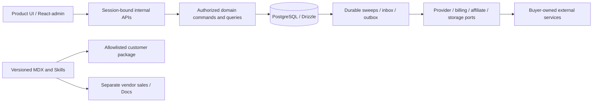

## Context

The repository still implements a website-generation platform. The new product is a source template that developers independently deploy and customize as their own AI video SaaS. D01-D31 are confirmed product scope; technical choices are selected engineering designs. This document consolidates the [detailed technical baseline](../../../docs/plans/2026-09-27-shpitto-detailed-technical-design.md), closes the five readiness ambiguities below, and defines phase ownership. It is not runtime verification.

The [requirements](../../../docs/plans/2026-09-27-shpitto-restart-requirements.md), [PRD](../../../.omx/plans/prd-shpitto-restart.md) and [acceptance catalog](../../../.omx/plans/test-spec-shpitto-restart.md) retain D/J/G/T identifiers. All paths below are future implementation targets. Current normative specs remain under this change until implementation and archive.

## Goals / Non-Goals

**Goals:** one deployable application, one domain database authority, persistent cloud-free local mode, two real providers/four mode combinations, transactional credits/billing, minimal teams, useful operations, optional external affiliates, governed customization, accurate Docs and clean independent delivery.

**Non-goals:** retaining the legacy website-generation runtime in the template; a generic builder or embedded coding agent; public generation APIs/customer API keys; a custom marketplace or commission balance system; Payload/content workflow infrastructure; annual/multi-item billing, scheduled plan changes or automatic proration; a promise that all production services can be self-hosted.

## Decisions

### 1. One change, phased execution and stable authority

Keep twelve capability specs within one coordinated restart change. Shared credit, task and payment invariants make independent closure misleading. Tasks are small execution slices with explicit dependencies; M4/M5 may run concurrently after M3. Do not check a task on the basis of another task's prose or archive a partially implemented restart. If separate releases later require change splitting, preserve IDs and record dependency/ownership changes first.

Alternative: many simultaneous OpenSpec changes. This would reduce individual folder size, but adds cross-change sequencing and duplicate ownership of shared invariants before a new baseline exists. Phase gates give bounded execution now without asserting independent releases.

Authority: explicit product decisions → capability behavior and this design → detailed technical register → historical plans. New E01-E05 are selected defaults for review, not new D-level user confirmations. Requirements cannot be weakened by technical implementation convenience. Exact external capabilities must be evidenced before their phase gate.

### 2. Selected stack and dependency ownership

| Area | Selected baseline | Evidence owner |
| --- | --- | --- |
| Runtime/frontend | Node 24 LTS; pnpm 12.6.0; Next.js 16.3.6; React/react-dom 19.3.0; TypeScript 6.0.3 | M0 isolated lock/peer/build evidence; no unsupported overrides |
| Data/identity | PostgreSQL 17; Drizzle ORM 0.45.3/Kit 0.31.11; pg 8.23.0; Better Auth and Drizzle adapter 1.7.6 | M0/M2 schema generation, reviewed SQL, session/domain integration |
| Operations/Docs | React-admin OSS 5.15.4; Fumadocs core/ui 16.15.14, MDX 15.4.5 | M0 adapter/build/license slice; M6/M7 behavior |
| UI/validation | Tailwind/PostCSS 4.3.3; selected shadcn CLI 4.21.0 with copied source provenance; Zod 4.6.5 | M0/M1 source/version/license inventory |
| Billing/jobs | Stripe 22.6.2; buyer-owned provider worker and recovery loops by default; Trigger SDK/build 4.6.4 as an optional adapter | M0 contract verification; M4/M5 recovery evidence |
| Storage/mail/media | AWS S3 client/presigner 3.1141.0; Resend 6.30.0; Nodemailer 10.0.10; sharp 0.35.4; worker FFmpeg/ffprobe 7.x | M0 pin media builds/checksums/notices; M3/M4 ingest evidence |
| Production | Vercel + Neon PostgreSQL 17 + private R2 + Resend with a buyer-owned worker by default; Trigger.dev Cloud is an optional managed task-runtime profile | M8 clean export deployment evidence |
| External products | Replicate/fal.ai four Wan 2.2 paths; buyer FirstPromoter V2; vendor Lemon Squeezy | Endpoint/model register in baseline §10; M4/M6/M8 account-backed evidence |

These are selected versions from the prior design, not freshly installed or verified in this planning task. M0 checks availability, exact lock resolution, license compatibility and upstream changes. Version replacements require a recorded reason and relevant contract regression evidence. Media tool patch/build and testing-tool exact patches are intentionally fixed by the first reviewed lock/build manifest, not guessed here.

The current application dependency evolution is bounded by [the separate replacement decision](../../../internal/restart/root-dependency-evolution.md): retain the already-adopted Next `16.3.8` patch and selected S3 client `3.1141.0` under an exact application lock, without rewriting the historical M0 prototype/provenance. The root validator rejects all other graph drift; its regression suite runs in `verify:root`. This decision requires independent engineering review and current compatibility evidence and does not approve an M4 or later gate.

Storage is one application capability with two drivers: `local` for development/demo/acceptance and `s3` for production. The `s3` driver is one bounded AWS SDK adapter shared by Cloudflare R2 and AWS S3 through endpoint/region/bucket/credential configuration; MinIO is used only for compatibility tests. Asset rows store opaque object keys and metadata, never provider URLs. Upload, provider materialization, download, delete and orphan cleanup all call the same port so changing R2 to AWS S3 does not alter domain or authorization behavior.

React-admin remains a client-only MUI/Emotion operations island with custom auth/data providers. Product UI uses shadcn/Tailwind. Fumadocs compiles trusted versioned MDX and static search. Payload would introduce unnecessary CMS/schema/auth responsibilities for V1; Refine requires more generic screen assembly. Neither is a fallback silently included in the app. Better Auth handles credentials/sessions/verification/2FA; minimal workspace invariants remain domain-owned rather than duplicated with its organization plugin.

### 3. Boundaries, data and integration control



`src/app` only validates/authenticates/authorizes and maps DTOs. `src/modules/{workspaces,credits,generation,assets,billing,affiliates,operations}` owns rules; adapters own external protocol translation. Domain code cannot import React, Next request objects or Trigger SDKs; browser code cannot import database/secrets/privileged adapters. The buyer-owned worker is the default task runtime; the optional `trigger/` registration and `src/adapters/tasks/trigger.ts` invoke the same commands without becoming domain authorities.

### 3.1 E06 — Buyer-owned task runtime

The default deployment SHALL run task dispatch, provider polling, callback inbox draining, overdue recovery and orphan cleanup in the buyer-owned provider worker. The worker SHALL use the persisted PostgreSQL outbox, leases, fencing and domain commands already shared by all execution paths. `TASK_RUNTIME=self_hosted` is the default and does not require Trigger.dev credentials.

Trigger.dev SHALL remain an optional task-runtime adapter rather than a required service. `TASK_RUNTIME=trigger` MAY be enabled only after scoped executable registration, configuration and deployment have been verified; project credentials alone do not establish an operational runtime. The current build rejects that selection explicitly. The future Trigger adapter SHALL call the same bounded domain commands and SHALL NOT create a second settlement, storage or authorization authority. An environment SHALL select exactly one task runtime; running the self-hosted worker and Trigger dispatcher for the same outbox scope is not a supported deployment.

This user-approved amendment is dated 2026-10-15. It changes the default orchestration profile, not the generation, credit, provider, storage or webhook contracts. The current real-provider worker remains fenced to its isolated Railway acceptance project, private database and assigned workspace. Generic buyer-owned production/Docker deployment remains an M8 implementation and verification obligation; this amendment does not remove those fences or claim that release profile is operational.

The full table/key/constraint register is baseline §4, including supplements §§6.4, 9.4, 10.7. Composite workspace keys prevent cross-tenant joins; money and credits are different integer quantities, JSON encoded as decimal strings. Auth IDs keep their native text representation. One reviewed Drizzle migration chain manages both auth and domain tables. Deploy migrations use the documented direct connection/advisory lock, never an HTTP request or second CMS migration engine.

Credit mutations serialize through the account row with immutable allocations/ledger. Cross-domain billing uses workspace → billing → credit → order → task/grants lock order. Business mutation, command result, successful privileged audit and outbox append commit together; vendor calls occur outside the database transaction behind persisted idempotency/lease/fencing state. No admin generic CRUD writes balances or terminal outcomes.

### 4. E01 — Minimal workspace ownership

Selected default closing the prior unspecified personal/team distinction:

- A personal workspace has exactly its creator as immutable owner. It cannot invite members, transfer ownership, leave, demote its owner or convert itself into a team.
- Teams are separate workspaces with separate tasks, assets, billing and credits. No silent migration of personal balances or referrals occurs when a user creates a team.
- A team owner may invite/remove members. Ownership transfer targets an existing active, verified member of that team; validate under the same workspace lock as the transfer. The final owner cannot be removed/demoted; concurrent mutations must preserve the invariant.
- User and workspace suspension records belong to the domain policy (for example `user_access_controls`), without inventing a second credential store or directly editing Better Auth internal fields. Suspended accounts keep financial/history references for recovery.

Implementation evidence belongs to M2/T02-T05 and administrative recovery M6/T04/T59. This narrows unimplemented permissions rather than adding a complex organization product.

### 5. E02 — Account, workspace and billing restrictions

| Condition | Login/session | History/download | Invite/transfer | New generation | New Checkout | Portal/support | Existing worker delivery/settlement |
| --- | --- | --- | --- | --- | --- | --- | --- |
| User disabled | Deny/revoke affected user | Deny affected user | Deny affected user | Deny affected user | Deny affected user | Authenticated operations denied; out-of-band support remains | Continue for workspace; other active members unaffected |
| Workspace suspended | Account may access other workspaces | Deny member access in suspended workspace | Deny | Deny | Deny | Deny workspace-scoped authenticated Portal; out-of-band support remains | Continue bounded work and settlement; authorized operators retain audited inspection/recovery |
| Billing hold only | Allow | Allow with normal membership checks | Allow normal owner permissions | Deny | Deny | Allow owner Portal and support | Continue and settle with original lineage |

Combine restrictions by the most restrictive applicable result. Every request rechecks live domain membership/status/global operator role. Suspension never manufactures refunds, deletes records, cancels a paid provider job or bypasses terminal settlement. Restore by a reasoned, idempotent, audited operator command; a disabled operator cannot use its own prior role to bypass account disablement. Role changes and account disablement share an administrative-ownership lock and MUST preserve at least one active superadmin. Lost credentials require an explicit audited server-side recovery procedure rather than a reopened public bootstrap route. This closes the prior missing suspension matrix.

### 6. E03 — One provider contract

The earlier §7 and §10.2 method names differed. Use this single contract for Mock and both live providers:

```ts
type ProviderPort = {
  capabilities(modelKey: string): ModelCapabilities;
  validate(input: VideoInput): ValidatedVideoInput;
  submit(attempt: SubmissionContext): Promise<SubmitResult>;
  getStatus(ref: ProviderRequestRef): Promise<ProviderObservation>;
  readResult(ref: ProviderRequestRef): Promise<ProviderResult>;
  verifyWebhook(rawBody: Uint8Array, headers: Headers): Promise<VerifiedObservation>;
};
// SubmissionContext contains validated input, immutable catalog snapshot and persisted attempt correlation.
// SubmitResult = accepted(requestId) | definitelyRejected(code) | unknown(evidence).
// ProviderObservation contains queued/running/completed/failed, stable request identity and vendor evidence.
// ProviderResult = outputCandidates(validated locations/metadata) | failed(code) | unavailable(evidence).
```

Status `completed` is only an observation. `readResult` exposes output candidates and errors; the domain must still materialize and validate durable output before success. Authenticated callbacks may include result candidates but never settle credits directly. Provider secrets/raw fetch URLs/prices are absent from public DTOs. The selected model catalog contains vendor endpoints, exact version or schema digest, supported options and tariff versions. §10 remains the single endpoint mapping register.

The local Mock implements this same port and persistent state. A timeout is `unknown`, not proof of rejection. No blind second paid submission, no invented provider idempotency support, and no similarity match to recover an unknown request ID. Replicate/fal authentication uses documented raw-body signatures, not just a nonce. Provider-created output alone is not delivery.

### 7. Lifecycle and credit policy

Reserve eligible grants FEFO using server quotes and account-row serialization. Preserve allocation kind, original expiry and lineage. Duplicate command with a different payload conflicts. Cancellation is permitted only before the atomic dispatch claim; cancellation after grant expiry returns the amount to expired state and does not create failure compensation.

Failure without usable delivered video refunds allocations once despite upstream cost. Expired subscription allocations yield one seven-day compensation grant from refund time. Compensation refund retains original compensation expiry; repeated failure does not renew it. Permanent purchases remain permanent; mixed refunds keep each source rule. Terminal late/conflicting events enter quarantine, never reopen or silently re-debit.

| Stage | Selected upper bound | Recovery authority |
| --- | --- | --- |
| Queued before dispatch | 10 minutes | Independent sweep fails/refunds when starved |
| Submission HTTP | 30 seconds | Persisted unknown attempt on ambiguous response |
| Unknown submission | 60 minutes; maximum 24 probes; alert at 30 minutes | Authenticated correlation/reconciliation, then terminal delivery failure |
| Known inference | 60 minutes from dispatch | Poll/callback observation under stored deadline |
| Materialization | 30 minutes; maximum 8 attempts | Private owned object with integrity/media proof |
| Overall after dispatch | 90 minutes | No retry resets deadline; stale state advance rejected |

The buyer-owned worker runs dispatch, inbox and cleanup loops continuously and runs the independent deadline sweep at least every sixty seconds; local development and the isolated Railway worker use a ten-second interval. A separately verified optional Trigger schedule may provide the same sweep. Claim leases with owner/token/generation and compare-and-set completion; a reclaimed lease never grants a new paid-submit right. Sweep is independent of the original job but cannot run through total database/runner outage. On restore, drain overdue work in bounded batches before accepting progress; an unfinished or nonprogressing backlog defers dispatch. Heartbeat older than three minutes alerts. Independent loop freshness affects readiness, but in-memory readiness alone does not prove durable external heartbeat/alert delivery. Boundary races, crashes and stale acknowledgements are required M3/M4 cases.

### 8. E04 — Deliberately bounded subscription lifecycle

V1 uses monthly subscriptions with one configured recurring price and independent permanent-credit packs. It does not implement scheduled plan changes, annual plans, multi-item subscriptions or proration. Portal configuration must hide unsupported plan-switch paths. Cancel at period end, retain original grant expiry, then permit a new purchase only after authoritative reconciliation proves the previous subscription ended. A catalog price edit changes future purchases; existing subscriptions need a separately designed explicit migration.

This replaces the earlier vague next-cycle scheduled-change promise. T23 covers cancellation, renewal, payment failure and cancel-then-repurchase. If scheduled upgrade/downgrade becomes required, it needs its own pending-change state, Stripe mapping, replacement/cancellation behavior and failure scenarios before implementation.

Billing keeps persisted Checkout attempt slots and Stripe idempotency keys before the external call. Ambiguous responses retain the slot. Reconciliation uses canonical invoice/PaymentIntent/session aliases, fenced authoritative reads and the cross-domain lock order; browser returns cannot grant credits. Refund/dispute-before-payment prevents a fresh automatic grant; duplicates and reordered events cannot reverse the same economic loss twice.

Full unused cash refunds revoke only their attributable unspent credits. Partial, reserved/consumed or disputed amounts create recovery cases and hold new generation/Checkout; active tasks still settle. Cash refund eligibility and legal terms remain commercial inputs. Never confuse an in-app generation-credit refund with a cash refund or affiliate reversal.

### 9. E05 — Deterministic affiliate attribution and corrections

The optional buyer program uses FirstPromoter V2 server tracking and `uid=workspace:<uuid>`. Disable duplicate native Stripe sale tracking. Selected default: last valid creator touch within 30 days before workspace creation, captured in a signed, Secure/HttpOnly first-party referral token, validated against the configured provider/program through its supported contract. Invalid/expired references are discarded; transient verification failure stays pending/held, not represented as verified attribution. Seal the creator reference at workspace creation; later members, payer changes or referral touches cannot replace it. Resolve a held captured reference without accepting a later touch. No referral means no commission, but the first-payment slot is still consumed.

First sale export waits five minutes and reconciles all historical Stripe customer mappings, ordering canonical payments by paid time and stable ID. FirstPromoter native `By count = 1` is the default; send subsequent verified payments with the same UID so supported campaign configuration can work. A deliberate `provider_campaign` revision must match provider configuration; it cannot silently override the documented default. A late older payment creates a conflict hold and audited repair, not a rewritten history or local reward ledger.

Unique incremental cash refunds reference the original sale. If a dispute is won after external commission denial/reversal, retain a manual correction case and payout hold until supported vendor correction is independently verified and audited. Never create a new first-payment reward or blindly replay sale events. Third-party commission values and payouts remain provider-owned.

Persist review/denial state, account checkpoint and campaign revision. Synchronize at least every five minutes, refresh relevant authoritative records within 60 seconds of approval/handoff, and fail closed if any required hold/denial lacks confirmation. Manual hosted payout handoff is supported; it is not a claim of a direct payout API or authority to transfer live funds. External dashboard use can bypass app controls, so document procedures and leave automatic disbursement off by default. Self-identity matches and the selected >3 new referred workspaces/24h signal trigger review, not a hidden user-lifetime eligibility cap.

### 10. Customization, Docs and customer delivery

Twelve canonical Skills target external coding agents. Four personalization Skills alter the buyer's own video SaaS. The shipped default is a coherent presentation baseline: `src/config/brand.ts` owns named colors, typography and spacing/control tokens; `src/app/globals.css` binds those tokens to marketing, auth, product and admin shells; shared navigation uses the same control height, radius, focus, hover and disabled semantics. `customize-brand` and `customize-site` are the supported Skill surfaces for changing those tokens and shared-shell presentation. Scope classifiers and trusted validators come from outside the candidate diff. Required behavior checks catch indirect breakage as well as forbidden paths. Bind evidence to staged source, lockfile, contracts/configuration digest and validator version; exporter/deployer rejects stale or missing proof. Rebaseline policy changes through engineering review. Rollback only attributable changes and surface overlapping user work before destructive recovery.

The local Mock profile is also a first-class experience contract. A seeded demo account must be able to traverse login, personal/team workspace and invitation management, Mock success/failure/cancel/unknown recovery, credit and asset history/download, fixture billing, operations/admin views and restart persistence. These results are labeled local/mock evidence; real provider, payment and production evidence remains separately gated.

Fumadocs reads release-tagged trusted MDX for template, all Skills and actual internal API/integration references. Public documentation does not enable the deferred public generation API. Export buyer content from the same release source without vendor shell, accounts or credentials. English product defaults retain an i18n seam; Chinese engineering review is not a change to D06.

Source commerce uses a separate vendor Lemon Squeezy program and per-customer clean private repositories plus versioned ZIPs. Manual Beta provisioning is acceptable. Acquired versions keep working; twelve-month updates/support govern access to later source, not runtime licensing. Shared repositories exposing every future commit cannot enforce expired update access. Export from an explicit allowlist to fresh staging, exclude old history/private state/legacy/vendor secrets, validate there and bind evidence to exact bytes.

## Risks / Trade-offs

| Risk | Mitigation and evidence |
| --- | --- |
| Selected package metadata fails integration | Isolated M0 lock/build/auth/admin/Docs/media slice; review deviations before migrating root |
| Multiple agents mutate shared schema/ledger | Single domain owner, explicit file ownership, freeze interfaces before M4/M5 parallel work |
| External side effect succeeds while local response fails | Persist intent/idempotency, fenced reconciliation, independent sweeps and audited terminal policy |
| Billing/affiliate events arrive out of order | Canonical payment reducer, historical customer mapping, first-sale delay, manual conflict/denial holds |
| Framework reuse bypasses authorization/transactions | Server permission checks, no protected generic CRUD, actual PostgreSQL failure/concurrency evidence |
| Customization self-certifies or leaks vendor data | External trusted validation baseline, exact staged digest, clean export and fresh-copy proof |
| Source migration loses ignored local work | Inventory, hash verification, safe destination checks and reversible restoration map before move |
| Schedule pressure weakens complete V1 promise | Gates over dates; no real-provider/paid-Beta claim while required external evidence is blocked |

Pre-mortems: (1) an unknown paid submission retried by a recovered worker doubles spend—prove stale-lease and no-resubmit cases; (2) refund-before-paid or old network responses grant credits—prove canonical reducer/fencing cases; (3) commission denial remains asynchronous while payout opens—prove account checkpoint and denial-confirmation gates.

## fal.ai webhook verification

The fal.ai integration uses the provider-documented webhook protocol. Submission sends the final HTTPS callback URL through the queue request webhook parameter. The receiver verifies the raw request body with fal.ai JWKS keys from `https://rest.fal.ai/.well-known/jwks.json`, caches the key set for no more than 24 hours, validates the request ID, user identity, timestamp and signature headers, and acknowledges the inbox before asynchronous materialization or settlement. The receiver returns a bounded 2xx response quickly and treats duplicate deliveries as idempotent. Operators do not copy a PEM public key from the fal.ai console; the provider JWKS endpoint is the source of truth. Production provider catalog enablement remains separate from the acceptance profile and requires the M4 evidence gate.
### Isolated Railway provider worker

The Railway Demo/acceptance deployment uses a separate Node worker process as the default self-hosted task runtime, not the local Mock worker or a new backend domain authority. It reuses the same PostgreSQL task/reservation/outbox commands, provider adapters and private S3-compatible storage. Activation requires an explicit acceptance profile, matching Railway project binding and a single workspace allowlist. New paid creates are disabled by default. Before any provider POST the worker persists a submission-start fence; a restarted or stale owner may only reconcile that attempt, never create again. Input capabilities cover only an already-authorized workspace image and expire within one hour. Outputs pass bounded download, media validation and ready-asset publication before settlement; missing provider costs remain UNKNOWN.

An explicitly authorized one-shot acceptance probe may bootstrap an unconfirmed Fal account only in the isolated Demo project. It seeds a fresh workspace, enforces the approved preset and reference-price ceiling, persists a pre-POST fence and the exact API-returned request ID, and never retries an ambiguous paid create. Only a JWKS-verified callback correlated to that persisted request/attempt may establish the account binding. The ordinary worker paid-create guard remains unchanged; background creates remain disabled, and temporary recovery is restricted to that newly seeded workspace. Fixture authentication identities and unknown provider costs must remain explicitly labeled in evidence.

Independent deadline sweep and workspace-scoped cleanup run outside dispatch polling. Worker startup applies migrations through the existing locked migration runner and fails closed on missing schema/media tools. Deployment health and fixture restart evidence do not imply real provider callbacks or real-account M4 completion; optional Trigger profile evidence is recorded separately and is not required when the self-hosted runtime is the selected profile. Task 5.10 remains open until all applicable mandatory evidence and independent review are current.

## Migration Plan

1. M0 inventories root/Git/local authored files, establishes the relocation/preservation map and disposable selected-stack evidence, and checks configured hosting dependencies read-only. Preserve work before choosing the exact move list.
2. M1 verifies resolved absolute paths are inside approved root/archive targets, preserves snapshots and hashes, keeps `.git`, and moves only mapped source into `legacy/shpitto-platform/`. No recursive deletion or overwrite of conflicts. Replace root tooling only after preservation proof.
3. Establish new root guidance, schema owner, local prerequisites and explicit exclusions. Keep baselines/OpenSpec outside legacy. Do not inherit old workspace/deployment globs or credentials implicitly.
4. Implement M2/M3 with real local PostgreSQL and durable Mock flows. Freeze shared contracts; M4/M5 can then proceed independently. Complete admin/affiliates, Skills/Docs and release evidence in dependency order.
5. Database rollout uses expand/backfill/switch/contract and a migration lock. Application rollback requires backward-compatible schema plus explicit worker/version handling; irreversible data migrations require a tested backup/restore plan before execution. Do not assume down-migrations undo external payments.
6. Validate a clean customer staging copy, then deployment recipes. Publishing/private-repository provisioning and paid Beta remain separately authorized external actions. Do not archive this OpenSpec change until all implementation tasks and applicable G01-G31 evidence are complete.

Source rollback restores only mapped paths using recorded pre-move hashes, preserving unrelated new work. If root/legacy paths changed after the snapshot, stop destructive restoration and reconcile per file. New online deployment cutover or old-service retirement needs its own concrete runbook and authority; source migration itself makes neither change.

## Staged acceptance

The [acceptance contract](acceptance-gates.md) defines M0–M8 entry conditions, mandatory results, environments, evidence, independent review, failure handling and invalidation. Its [initial register](acceptance-status.json) starts every gate at NOT_STARTED; the [record template](acceptance-record.template.json) is a future evidence carrier, not CI enforcement or an implementation pass. Gate policy/validation commands are implemented under 1.7/2.3 and integrated with final packaging under 9.14/9.15.

M8-RC, M8-BETA and M8-STABLE are separate checkpoints within existing task 9.15. BETA PASS permits an accurate paid-Beta-ready label under scoped commercial authority; 9.15 stays open until STABLE PASS. Stable requires representative observed journeys, recovery/upgrade, monitoring and Beta issue closure on current candidate bytes. Record the observation plan/window at RC, rather than inventing a calendar duration or user-count target. This adds no implementation task or product capability.

## Open Questions

No unresolved behavior ambiguity is intentionally delegated to an implementation agent. E01-E05 are explicit selected review defaults; E06 records the user-approved task-runtime amendment dated 2026-10-15. Changing one updates its spec, scenarios, tasks and applicable review surfaces before dependent implementation.

Remaining inputs have scoped gates:

| Input | Owner | Latest gate | Independent work allowed |
| --- | --- | --- | --- |
| Exact lockfile/media builds/provenance and current upstream contract availability | Engineering | M0 gate 1.8 | Inventory and documentation |
| Provider accounts/regions/model eligibility and authorized small spend cap | Owner/integrations | M4 real-evidence task 5.9 / gate 5.10 | Mock, contract fixtures, recovery logic |
| Subscription price, pack sizes and production quote/cost policy | Product/billing | M5 production catalog; before M8 sale | Deterministic fixture catalog and test-mode flows |
| FirstPromoter account/campaign eligibility, commission rate, commercial hold/minimum/payout method | Owner/integrations | M6 account-backed gate 7.14 | Disabled path, adapter fixtures, review-state implementation |
| Source license project/seat/redistribution rights, support terms and cash-refund terms | Owner | M8 paid-Beta authorization | Clean packaging, draft checkout/configuration |
| Live accounts/domain/hosting budgets and publication authority | Owner/release | M8 real deployment/publication | Local builds and staging artifacts |

Thirty-day attribution is the selected engineering window; a commercial commission waiting period is a separate input and must not be conflated with it. Historical review approvals do not certify this supplement; its own documentary review is recorded separately.
