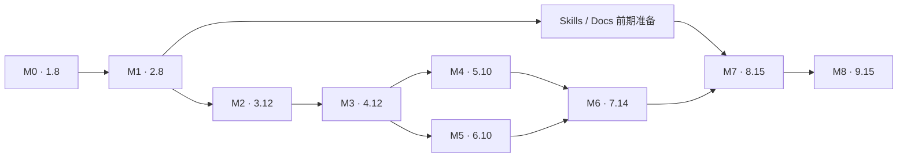

# Shpitto 项目重启：OpenSpec 完整中文审核入口

日期：2026-09-27  
变更：`restart-shpitto-video-saas`  
范围：正式规格、详细设计与实施任务；应用实现仍待执行。

## 1. 本次交付与阅读顺序

已将原有 D01–D31 产品要求、J1–J10 用户流程、G01–G31 验收门和 T01–T62 用例族，整理为一个完整 OpenSpec 变更。能力规格分为十二份，实施按 M0–M8 推进。旧源码仍在原处；文档完成不代表源码归档、应用重建或真实集成已经完成。

| 顺序 | 文档 | 审核内容 |
| --- | --- | --- |
| 1 | 本文 | 决策状态、五项边界补充、基础工程完整规格和 M0/M1 任务、依赖与发布输入 |
| 2 | [核心功能完整中文稿](shpitto-restart-core.zh-CN.md) | 身份／空间、积分、生成与供应商；全部对应场景；M2/M3/M4 的 35 项任务 |
| 3 | [账单、运营与联盟完整中文稿](shpitto-restart-commercial.zh-CN.md) | 现金支付、管理后台、联盟归因／审核／纠正；全部场景；M5/M6 的 24 项任务 |
| 4 | [Skills、Docs 与交付完整中文稿](shpitto-restart-delivery.zh-CN.md) | 十二个 Skills、文档、部署、源码销售和客户交付；全部场景；M7/M8 的 30 项任务 |
| 5 | [完整需求追踪表](../changes/restart-shpitto-video-saas/traceability.md) | D/J → 能力／REQ → SC → T → 任务 → G/M；可按编号核查覆盖 |
| 6 | [原详细技术方案中文版](../../docs/plans/2026-09-27-shpitto-detailed-technical-design.zh-CN.md) | 已选版本、数据模型、算法、接口、供应商映射和部署细节；本文补充规则优先 |
| 7 | [正式任务表](../changes/restart-shpitto-video-saas/tasks.md)、[设计](../changes/restart-shpitto-video-saas/design.md)、[提案](../changes/restart-shpitto-video-saas/proposal.md) | 英文工程执行依据，与上述中文稿使用同一编号 |

前三份分册提供完整需求、场景及任务说明，不是摘要。本入口补齐基础工程部分。正式规格和任务使用英文；中文作为完整审核视图。发现差异时同时修订两种语言，不能用翻译差异修改已确认范围。

新增：[阶段验收制度与完整标准](stage-acceptance.zh-CN.md)明确 M0–M8 的准入、必过条件、证据、独立复核和失败返工。沿用 105 项任务，M8 分为 RC、付费 Beta、稳定版三个检查点；9.15 仅在稳定版验收通过后完成。当前 M0 为 `IN_PROGRESS`，其余阶段和三个发布检查点仍为 `NOT_STARTED`。

## 2. 决策状态和文档优先级

| 状态 | 当前含义 |
| --- | --- |
| 已确认产品需求 | D01–D31，包括开发者源码模板、基础团队、两供应商四条真实路径、后台、联盟、受约束 Skills、Docs 和开源优先 |
| 已选工程方案 | Next.js／React／PostgreSQL／Drizzle／Better Auth；React-admin OSS；Fumadocs；Stripe；Trigger；Replicate/fal；FirstPromoter；Lemon Squeezy 源码销售。具体版本见详细方案 |
| 本轮补充默认值 | 下节 E01–E05，补齐实施边界；它们是工程方案选择，不倒写成用户在此前逐项确认的商业政策 |
| 后续业务／外部输入 | 价格、积分数量、佣金比例、商业退款和许可条款、真实账号资格、付费验证预算及正式发布安排 |
| 文档校验 | 检查 OpenSpec 格式、编号、依赖、链接和覆盖关系；不证明软件或外部账号实际可用 |
| 实施验收 | 实际实现后取得对应环境、源码摘要、用例和观察结果，才能勾选任务及验收门 |

优先级：用户明确决定及 D 项范围 → 当前 OpenSpec 规格／设计 → 详细技术登记表 → 历史计划。保留历史评审结论，但此前评审不会自动批准本轮新增文字。

本次采用一个完整变更，原因是积分、任务、账单及交付契约相互依赖；通过编号任务和阶段门控制实施规模。不能因为 M1 或某个能力完成，就归档整个重启变更。若将来需要独立发布多个变更，先明确依赖和唯一需求归属，再拆分。

## 3. 五项边界补充

### E01：个人空间与团队空间

个人空间只有创建者本人，所有权不可转移，不允许邀请、退出、降级或转为团队。协作需创建独立团队；不自动迁移个人积分、账单、资产或推荐关系。团队所有权只能转给已经属于本团队、有效且已验证的成员；转让及成员移除在同一工作区锁下检查，不能并发产生“没有所有者”的团队。此默认值在 M2 验证。

### E02：账号停用、空间暂停与账单冻结

| 状态 | 登录及会话 | 历史／下载 | 邀请／转让 | 新生成 | 新 Checkout | Portal／支持 | 已接受的后台任务 |
| --- | --- | --- | --- | --- | --- | --- | --- |
| 用户停用 | 拒绝并使该用户旧会话失效 | 对该用户拒绝 | 拒绝 | 拒绝 | 拒绝 | 拒绝认证内操作；保留站外支持方式 | 工作区任务继续；其他有效成员不受该用户停用影响 |
| 工作区暂停 | 账号仍可使用其他空间 | 对该空间成员拒绝 | 拒绝 | 拒绝 | 拒绝 | 不开放该空间 Portal；保留站外支持 | 继续按有限期限处理及结算；授权运营者可审计查看／恢复 |
| 仅账单冻结 | 允许 | 按原成员权限允许 | 按原所有者权限允许 | 拒绝 | 拒绝 | 所有者可进入 Portal／支持 | 按原积分来源继续结算 |

多种限制同时存在时取更严格结果。每次请求检查当前权限和状态。暂停不会自动撤销财务记录、制造退款或重新提交供应商任务；恢复使用带原因、幂等和审计的运营命令。停用的运营账号也不能依赖旧角色绕过限制。角色修改与账号停用必须使用统一的管理权锁，始终保留至少一位有效 superadmin；丢失凭据时按明确的、留审计的服务端恢复流程处理，不重新开放公共初始化入口。

### E03：唯一供应商接口

Mock、Replicate、fal.ai 统一使用 `capabilities`、`validate`、`submit`、`getStatus`、`readResult`、`verifyWebhook`。`completed` 仅表示观察结果，读取输出候选／错误后，仍须取得并验证自有持久化资产，领域任务才能成功。浏览器不得指定可信积分报价、供应商密钥或任意远程下载 URL。

提交返回“已接受”“明确未接受”或“不确定”。网络超时不是明确拒绝，不能据此再次付费提交。Nonce 仅用于关联，不能代替签名认证。详细方案原先两套接口名称已经统一。

### E04：V1 订阅范围

采用一个月度循环价格和永久积分包。不实现年付、多订阅项、预约换套餐、期中升级或按比例结算。所有者可以到期取消；权威对账确认旧订阅结束后才可重新购买。原积分继续遵循原批次到期时间。

Stripe Portal 隐藏未支持的改价／换套餐入口。商品目录变价只影响未来购买；已有订阅变价须另外设计迁移。这取代历史文档不完整的“预约下周期变更”承诺。未来若增加升级降级，需要补充待生效状态、替换／撤销、Stripe 对象及失败处理后再实施。

### E05：联盟归因及争议纠正

默认取创建工作区前 **30 天内创建者最后一次有效触达**，通过签名、Secure、HttpOnly 的第一方推荐令牌保存，并按第三方支持的契约核验服务／项目／引用。无效或过期来源丢弃；临时核验失败保留原候选并冻结待核验，不当作已确认归因。创建工作区时固定候选，后续成员、付款人或新触达不可替换；可以恢复核验原候选，不能借此补入后来推荐。

无推荐来源仍消耗工作区首笔付款资格，但不产生佣金。首笔销售上报先等待五分钟，并查询历次 Stripe Customer 映射，以实际付款时间和稳定 ID 排序。FirstPromoter 原生单笔上限是默认；买家主动选择其他受支持计划时，必须同步本地策略版本与第三方配置。

现金争议胜诉但第三方佣金此前已撤销／拒绝时，保留人工纠正案件及付款冻结，待第三方支持的纠正被核验并审计后解除。不能盲目重放 sale、重新获得首付奖励或本地计算一套佣金余额。审核／付款入口仍须账户同步检查、60 秒内权威刷新、所有冻结与拒绝结果已确认；自动打款默认关闭。**归因 30 天与商业佣金等待期是不同参数。**

## 4. 基础工程完整规格

对应英文：[restart-foundation](../changes/restart-shpitto-video-saas/specs/restart-foundation/spec.md)。

### REQ-FND-01：可恢复的源码保全

迁移前必须记录已跟踪文件、需保留的未跟踪／忽略文件、Git 状态及路径归属，保存内容摘要和恢复映射。`.git` 留在根目录，密钥仅在私有位置保全，不进入客户包。移动源码不等于停止线上服务。追踪：D02/D14，J1/J9，T44/T46，G02/G14。

| 场景 | 当 | 则 |
| --- | --- | --- |
| SC-FND-01 | 按已审查清单迁移 | 每项都有校验通过的目标内容或明确保留位置；历史可达；未列入的文件不被覆盖 |
| SC-FND-02 | 内容已变化、目标冲突或保全清单漏项 | 在破坏性替换前停止，报告具体冲突，保留双方内容供恢复 |
| SC-FND-03 | 旧源码进入 `legacy/shpitto-platform/` | 不因此删除／停用现有部署、托管项目、账号或远程资源 |

### REQ-FND-02：根目录重建与旧项目隔离

新根目录必须独立运行；安装、构建、检查、测试发现、格式化、容器上下文及导出显式排除 legacy 和销售站专属代码。销售站使用另行命名的命令。新指导文件服务新模板，旧指导随旧源码保留。追踪：D01/D02/D14/D16，J1/J9，T44–T47，G01/G02/G14/G16。

| 场景 | 当 | 则 |
| --- | --- | --- |
| SC-FND-04 | 临时 legacy 样本故意包含错误源码／依赖，新根命令运行 | 样本不被安装、编译、发现为测试、格式化、打包或导出 |
| SC-FND-05 | 开发者进入新根或旧项目目录 | 使用各自适用的指导入口，新产品不继承无关的网站生成修复规则 |

### REQ-FND-03：技术选定必须取得集成证据

使用已选版本或经记录的替代决策；依赖解析、兼容性、许可、后台适配、迁移所有权、Docs 构建及交付均需证据。上游声明不能代替运行验证。追踪：D15/D31，J1/J7/J9/J10，T59–T62，G15/G31。

| 场景 | 当 | 则 |
| --- | --- | --- |
| SC-FND-06 | 在独立临时原型中评估已选组合 | 保存锁文件、来源／许可、集成结果及替代原因，不用不受支持的依赖覆盖掩盖冲突 |
| SC-FND-07 | 依赖、再分发许可或必要外部契约无法验证 | 对应门槛保持未解决，由负责人调整；不能把“选了这个方案”写成通过 |

### REQ-FND-04：本地持久化前置条件

买家具备 Node、pnpm、Docker 即可在无云密钥时初始化数据库、邮件捕获、worker／媒体工具及持久化资产。演示驱动明确标识，在生产拒绝使用。追踪：D07/D15/D18，J1/J3/J9，T01/T47/T48/T62，G07/G15/G18/G31。

| 场景 | 当 | 则 |
| --- | --- | --- |
| SC-FND-08 | 干净客户副本使用本地示例环境启动，无外部密钥 | 必要服务通过文档命令初始化，不依赖未声明的全局工具或内部工作目录 |
| SC-FND-09 | 不删除声明的数据卷，重启应用及依赖容器 | 账号、空间、领域记录及资产保留，待处理工作可恢复 |
| SC-FND-10 | 生产配置使用 Mock、演示积分、本地邮件／存储或示例密钥 | 接收流量前拒绝启动／部署，输出可操作且脱敏的错误 |

### REQ-FND-05：单一数据权威和事务底座

认证表及领域表使用同一 Drizzle 迁移序列；框架、后台不得另建成员、积分、支付或任务权威。跨模块遵守事务及锁顺序，HTTP 请求不执行迁移。追踪：D05/D15/D22/D31，J5/J7，T04/T59–T61，G05/G15/G22/G31。

| 场景 | 当 | 则 |
| --- | --- | --- |
| SC-FND-11 | 两个部署实例同时尝试认证／领域迁移 | 单一所有者及部署锁串行执行，不存在第二套 CMS 迁移或请求时推送结构 |
| SC-FND-12 | 后台原型命令在领域、账本、审计或 outbox 步骤注入失败 | 不留下部分成功的业务变更；重试不重复生效 |

### REQ-FND-06：阶段证据与外部输入

各阶段必须按[阶段验收制度](stage-acceptance.zh-CN.md)提交当前候选、环境与 SC/T 证据，经过独立复核及集成人记录后才能通过。强制条件须全部通过；失败或受阻阻止依赖任务完成。相关源码、结构、配置或政策改变后，受影响证据标为 STALE 并复核重验，任务勾选不能替代阶段记录。

每阶段记录依赖、观察结果、未解决输入及恢复点。缺失、模拟或阻塞证据不能满足真实执行门槛；账号、商业条件和预算只阻塞依赖它们的任务，独立本地工作可继续。追踪：D03/D10/D19/D31，J3/J9，T01/T48/T49/T62，G03/G10/G19/G31。

| 场景 | 当 | 则 |
| --- | --- | --- |
| SC-FND-13 | 缺少供应商／联盟账号资格、凭据或费用授权 | 标明负责人、原因和阻塞任务；允许独立本地工作；不报告真实供应商／付费 Beta 已通过 |
| SC-FND-14 | OpenSpec 校验成功，但实现没有实际证据 | 只报告计划有效；缺少实施证据的阶段保持 NOT_STARTED，独立复核与当前环境证据齐备后才可通过；任务仍未完成，不归档、不声称部署或发布完成 |

## 5. M0/M1 完整任务清单

每项均是后续实施任务，当前不得勾选。路径是计划目标，不表示文件已经实现。每项完成标准包括目标结果及指定证据；下述 `SC` 见上一节，`T` 见原验收规格。

### M0：现状保全与已选技术验证

| 编号／任务 | 目标位置 | 依赖 | 完成标准与证据 |
| --- | --- | --- | --- |
| 1.1 建立源码、Git 和本地资料保全映射 | `internal/restart/{inventory.json,relocation-map.json,restore.md}` | 实施授权 | 只读盘点跟踪／未跟踪／忽略资料、摘要、改动、保留位置和托管依赖；明确目标冲突；此项不移动源码。SC-FND-01/02/03；T44/T46 |
| 1.2 独立原型验证依赖和许可 | `internal/spikes/selected-stack/`、依赖决策和 provenance 清单 | 1.1 | 解析冻结锁，验证 peer／构建，固定复制组件及媒体工具来源／摘要／许可；有依据替换版本，不改旧锁文件。SC-FND-06/07；T52/T62 |
| 1.3 验证认证、后台与事务切片 | 原型 `auth/admin/domain`、`admin-integration.md` | 1.2 | Better Auth 会话、独立角色读接口、带审计积分命令及迁移；证明直接接口拒绝、角色撤销和领域／账本／审计／outbox 故障原子性。SC-FND-11/12；T04/T59–T61 |
| 1.4 验证 Docs、媒体工具及独立打包 | 原型 `docs/worker/packaging`、打包记录 | 1.2 | 版本化 MDX／搜索可构建，后台隔离及 standalone 打包可用，worker 容器可探测媒体而不依赖宿主 FFmpeg；记录许可。SC-FND-06/08；T57/T62 |
| 1.5 核对外部契约及账号／预算前提 | `integration-matrix.md`、`external-inputs.json` | 1.2 | 官方当前模型／签名／重试、Stripe 标识、联盟 UID／推荐核验／活动／审核和销售契约有依据；外部资格／费用阻塞映射到具体任务。SC-FND-07/13；T11/T22/T25/T27/T30/T53 |
| 1.6 冻结契约登记表与 E01–E05 | `contract-register.md`、规格与契约设计输入 | 1.3/1.4/1.5 | 接口、DTO、数据所有权、锁顺序及五项默认规则无冲突；任何偏离先同步规格、场景和双语视图。SC-FND-05/11；T05.a/T22/T27/T59 |
| 1.7 建立验证命令、用例归属与证据约定 | `verification-plan.md`、`evidence-index.json` | 1.6 | 每项 T/SC/G 有负责人；按阶段制度定义条件／环境记录、状态转换、独立复核和摘要失效，实施初版记录检查器并记录后续 CI 接线命令；定义真实本地数据库、时钟、适配器、脏工作区和导出样本；核心领域分支覆盖至少 80%，资金／隔离／状态必需场景全部通过，不以覆盖比例替代。SC-FND-13/14；T01–T62 |
| 1.8 M0 独立评审门 | `m0-evidence.md`、迁移映射 | 1.1–1.7 | 本地技术切片及保全证据完整，契约有唯一负责人，外部后续前提明确；本地技术失败未解决不能替换根目录。SC-FND-01/02/06/07/11/12/13/14；G02/G15/G31 的基础证据 |

### M1：可逆归档与新根目录骨架

| 编号／任务 | 目标位置 | 依赖 | 完成标准与证据 |
| --- | --- | --- | --- |
| 2.1 迁移前重新快照并校验 | `pre-move-manifest.json`、私有备份、legacy 目标规划 | 1.8 | 复核源码、忽略资料、Git 及目标冲突，验证绝对路径位于批准范围；不一致时停止且不覆盖。SC-FND-01/02；T44 |
| 2.2 按清单移动旧项目 | `legacy/shpitto-platform/**`、`post-move-manifest.json` | 2.1 | 只移动列明路径，保留根 `.git`、OpenSpec 和批准规划，校验前后摘要，在临时副本演练恢复；不停止现有线上服务。SC-FND-01/02/03；T44 |
| 2.3 新根清单、工具及配置 | 根 package／lock／tsconfig／Next／检查配置、ignore、环境示例及校验 | 2.2 | 将验收记录／依赖／摘要检查接入新验证命令和 CI 入口；仅采用已验收依赖，移除旧 workspace／部署假设，命令显式排除 legacy/vendor；本地与生产配置及示例密钥规则明确。SC-FND-04/06/10；T45/T46/T62 |
| 2.4 数据库、接口边界与迁移执行器 | `src/db`、`scripts/migrate.ts`、共享领域／适配器及导入规则 | 2.3 | 定义事务／ID／时间／错误，直连迁移和锁；禁止浏览器秘密依赖和领域导入框架；不继承旧模型或请求时推送结构。SC-FND-11/12；T60/T61 |
| 2.5 持久化本地依赖和 worker 镜像 | 本地 compose、worker Dockerfile、服务脚本、环境校验和买家指南 | 2.3/2.4 | PostgreSQL、邮件捕获、资产卷、媒体工具无云密钥启动／重启；声明卷生命周期、生产演示拒绝和就绪状态。这里只验收前提，完整生成在 M3。SC-FND-08/09/10；T01 前置部分/T48/T62 |
| 2.6 产品、认证、应用、后台及 Docs 外壳 | `src/app` 路由组、组件、品牌／导航、`content/docs` | 2.3/2.4 | 英语默认及国际化边界、响应式可访问外壳、加载／错误状态、后台客户端样式隔离、服务端守卫接入点和版本化文档导航；不宣传占位业务已完成。SC-FND-05/06；T56/T59 前置部分；G06/G08 页面检查 |
| 2.7 切换指导入口与内容交付边界 | 根／legacy `AGENTS.md`、`skills/`、`.shpitto/contracts/`、Docs、buyer、internal | 2.2/2.3/2.6 | 旧 harness 随旧代码保留；新根指向 OpenSpec；定义十二 Skills、共享正文、可信验证基线及导出分类；私有规划／状态不进入客户运行包。SC-FND-05；T44/T46/T52/T58/T62 |
| 2.8 M1 骨架与隔离验收门 | `m1-evidence.md`、干净副本／legacy 哨兵样本 | 2.1–2.7 | 新根安装／构建／检查只处理预期文件；错误 legacy 样本被排除；本地依赖可重启；源码、历史和恢复证明完整。业务闭环仍在后续阶段验收。SC-FND-01/02/03/04/05/06/08/09/10/11/14；T44–T48/T62 |

## 6. 阶段依赖、并行范围与完成标准

| 阶段 | 任务数量 | 退出门 | 可证明的结果 |
| --- | --- | --- | --- |
| M0 | 8 | 1.8 | 保全计划、已选技术切片、唯一契约、验证及外部前提清单 |
| M1 | 8 | 2.8 | 源码可恢复归档，新根骨架及本地依赖，legacy 工具隔离 |
| M2 | 12 | 3.12 | 认证／团队权限、积分账本、到期及补偿规则 |
| M3 | 13 | 4.12 | 无云凭据的持久化 Mock 视频闭环、团队界面、资产和恢复；补充任务 4.13 先于门 4.12 完成 |
| M4 | 10 | 5.10 | 两家供应商四条真实路径、生产任务／存储和有限恢复 |
| M5 | 10 | 6.10 | Stripe 测试环境购买／续费／取消／退款／重复事件正确性 |
| M6 | 14 | 7.14 | 运营授权与命令、可选联盟完整集成和审核付款交接 |
| M7 | 15 | 8.15 | 十二 Skills、可信定制保护、版本一致 Docs／买家指南 |
| M8 | 15 | 9.15 | 干净独立交付、两条部署路径、商业条款／发布证据 |

合计 105 项任务；具体依赖以英文总任务表及三个中文分册为准。编号是稳定标识，依赖图决定先后；例如 4.13 先于门 4.12，M8 部署文件先定稿再执行 9.3 最终制品冻结。M4 与 M5 在 M3 后并行，但共享数据库、账本与契约由一名负责人管理；不能并发抢改同一迁移／接口。最多四个执行席位包含负责人，另外三个按领域、集成、界面／文档或独立评审分配。

任务“完成”必须记录源码／制品标识、配置与可信验证器摘要、环境、用例、期望／实际结果和脱敏证据路径。Mock、契约样本、沙箱、真实账号各自证明不同层面。没有凭据或预算时，依赖它的任务显示阻塞；不能用 Mock 把真实供应商或发布门标为通过。

## 7. 关键不变量与风险处置

- 积分按最早到期优先预留，保留来源；系统交付失败全退生成积分。执行期间过期的订阅份额只补偿一次七天，补偿本身退款不续期。
- 取消只发生在原子派发领取之前；提交不确定后不盲目再次付费。排队 10 分钟、未知／已知执行 60 分钟、资产落库 30 分钟／最多 8 次、总执行 90 分钟；未知最多 24 次核对，30 分钟告警。数据库时间与租约代次控制边界。
- 独立扫描保障原任务丢失后恢复，但不承诺数据库或 Trigger 全部停机仍可运行。恢复时先结算超期任务；迟到结果隔离，不重开已退款任务。
- 付款／退款同一权威对账命令处理，保存网络调用前的意图和幂等键；外部成功、本地响应丢失由对账解决。退款先到、旧网络结果、重复付款事件不能产生重复积分。
- 框架负责通用能力，领域命令负责资金、权限和任务规则。后台通用 CRUD 不得直接修改余额、订单效果或任务终态。
- 定制校验器来自候选改动之外，验证证据绑定最终暂存源码／锁文件／契约／配置。内容改变后必须重验；恢复只处理本次可归属修改，保护已有用户工作。
- 源码客户交付采用明确白名单和全新历史；排除 legacy、vendor 业务、私有代理状态、旧 Git 历史、缓存和密钥。已购版本持续可用，十二个月规则控制后续版本与支持，不做运行时断供。

数据库按扩展、回填、切换、收缩演进；应用回退只能使用兼容结构，破坏性迁移先证明备份／恢复。数据库回退不能撤销外部付款。源码恢复依赖移动前映射与摘要；发生新改动或路径冲突时先逐文件处理，不全量覆盖。

## 8. 剩余输入及阻塞范围

| 输入 | 负责人／最晚阶段 | 可先继续的工作 |
| --- | --- | --- |
| 实际锁解析、媒体工具构建及开源许可／来源 | 工程；M0 门 1.8 前 | 只读盘点、文档 |
| 供应商账号地区、模型资格与真实调用预算 | 业务／集成；M4 的 5.9 实测及 5.10 前 | Mock、样本、状态恢复 |
| 实际订阅价格、积分包、生产报价／成本政策 | 产品／计费；生产目录和销售前 | 固定样本目录、Stripe 测试流程 |
| FirstPromoter 账号、佣金比例、商业等待期／最低额／付款方式 | 业务／集成；M6 的 7.14 前 | 禁用模式、适配器样本、审核状态实现 |
| 源码项目／席位／再分发权利、支持及现金退款条款 | 业务；M8 付费 Beta 前 | 干净导出及销售配置草稿 |
| 生产账号、域名、托管费用及发布授权 | 业务／发布；M8 对外操作前 | 本地构建、待部署制品 |

这些输入不会重新开启已经收敛的框架选型。若外部契约实际不支持已选默认行为，则保留失败证据，修订方案及相应验收后继续，不能悄悄降低产品承诺。

## 9. 审核与实施交接

[本次检查及评审记录](readiness.md) 汇总正式校验、追踪覆盖和独立评审。原评审记录仍保留在原文档中，二者日期相同也不视为同一次审批。

审核意见可直接引用 `E04`、`REQ-AFF-xx`、`SC-GEN-xx` 或任务 `6.4`。开始实施时，从 M0 的 1.1 按依赖推进；先取得保全与选定技术证据，再执行源码归档。只有相关任务实际完成并取得 G01–G31 所需证据，才能进入对应发布状态。
